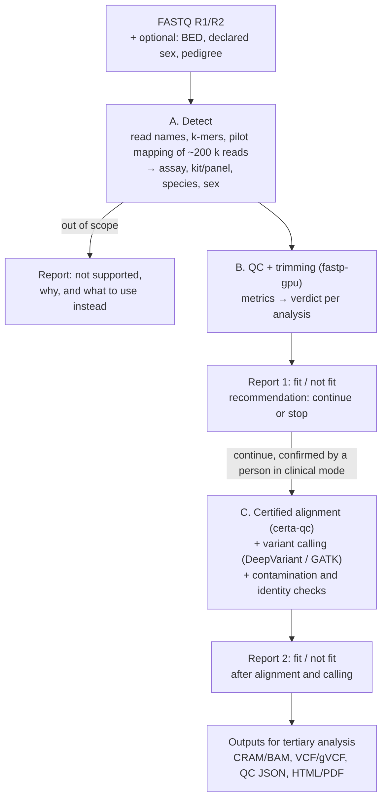

# From FASTQ to fit-for-purpose data: automated, self-assessing primary analysis (plan)

**Status:** plan, nothing built yet (2026-11-07). Builds on
[FUSED_QC_MAPPING_DESIGN.md](FUSED_QC_MAPPING_DESIGN.md) (`certa-qc`: fastp-gpu's
QC and CERTA's certified mapping in one pass, the engine of this plan) and
[RESEARCH_ROADMAP.md](RESEARCH_ROADMAP.md) (CERTA, clinical scenarios S1–S7).
Every number in the example reports below is illustrative, not measured.

## Contents

1. [Goal](#1-goal)
2. [Scope](#2-scope)
3. [Pipeline](#3-pipeline)
4. [Stage A: what is this file?](#4-stage-a-what-is-this-file)
5. [Stage B: QC, trimming and the first verdict](#5-stage-b-qc-trimming-and-the-first-verdict)
6. [Stage C: alignment, calling and the second verdict](#6-stage-c-alignment-calling-and-the-second-verdict)
7. [The fitness-for-purpose model](#7-the-fitness-for-purpose-model)
8. [Contamination and sample identity](#8-contamination-and-sample-identity)
9. [Reports and explanations](#9-reports-and-explanations)
10. [What exists already](#10-what-exists-already)
11. [The PhD: contributions](#11-the-phd-contributions)
12. [Validation plan](#12-validation-plan)
13. [Regulation and data protection](#13-regulation-and-data-protection)
14. [Milestones](#14-milestones)
15. [Risks](#15-risks)
16. [Sources](#16-sources)

## 1. Goal

A lab hands over FASTQ files and gets back the following, without anyone
designing a pipeline:

1. **What the data is.** The assay, the capture kit or panel, the species,
   the sex and the platform.
2. **A first report**, readable by someone with little bioinformatics
   experience. It lists the analyses the data **is fit for** and those it
   **is not fit for**, each with the reason.
3. **A recommendation** to continue or to stop, which a person confirms.
4. **If it continues:** trimming, certified alignment and variant calling,
   done once and fast, with settings chosen from what was detected.
5. **A second report** on the alignment and the calls, again fit / not fit
   per analysis.
6. **The files for tertiary analysis** (annotation and interpretation):
   CRAM/BAM, VCF/gVCF and machine-readable QC.

Today a person makes each of these choices: which Galaxy workflow or nf-core
pipeline to run, which BED file to use, which thresholds apply, and whether
the sample is good enough. This plan replaces those choices with detection and
measured rules, and explains every decision.

## 2. Scope

**In scope (first version):** human germline short-read DNA.

- whole genome (WGS, roadmap scenario S1) and low-coverage WGS;
- exome and large panels (S2);
- small targeted panels (S3), both hybrid capture and amplicon.

**Detected and reported as not supported.** The tool must never silently
treat these as DNA:

- RNA-seq, bisulfite/methylation, single-cell, ChIP-seq and ATAC-seq;
- non-human samples and metagenomes;
- long reads (CERTA's long-read path, S5, can come later);
- tumour/normal pairs (somatic, S4), which need other thresholds and another
  contamination model.

Detecting an out-of-scope input is a result in itself: it stops the wrong
pipeline from running.

## 3. Pipeline



**The gate between B and C.** In `certa-qc`, QC and mapping are one pass over
the data. There are two ways to run the gate:

- **Fused (default).** QC and mapping run together, and report 1's verdict
  decides whether the alignments are kept and calling runs. Nobody waits for
  a person before mapping starts.
- **Gated.** QC runs alone first (fastp-gpu), and mapping starts only after
  confirmation. Use this when compute is expensive, or to stop bad files
  early.

Report 1 is the same in both modes, because its metrics do not depend on
mapping. Byte-identical output across modes is already a design property of
`certa-qc` (its §6).

## 4. Stage A: what is this file?

The signals, cheapest first:

| Signal | Source | What it tells |
|---|---|---|
| Read names (Illumina: instrument, run, flow cell, lane) | first records | Platform family. Two-colour chemistry means poly-G tails are expected. The lane is needed for the cross-talk check (§8.1). |
| Read length, pairing, quality binning | first records | Paired or single end; binned qualities |
| k-mer profile (the SeqWho approach) | first ~1 M reads | DNA, RNA or bisulfite; species; broad library type |
| Base composition per position (the MultiQC Librarian approach) | first reads | Bisulfite (C depleted); random-primed RNA |
| Pilot mapping of ~200 k reads with CERTA | seconds | Fractions mapped and certified; coverage pattern |
| Coverage pattern compared with a library of capture-kit BED files | pilot mapping | WGS, exome or panel; which kit (best match score) |
| Identical read starts and ends; primer sequences at read starts | pilot mapping | Amplicon or hybrid capture |
| Spliced reads; coverage confined to exons; rRNA and mitochondrial fraction | pilot mapping, k-mers | RNA-seq |
| chrX/chrY coverage ratio | pilot mapping | Sex, checked against the declared sex |
| Total read count × read length ÷ target size | the whole file, or estimated from file size | Expected depth; WGS or low-coverage WGS |

**Kit library.** BED files of the common exome kits (Agilent SureSelect,
Twist, IDT xGen, Roche KAPA HyperExome) and of common commercial panels.
A custom panel needs its BED file. Without one, the tool infers the targets
from the coverage peaks and says so.

**Output.** The assay class with a confidence. When the confidence is low,
the tool asks one question (for example, "Which panel is this?") instead of
guessing.

## 5. Stage B: QC, trimming and the first verdict

**Metrics fastp-gpu already computes:**

- read count, Q20/Q30, quality per position, GC content, N content;
- adapter content and trimming, poly-G/poly-X trimming;
- duplication estimate, insert size from the overlap of mates;
- overrepresented sequences, read length after trimming, filtered reads.

**Added for the verdict:**

- the expected depth over the detected target;
- the pilot's mapped and certified fractions;
- a k-mer species and contaminant screen (§8.2).

**Settings chosen from detection, not by a person:**

- poly-G trimming for two-colour instruments;
- adapter detection by overlap for paired reads;
- for amplicon panels, primer trimming, which needs the primer list (fastp
  does not trim primers by position).

**The first verdict uses only pre-alignment metrics.** Examples:

- the expected depth is too low for the assay's main analyses;
- too many reads come from short inserts or adapter dimers;
- the base quality is too low;
- the species is wrong.

## 6. Stage C: alignment, calling and the second verdict

**Alignment.** `certa-qc` places the reads with a certificate, and sends the
uncertified ~5 % of reads to a fallback aligner. Trimmed bases become soft
clips. The design is in
[FUSED_QC_MAPPING_DESIGN.md](FUSED_QC_MAPPING_DESIGN.md).

**Variant calling.** Use an existing caller; writing a new one is not part of
this plan. Two candidates:

- DeepVariant, with the WGS or WES model chosen from Stage A;
- GATK HaplotypeCaller.

The caller's accuracy on CERTA's alignments has to be measured, not assumed
(§15).

**Specialised callers**, run only when the data supports them:

- ExpansionHunter for repeat expansions (PCR-free WGS);
- SMNCopyNumberCaller for SMN1/SMN2 (WGS);
- Cyrius for CYP2D6 (WGS);
- an exome CNV caller for exomes.

These come after the first version.

**Metrics for the second verdict:**

- **Mapping:** mapped fraction, certified fraction (overall and per gene),
  marked duplicates, insert-size distribution.
- **Depth:** mean depth, depth distribution over the targets or the genome,
  fraction of bases at ≥ 10×, 20× and 30×.
- **Capture:** coverage uniformity (fold-80 penalty), on-target fraction,
  per-gene and per-exon coverage gaps.
- **Sample:** contamination and sex (§8).
- **Calls:** Ti/Tv ratio, het/hom ratio, number of variants compared with
  what the assay should give.

For WGS, the metrics carry their GA4GH WGS QC Standard names and definitions
where one exists.

## 7. The fitness-for-purpose model

This is the research core of the plan.

### 7.1 Analyses

| Analysis | Driven mostly by |
|---|---|
| SNV / small indel in coding regions | depth and fraction of targets ≥ 20×, uniformity, base quality, contamination |
| SNV / small indel genome-wide, including non-coding | assay (WGS), fraction of bases ≥ 15×, certified fraction |
| Exon-level CNV | uniformity, duplicates, GC bias, a batch of comparable samples |
| Large CNV / aneuploidy | assay, depth (low-coverage WGS is enough), GC bias |
| Structural variants | WGS, insert-size distribution, read length |
| Repeat expansions | PCR-free WGS, read length, depth |
| Mitochondrial variants and heteroplasmy | mtDNA depth, contamination (haplogroup mixture) |
| Mosaic variants (low VAF) | depth, duplicates, contamination |
| Genes in segmental duplications (SMN1/SMN2, PMS2, CYP2D6, …) | WGS, certified fraction in the gene |
| Pharmacogenomic star alleles | assay, depth, certified fraction in the gene |
| Runs of homozygosity / uniparental disomy | density of heterozygous calls (WGS or exome) |
| Relatedness, ancestry | number of informative SNPs |

### 7.2 Verdicts

Each analysis gets one of four states: **fit**, **borderline**, **not fit**
or **not assessable**. "Not assessable" covers cases such as contamination on
a 20-gene panel. Every verdict names the metrics that decided it, the
threshold, and where the threshold comes from.

### 7.3 Where the thresholds come from

**Version 1: rules.** A versioned rules file, in which each rule cites its
source:

- the GA4GH WGS QC Standard for metric definitions;
- professional guidelines (ACMG, AMP/CAP, EuroGentest);
- the lab's own validation.

**Version 2: measured (the research).** Take Genome in a Bottle (GIAB)
samples, which have truth sets, and degrade them in controlled ways. Run the
whole pipeline on each degraded copy and measure recall and precision per
analysis against the truth.

| Degradation | How |
|---|---|
| Depth | Downsample (e.g. 5–60× WGS, 20–300× exome). |
| Duplicates | Duplicate reads at chosen rates. |
| Adapters, poly-G | Append adapter or poly-G sequence to a fraction of reads. |
| Short inserts | Select read pairs by insert size. |
| Base quality | Add errors following real error profiles (`certa/tools/simulate.py` already has NovaSeq X / 6000 quality profiles). |
| Contamination | Mix reads of two GIAB samples (§8.5). |
| Uniformity, GC bias | Subsample reads by GC content. |

**The model.** It maps metrics to the expected recall and precision of each
analysis, with prediction intervals.

- **Model class:** start with an interpretable one, such as a generalised
  additive model or gradient-boosted trees with monotone constraints. Some
  constraints must hold, for example that more depth never lowers recall.
- **Verdict:** "fit" when the lower end of the predicted recall is at least
  the recall required for that analysis. The lab sets the required recall.
- **Out of range:** when a sample's metrics fall outside the range the model
  was fitted on, the verdict is "not assessable", not an extrapolation.
- **Testing:** on real samples that were not used for fitting (public
  genomes and exomes from other labs, §12).

**Novelty.** Error prediction exists per variant (ForestQC) and per region
(StratoMod). A quick search (2026-11) found no per-sample model that
predicts, before or after alignment, which analyses will reach a required
accuracy. Even if a lab keeps simple rules, these measurements show which
thresholds are justified.

## 8. Contamination and sample identity

Contamination is three separate checks, each with its own method. Two of
them gain something from CERTA's certificates.

### 8.1 DNA from another person (cross-sample contamination)

This is the most important check for germline work.

**Principle.** At common SNPs where the sample is homozygous, a contaminating
person shows up as a small fraction of the other allele. At heterozygous
sites the 50/50 balance drifts.

**Model** (the original VerifyBamID "freemix" model). Let p_i be the
population allele frequency of SNP i, adjusted for ancestry. The sample's
genotype g and the contaminant's genotype h (each 0, 1 or 2 alternate
alleles) both have Hardy–Weinberg priors from p_i. A read shows the alternate
allele with probability

  (1 − α) · g/2 + α · h/2,

corrected for the sequencing error ε. The contamination fraction α is found
by maximum likelihood over all sites.

**Existing tools:**

| Tool | Notes |
|---|---|
| VerifyBamID2 | The standard. Corrects for ancestry. Ships GRCh38 resource files built from 1000 Genomes. DRAGEN has a similar built-in estimate. |
| GATK CalculateContamination | Built for tumour data; works on any BAM. |
| CHARR (gnomAD team) | Works from the VCF. |
| Haplocheck | Finds a mixture of two mitochondrial haplogroups. An independent second signal on WGS and most exomes. |

**What it needs:**

- aligned reads, so this check belongs in report 2;
- about 10 k–100 k common SNPs with allele frequencies;
- enough depth at those SNPs.

**What each assay can detect (rough figures, to be measured in §8.5):**

| Assay | Detection limit |
|---|---|
| WGS at 30× | about 0.5–1 % |
| Exome | about the same; the targets contain tens of thousands of SNPs |
| Small panel | too few SNPs: report "not assessable", never "pass" |
| Low-coverage WGS | weak |

**Naming the source.** Index hopping and cross-talk between samples on the
same lane give the same signal. Because the tool processes whole runs, it
can compare the contaminating alleles with the genotypes of the other samples
in the run, and name the likely source ("S07, same lane"). Single-sample
tools cannot do this.

### 8.2 Non-human material

**Typical sources:**

- bacteria and mycoplasma (common in cell lines);
- EBV (cell-line samples, including GIAB's; GRCh38's analysis set has a
  `chrEBV` contig);
- PhiX spike-in, cloning vectors (UniVec) and adapter dimers;
- mouse reads in xenograft samples.

**First signals** come from Stage B: the unmapped fraction of the pilot, a
second peak in the GC-content distribution, and overrepresented sequences.

**Identification** classifies only the reads that do not map, which keeps it
cheap. Two options:

- Kraken2/Bracken. The full standard database needs tens of GB of RAM;
  size-capped 8 and 16 GB versions exist.
- A small FastQ Screen-style panel of PhiX, E. coli, mycoplasma, EBV, mouse,
  UniVec and human rRNA.

**CERTA's advantage.** CERTA can prove that a read's best alignment to the
human reference is beyond the error limit. On HG002 NovaSeq reads it
certifies this for 0.89 % of single-end reads at 4 % errors
([certa/README.md](certa/README.md)). The non-human read set is therefore
proven, not just "the aligner did not find a hit". Other aligners' unmapped
sets mix real foreign reads with human reads they missed, which inflates the
foreign fraction.

**Xenografts** (human and mouse) need mapping against a combined reference.
They are out of scope unless needed.

### 8.3 Sample identity

Strictly this is a sample swap, not contamination, but reports group the two,
and these checks are cheap:

- **Sex:** chrX/chrY coverage compared with the declared sex.
- **Fingerprint:** a match against an earlier sample or a genotyping array of
  the same person, with Picard CrosscheckFingerprints or NGSCheckMate
  (NGSCheckMate also works directly on FASTQ, using k-mers).
- **Relatedness in trios and families:** somalier.

### 8.4 Effect on the fit / not-fit matrix

Contamination affects analyses differently, so it enters the matrix rather
than giving one pass/fail. Large studies commonly exclude samples above a few
percent (2–5 %). Analyses of low-VAF variants tolerate much less, because a
contaminant's alleles look like mosaic variants. The thresholds per analysis
come from §8.5.

```
Cross-sample contamination: 1.4 % (61,200 SNPs); likely source: S07, same lane
  ✓ Germline SNV / indel             heterozygous calls unaffected at this level
  ✗ Mosaic variants below ~5 % VAF   contaminant alleles look like mosaics
  ✗ Mitochondrial heteroplasmy       Haplocheck: two haplogroups
Non-human: 0.6 % of reads (certified non-human): EBV 0.4 %, PhiX 0.2 %
Identity: sex matches (XX); no fingerprint on file
```

### 8.5 Validation

- **Human mixtures.** Mix reads of two GIAB samples at 0.5, 1, 2, 5 and
  10 %. Use one pair of similar ancestry (HG002 + HG001) and one of different
  ancestry (HG002 + HG005). The true fraction is known, so the estimator's
  error, and the fall in each analysis's recall and precision, can both be
  measured. This is one more axis of the degradation grid in §7.3.
- **Non-human.** Add bacterial, EBV and PhiX reads at known fractions.
- **Identity.** Use the GIAB trios (HG002–HG004 and HG005–HG007) and
  deliberate in-silico swaps.

### 8.6 What could be new

- **Certified allele counts.** Count alleles only from reads with a certified
  position. Reads misplaced from paralogous regions create false "other
  allele" counts and inflate contamination estimates. This is a hypothesis,
  to test against VerifyBamID2 on the mixtures.
- **Certified non-human reads** (§8.2).
- **Naming the contaminating sample** within a run (§8.1).
- **An early warning before alignment:** count allele-specific k-mers at SNP
  sites during the fastp pass, as NGSCheckMate does.

### 8.7 Effort

- **Minimum (days).** Wrap VerifyBamID2, Kraken2 on the unmapped reads, and
  somalier. Download the SNP resource files and a Kraken2 database. The
  compute cost is small compared with alignment.
- **Research version (weeks, overlapping §7.3).**
  - The estimator is a likelihood over one parameter, a few hundred lines,
    run inside `certa-qc`'s mapping stage. Counting alleles at SNP sites is a
    by-product of placing the reads.
  - Most of the work is the ancestry-adjusted allele frequencies and the
    mixture validation.

**Order:**

1. Human cross-sample estimate, with VerifyBamID2 as the baseline.
2. The non-human screen on CERTA's certified-unmapped reads.
3. The identity checks.

## 9. Reports and explanations

**Rules decide; text explains.** Verdicts come from the rules or the model,
which are deterministic and versioned. The explanation is written from a
facts file: a JSON file holding every metric, verdict, threshold and source.

- **Version 1:** text templates.
- **Optional:** a local LLM rewrites the text for readability, under three
  conditions:
  - it receives only the facts file;
  - it cannot change a verdict;
  - a check rejects any text that contains a number not in the facts file.

An LLM must not make the continue/stop decision: its output cannot be
validated, is not reproducible, and can be wrong.

**Three levels of detail:**

- a one-screen summary for a non-expert;
- every metric and plot for a bioinformatician;
- machine-readable JSON, with GA4GH metric names where defined, plus MultiQC
  custom content so that existing MultiQC setups pick it up.

**Report 1 (after QC; illustrative):**

```
Sample S12 — detected: exome, Twist Exome 2.0 (coverage match 0.96),
             human, female (declared: female)
Platform: NovaSeq X (two-colour: poly-G trimming on)
48.1 M pairs · Q30 93 % · adapters trimmed in 4.2 % · duplicates (estimate) 7 %
insert median 210 bp · expected mean depth on target ~115×

Expected fit (confirmed after alignment):
  ✓ SNV / small indel in coding exons
  ✓ ACMG secondary-findings genes
  ~ Exon-level CNV                       depends on uniformity, measured after alignment
Not fit:
  ✗ Structural variants / breakpoints    exome data
  ✗ Deep intronic variants               exome data
  ✗ Repeat expansions                    exome data, PCR library
Recommendation: continue
```

**Report 2 (after alignment and calling; illustrative):**

```
Mapped 99.6 % · certified placement 95.1 % · duplicates 7.3 %
mean target depth 112× · ≥ 20×: 97.1 % · fold-80 1.9
Contamination 0.3 % (61,200 SNPs) · sex XX (matches) · Ti/Tv 2.9

  ✓ SNV / small indel in coding exons    expected recall 99.2 % (± 0.3)
  ✓ ACMG secondary-findings genes        gaps < 20× listed: 2 exons
  ~ Exon-level CNV                       uniformity borderline (fold-80 1.9)
  ✗ SMN1 copy number                     41 % of reads in SMN1/SMN2 certified
  ✗ PMS2 exons 12–15                     38 % certified (PMS2CL homology)
  ✗ Mitochondrial heteroplasmy < 10 %    mtDNA depth 85×
Outputs: S12.cram, S12.g.vcf.gz, S12.qc.json, S12.report.html
```

**Galaxy.** Ship the tool as one Galaxy tool as well as a command-line
program, so that it replaces hand-built Galaxy workflows instead of competing
with Galaxy.

## 10. What exists already

This is a quick survey (2026-11), not an exhaustive one.

| Kind | Examples | What is missing compared with this plan |
|---|---|---|
| FASTQ to report, one click | SOPHiA DDM (a separate pipeline per kit), Illumina BaseSpace + DRAGEN | The user chooses the assay and kit. BaseSpace "Auto Analysis QC" marks pass/fail only against thresholds the user sets, for a workflow the user chose. Closed and tied to specific kits. |
| Fast alignment | DRAGEN, Parabricks, Sentieon | Speed only; no judgement of fitness. |
| Open pipelines | nf-core (sarek, raredisease), Galaxy curated (IWC) workflows | A person chooses the pipeline and its parameters, which is exactly the step this plan removes. |
| QC report with AI | MultiQC, with LLM summaries since v1.27 (January 2025) | Explains but does not decide; not checked against outcomes; sends data to the LLM provider. |
| Assay identification | SeqWho (k-mer random forest, 9 library types including WGS, WES and RNA-seq, about 98 % in its preprint), MultiQC Librarian | Broad classes only: no panel or capture kit, no "fit for X". |
| LLM agents that build pipelines | Galaxy's agent work (8 LLMs re-ran a published RNA-seq study; 6 reproduced the main result), BaseCamp (arXiv, Sept 2026), BioMaster, Biomni | The agent improvises a new pipeline each time, so results cannot be reproduced or validated for diagnostics. |
| QC standards | GA4GH WGS QC Standards, ACMG, AMP/CAP and EuroGentest guidelines | Definitions and some thresholds; no tool turns them into "this sample can be used for X". |

**The gap.** No tool found combines all of these:

1. detecting the assay from the data;
2. a fit / not-fit verdict per analysis, validated against truth sets;
3. an explanation a non-expert can follow;
4. certified, fast alignment, followed by a second fitness report after
   alignment.

## 11. The PhD: contributions

| | Contribution | State |
|---|---|---|
| C1 | **Speed:** fastp-gpu, CERTA, and the fused `certa-qc` pass | done / in progress |
| C2 | **Precision:** certified alignment, and the certificate as a QC signal (certified fraction per gene, certified non-human reads, certified allele counts) | done / new use |
| C3 | **Fitness for purpose:** the degradation experiments, the model, the reports; contamination as one axis | new: the research core |
| C4 | **Automation:** assay detection, settings chosen from the data, detection of out-of-scope inputs | new |
| C5 (optional) | **User study:** do non-experts make the right continue/stop decision with the report? For example, lab staff or students shown real and degraded samples, with and without the report. | new |

C2 connects the two halves. No other aligner can report, per gene, where
placement is proven and where it is not, so only CERTA can answer "is SMN1
copy number assessable in this sample?" from the alignment itself.

The roadmap's thesis aims ([RESEARCH_ROADMAP.md](RESEARCH_ROADMAP.md) §3.8)
cover C1 and C2. C3 and C4 would be a fifth aim, "fitness for purpose".

A possible thesis title: *Fast, certified and self-assessing primary analysis
of short-read sequencing data.*

## 12. Validation plan

| What | Data | Measure |
|---|---|---|
| Fitness model (§7) | GIAB HG001–HG007 WGS and exomes; the v4.2.1 small-variant benchmarks; the challenging medically relevant genes (CMRG) benchmark for C2 | recall and precision per analysis over the degradation grid; model error on held-out real samples |
| Assay detection (§4) | public SRA/ENA runs labelled with library strategy (WGS, WXS, AMPLICON, RNA-Seq, Bisulfite-Seq) and, where given, the kit | accuracy per class and per kit (the labels are noisy; report the disagreements) |
| Contamination (§8) | in-silico GIAB mixtures; spiked non-human reads | estimator error against the known fractions; comparison with VerifyBamID2 |
| Identity (§8.3) | GIAB trios; in-silico swaps | swaps and wrong relationships found |
| Speed and memory | as in [FUSED_QC_MAPPING_DESIGN.md](FUSED_QC_MAPPING_DESIGN.md) §6 | wall and CPU time, peak memory, against the hand-built pipeline |
| Real-world check | public genomes and exomes from other labs; the lab's own panels | verdicts compared with expert review |

Panels are the weak point: little public panel data comes with truth sets.
Restricting WGS or exome reads to panel targets does not reproduce capture
artefacts, so the panel claims need the lab's own data.

## 13. Regulation and data protection

- **EU IVDR.** Software intended to inform a diagnosis is likely an in-vitro
  diagnostic medical device, and a tool that decides whether a patient sample
  is usable is close to that. For the PhD:
  - **Research use only.**
  - **Clinical mode only recommends.** A person confirms, and every verdict
    is logged with the version of the rules or model that produced it.
- **GDPR.** Genetic data is a special category of personal data (Art. 9).
  - **Nothing leaves the lab by default.** No external LLM; a local model is
    optional.
  - **Reports can be anonymised.**
- **Reproducibility.** The same input with the same rules version gives the
  same verdicts and the same output files. Byte-identical output is already
  a design property of `certa-qc`.

## 14. Milestones

| | Deliverable | Needs | Done when |
|---|---|---|---|
| P0 | Rules-only reports from existing tools' output (fastp-gpu JSON; alignment metrics from samtools, mosdepth or Picard; VerifyBamID2; somalier) | nothing | GIAB WGS and exome reports give the verdicts the guideline rules imply |
| P1 | Assay detection (§4) | CERTA pilot mapping | accuracy measured on labelled public runs; the common exome kits identified |
| P2 | Degradation experiments (§7.3) | P0 | recall and precision per analysis over the degradation grid on GIAB |
| P3 | Fitness model replaces the rules | P2 | predicted recall within its interval on held-out real samples |
| P4 | Contamination: own estimator with certified allele counts; non-human screen on certified-unmapped reads; source within the run | P0, `certa-qc` M1 | error against the known mixture fractions no worse than VerifyBamID2's |
| P5 | Integration: `certa-qc` + calling + outputs + Galaxy tool | `certa-qc` M1–M2 | one command, or one Galaxy tool, from FASTQ to CRAM, VCF and reports |
| P6 | Explanations (templates, optional local LLM); optional user study (C5) | P3 | number check passes on every report; study run |

Start P0 and P2 early. They do not need `certa-qc`, and P2 is the novel part.

## 15. Risks

- **Engineering can take over the PhD.** Splitting fastp into a library
  (`certa-qc` M0) alone is a large job.
  - *Mitigation:* do P0 and P2 on existing tools first.
- **Too little panel data with truth sets** (§12).
- **The caller's accuracy on CERTA's alignments.** DeepVariant and GATK are
  tuned on other aligners' output. Measure it; report it if it is worse.
- **The model may not generalise.** It is fitted on GIAB cell-line DNA,
  while clinical samples (blood, saliva, FFPE) and other labs' kits and
  instruments differ.
  - *Mitigation:* "not assessable" outside the fitted range, and the
    real-world check in §12.
- **Custom panels without a BED file:** the inferred targets are less
  reliable.
- **Scope creep** into somatic, RNA and long reads. Keep these out of the
  first version (§2).
- **Regulatory claims.** Say "research use only" until the tool is validated
  as a device.

## 16. Sources

Survey and standards (searched 2026-11):

- SeqWho: [preprint](https://www.biorxiv.org/content/10.1101/2021.03.10.434827.full.pdf), [PyPI](https://pypi.org/project/seqwho/1.0.3/)
- MultiQC: [AI summaries (Seqera blog)](https://seqera.io/blog/ai-summaries-multiqc/), [v1.27 changelog](https://docs.seqera.io/changelog/multiqc/v1.27), [Librarian module](https://docs.seqera.io/multiqc/modules/librarian)
- Agents: [Galaxy: eight LLMs, one RNA-seq dataset](https://galaxyproject.org/news/2026-06-09-llm-agents-reanalyze-rnaseq/), [BaseCamp (arXiv)](https://arxiv.org/pdf/2609.28557), [Agentic genomics (Cell Genomics)](https://www.cell.com/cell-genomics/fulltext/S2666-979X(26)00167-9), [BioMaster](https://www.biorxiv.org/content/10.1101/2025.01.23.634608.full.pdf)
- GA4GH: [WGS QC Standards approved](https://www.ga4gh.org/news_item/whole-genome-sequencing-wgs-quality-control-qc-standards-approved-as-an-official-ga4gh-product/), [metric definitions](https://ga4gh.github.io/quality-control-wgs)
- Commercial: [SOPHiA DDM, Twist exome](https://www.sophiagenetics.com/clinical/inherited-disorders/twist-exome-solutions/), [BaseSpace Auto Analysis QC](https://help.connected.illumina.com/basespace-sequence-hub/analyze/automatic-analysis-qc)

Tools named in the plan:

- Contamination and identity: [VerifyBamID2](https://github.com/Griffan/VerifyBamID), [Haplocheck](https://github.com/genepi/haplocheck), [somalier](https://github.com/brentp/somalier), [NGSCheckMate](https://github.com/parklab/NGSCheckMate)
- Non-human screen: [Kraken2](https://github.com/DerrickWood/kraken2), [FastQ Screen](https://github.com/StevenWingett/FastQ-Screen)
- Callers: [DeepVariant](https://github.com/google/deepvariant), [ExpansionHunter](https://github.com/Illumina/ExpansionHunter), [SMNCopyNumberCaller](https://github.com/Illumina/SMNCopyNumberCaller), [Cyrius](https://github.com/Illumina/Cyrius)
