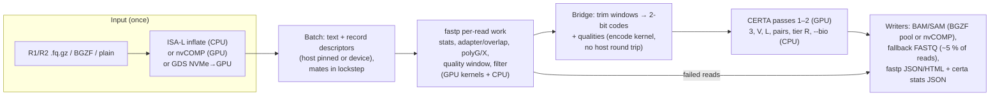

# One pass from FASTQ to certified alignments: fastp-gpu × CERTA (design)

**Status:** design, nothing built yet (2026-10-29). Repositories:
[d0bromir/fastp-gpu](https://github.com/d0bromir/fastp-gpu) (v1.3.3-d0bromir,
QC/trimming, CUDA, nvCOMP, GPU-Direct Storage) and this repository's
[`certa/`](certa/README.md) (certified mapping, CUDA). Working name of the new
program: **`certa-qc`**.

## 1. Goal

One process that reads the FASTQ files once, runs fastp's QC, trimming and
filtering and CERTA's certified mapping on the same reads, and writes the
alignments, the fallback reads and both reports:

- **no intermediate FASTQ**: nothing is compressed, written, read back or
  inflated between the two programs;
- **one upload per batch**: a batch's text goes to the GPU once (or is
  produced there, from compressed input), QC and mapping read the same
  device buffer;
- **one CUDA context and one index upload**: the reference index (GRCh38:
  9–21 GiB) is uploaded once, overlapped with reading the first batch, as
  `certa map --gpu` already does;
- **the same output as the two programs run one after the other**, byte for
  byte, on any thread count, batch size and back-end (CPU or GPU). Both
  projects already test themselves this way; the fused program is tested
  against the pair of them.

## 2. What the hand-off costs today

The two-step pipeline today:

```
R1/R2.fq.gz ──inflate──▶ fastp-gpu ──deflate──▶ trimmed.fq.gz ──inflate──▶ certa map ──▶ certified.sam
                         (QC, trim,                             (parse, encode,          + uncertified.fq
                          filter)                                upload, map)              ──▶ fallback aligner
```

The input is inflated twice and the trimmed reads deflated once, and both
programs parse the text and upload it to the GPU separately. Measured in the
two repositories:

- **fastp-gpu is bound by inflation and output compression**
  ([docs/PERFORMANCE_SUMMARY.md](https://github.com/d0bromir/fastp-gpu/blob/main/docs/PERFORMANCE_SUMMARY.md)):
  inflating one 41.3 GB mate takes 204.5 s on one thread, and the CPU build
  reaches 241 s from 16 threads on, close to that bound; parallel output
  compression is where most of its 1.5–2.9× speedup over upstream comes from
  (2.4× at 8 threads, 4.4× at 32). The GPU QC kernels themselves are not the
  bottleneck (the GPU build is faster in 2 of 12 cells).
- **certa map** inflates a gzip input on one thread per file, and before the
  parallel reader its end-to-end time was dominated by parsing and encoding
  ([certa/README.md](certa/README.md), "Parsing now dominates").

So in the fused program the trimmed reads are never deflated or inflated,
the original input is inflated once, and the text is parsed once. With
uncompressed or BGZF input (parallel or GPU inflation) the remaining bound is
the mapping itself.

## 3. Architecture



### 3.1 Batches

One batch type flows through every stage: the decompressed FASTQ text, a
record descriptor per read (`GpuReadDescriptor` in fastp-gpu: sequence offset,
length, quality offset), and per-read results filled in by each stage. In
paired mode both files are read in lockstep, so mate *i* of both files is in
the same batch (fastp's `PairEndProcessor` and `certa map` already require
this). Batches are numbered; writers emit them in order (fastp-gpu's
min-heap ordered writer, `certa`'s in-order `AsyncWriter`).

### 3.2 Stage 1: input

fastp-gpu's three readers are kept as they are: ISA-L inflation on the CPU,
nvCOMP BGZF/gzip inflation on the GPU (`cuda_gzip.cu`), and the GDS path
(`gds_pipeline.cu`: NVMe → GPU memory → BGZF parse → nvCOMP → FASTQ parse →
`GpuReadDescriptor[]`, all on the device). With the last two the batch text
is produced on the GPU and never crosses PCIe in the host-to-device
direction.

### 3.3 Stage 2: QC (fastp)

fastp's per-pack work (`SingleEndProcessor::processSingleEnd`,
`PairEndProcessor::processPairEnd`: UMI, front/tail trimming, adapter
trimming by sequence or PE overlap, polyG/polyX, quality-window trimming,
filtering, deduplication, pre- and post-filter statistics) runs unchanged,
with one difference: instead of formatting the surviving reads as FASTQ text
for its writer, it emits, per read, a **keep flag and a trim window**
[start, end) into the batch. The read text is not copied. The GPU kernels
(`filter_and_stats_warp_kernel`, `cuda_trim.cu`) already compute
`trim_start`, `trim_end` and `polyG_trim_pos` per read (`ReadStatistics`).

The **evaluator** (adapter auto-detection, read length, duplication model)
reads the start of the input before processing in fastp. Here it runs on the
first records, buffered, which are then processed normally. For
reproducibility it uses a fixed number of first records, never "the first
batch" (whose size is a parameter).

### 3.4 Stage 3: the bridge

A kernel (or, without a GPU, the existing `encode_batch` loop) writes the
2-bit codes of each kept read's window straight into the mapper's code
buffer, with its offset, length and name hash, so `GpuMapper` maps a
device-resident batch. The one new entry point in CERTA:

```cpp
// certa/src/mapper.h
struct DeviceReadBatch { const uint8_t* text; const GpuReadDescriptor* desc;
                         const int32_t* trim_start; const int32_t* trim_end;
                         const uint8_t* keep; size_t n; };
void GpuMapper::map_device(const Params& p, const DeviceReadBatch& b, std::vector<Result>& out);
```

Only the uncertified reads' codes and qualities come back to the host for the
CPU passes (about 5 % of reads by default, and the qualities of every read
with `--bio`), with the 200-byte `Result` per read.

**Trimmed bases in the output.** By default the SAM/BAM record keeps the
original read, and the trimmed bases are soft clips (CIGAR `S`) around the
alignment of the window: downstream tools see the whole read, and the
certificate is about the window, as CERTA's tags already say for the aligned
span. `--hard-trim` writes the trimmed read instead, as `fastp | certa`
would.

### 3.5 Stage 4: mapping

`certa map`'s pipeline (`MapPipeline`) is unchanged apart from where its
batches come from: an interface `BatchSource` replaces `FastqInput`. Passes 1
and 2 run on the GPU (or CPU), passes 3, V, L, the pair certificate, tier R
and `--bio` on the CPU, fused per chunk of reads as now.

Two things the fused program can do that two programs cannot:

- **The fragment-length model of `--bio` pairs from the data.** fastp's
  overlap analysis measures the insert size of every overlapping pair before
  any mapping. The first N pairs' histogram (N fixed, for reproducibility)
  replaces the `--bio-insert MEAN,SD` Gaussian with the empirical
  distribution.
- **Adapters and poly-G trimmed before certification.** `--bio` aligns end to
  end, so a read with an adapter or a poly-G tail costs too much and goes to
  the fallback. fastp trims both first; on NovaSeq X data poly-G tails (≥ 10)
  are on 0.06–0.31 % of reads and adapters on short-insert libraries much more
  ([certa/bench/results/hg002_2026-10/recent_illumina_costs.txt](certa/bench/results/hg002_2026-10/recent_illumina_costs.txt)).

### 3.6 Stage 5: output

- **Alignments**: SAM as now, or BAM, compressed by fastp-gpu's BGZF
  compressor pool (libdeflate) or on the GPU (nvCOMP deflate,
  `cuda_gzip_compress.cu`).
- **Fallback reads**: the uncertified reads as FASTQ.gz (the only compressed
  FASTQ left), or streamed uncompressed into a fallback aligner's stdin
  (`--fallback-cmd "bwa-mem2 mem ..."`), merged into the same BAM.
- **Failed reads**: fastp's `--failed_out`.
- **Reports**: fastp's JSON/HTML report and `certa`'s `--stats` JSON, plus a
  combined JSON with both.

### 3.7 Threads, streams and memory

- One CUDA context, created on the main thread before any worker starts
  (fastp-gpu initialises CUDA lazily because of a glibc/CUDA heap race seen
  during adapter detection; creating the context first, before any thread,
  avoids the race as well).
- Host threads: one reader per input file, a pool of workers that take whole
  batches in chunks (fastp's per-pack work, then CERTA's CPU passes on the same
  chunk, which `fused_chunk` already does for CERTA), and one writer per
  output with a compressor pool.
- GPU streams: input (inflate/parse), QC, mapping; consecutive batches
  overlap (batch n maps while batch n + 1 is QC'd).
- Device memory on an A100 80 GB: index and reference (GRCh38 `-s 8`:
  about 9 GiB; `-s 1`: 21.3 GiB), fastp's slots (1,360 MiB peak today), and
  two or three batches of 1 M reads (text about 0.4 GB each, codes 0.15 GB,
  results 0.2 GB).

## 4. Semantics to settle

1. **Trimming in the output** (soft clips by default; `--hard-trim`).
2. **Filtered reads** (low quality, too short, too many N): not mapped; to
   `--failed_out` and counted in both reports.
3. **Deduplication** (`--dedup`): duplicates are dropped before mapping, which
   saves mapping time (on 20 M HG002 NovaSeq X reads, 1.9 % of single reads
   and 0.24 % of pairs are exact duplicates).
4. **Merged pairs** (`-m`): mapped as single reads of up to 320 bases (CERTA's
   `LMAX`), with the certificate of a single read.
5. **Thread-dependent fastp statistics**: fastp-gpu's documented differences
   from upstream with more than one thread (insert-size histogram sampling,
   per-sequence adapter counts) stay as they are; nothing CERTA uses depends on
   them, except the `--bio` fragment-length model, which is built from a fixed
   prefix of the input instead.

## 5. Code organisation

A new repository, `certa-qc`, with both projects as submodules (both MIT,
fastp's upstream MIT too) and a CMake build:

- **fastp-gpu → `libfastp_core`**: the per-pack processing, the options, the
  evaluator, the statistics and reports and the GPU kernels as a library; the
  reader and writer threads stay in fastp's `main`. The per-pack functions
  write the trim window and keep flag into the batch through a callback
  instead of formatting FASTQ. fastp-gpu's equivalence suite (654 cases) must
  still pass, so fastp itself is unchanged.
- **CERTA**: `BatchSource` instead of `FastqInput` in `MapPipeline`,
  `GpuMapper::map_device`, soft clips for trimmed bases in `sam_output.cpp`.
- **`certa-qc`**: the driver (options of both programs, one `--threads`), the
  batch type and the bridge kernel.

```
certa-qc ref.cidx R1.fq.gz R2.fq.gz --gpu --device 1 -t 64 \
    [fastp: --detect_adapter_for_pe --trim_poly_g -q 15 -l 50 --dedup ...] \
    [certa: --intervals | --full-cert | --bio ...] \
    -o out.bam -u fallback_R1.fq.gz -U fallback_R2.fq.gz \
    --qc-json qc.json --qc-html qc.html --stats map.json
```

## 6. Validation

- **Equivalence.** For every option set of fastp-gpu's synthetic equivalence
  suite and certa's own test matrix: `certa-qc` output equals
  `fastp-gpu -o trimmed.fq` (uncompressed) followed by `certa map trimmed.fq`
  with `--hard-trim` (SAM byte for byte, fallback FASTQ, every report field
  fastp-gpu's suite compares), on 1, 8 and 64 threads, several batch sizes, CPU
  and GPU. Without `--hard-trim` the same alignments with the clips added.
- **Speed and memory.** Wall and CPU time and peak host/device memory against
  the two-step pipeline (fastp-gpu writing `.fq.gz`, then `certa map`) on
  fastp-gpu's eight benchmark datasets and 20 M HG002 NovaSeq X pairs, on
  galaxy (A100, ARM) and a2 (x86-64, CPU only), one session per host.
- **Placement accuracy.** Unchanged by construction (same reads, same mapper);
  checked through the equivalence test.

## 7. Milestones

| | Deliverable | Done when |
|---|---|---|
| M0 | `libfastp_core` split out of fastp-gpu | fastp-gpu's equivalence suite and benchmark validation pass unchanged |
| M1 | CPU `certa-qc`: ISA-L input, fastp per-pack work and CERTA's CPU passes in the same worker chunks, SAM output | equivalent to the two-step pipeline; no intermediate file |
| M2 | GPU: one context, device batches, the bridge kernel, `GpuMapper::map_device` | equivalent; each batch's text uploaded once |
| M3 | nvCOMP / GDS input straight into device batches; BAM output (BGZF pool or nvCOMP) | equivalent; host never holds the text with GDS |
| M4 | combined report; data-driven fragment-length model for `--bio`; fallback aligner on a pipe | `--bio` pairs use the overlap histogram; one BAM with fallback reads |

## 8. Risks

- **fastp's structure.** Its processors own their reader and writer threads and
  read global options; the library split (M0) is the largest piece of work, and
  must not change fastp's own output.
- **CPU contention.** fastp's per-pack work and CERTA's CPU passes share the
  cores, and `--full-cert` and `--bio` move most of CERTA's work to the CPU.
  The worker pool takes both per chunk, so neither starves, but the stage
  balance has to be measured (M1).
- **GPU memory.** With a `-s 1` index (21.3 GiB) and three batches in flight,
  an A100 40 GB is tight; batch size has to adapt to the free memory.
