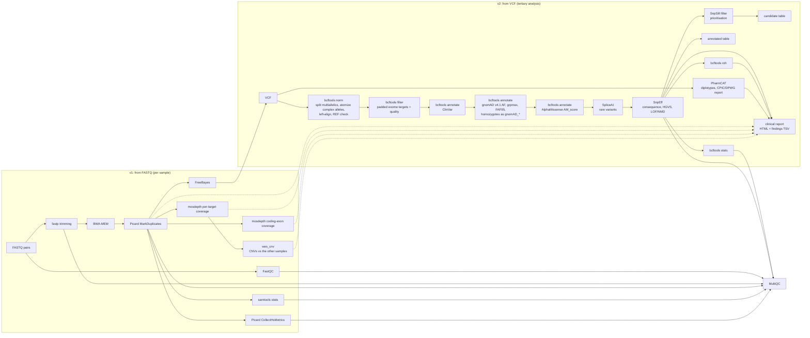

# Whole exome sequencing (WES): tertiary analysis workflows for Galaxy

Two Galaxy workflows for germline whole exome sequencing. Import the `.ga` files.

| File | Version | Starts from | What it does |
|---|---|---|---|
| [`wes-tertiary-from-fastq.ga`](wes-tertiary-from-fastq.ga) | **v1** | paired-end FASTQ (`list:paired` collection, one element per sample) | Read QC and trimming, alignment, duplicate marking, capture/coverage QC, variant calling, then the full v2 tertiary analysis, plus one MultiQC report for all samples |
| [`wes-tertiary-from-vcf.ga`](wes-tertiary-from-vcf.ga) | **v2** | a germline VCF/BCF from any caller (FreeBayes, GATK, DeepVariant, DRAGEN, …) | Normalisation, restriction to the exome targets, quality filtering, ClinVar, gnomAD and SnpEff annotation, prioritisation, tables, runs of homozygosity and a **clinical interpretation report** |

Both end in a human-readable HTML report of the medically significant findings (section 4a): diagnostic
findings, candidate variants, copy-number variants and chromosome dosage, ACMG secondary findings, carrier status, pharmacogenomics, risk alleles,
runs of homozygosity, coverage of clinically relevant genes, and what the analysis cannot detect.

v1 embeds v2 as a subworkflow, so both workflows apply exactly the same tertiary logic.



## 1. Install the tools and import the workflows

**Quick install.** [`install.sh`](install.sh) runs every step of this section and section 2 on the Galaxy server.
It installs the command-line programs, the Tool Shed and local tools with their dependencies, and the workflows.
It also downloads and builds the reference and knowledge files and uploads them into a history.
[`COMPONENTS.md`](COMPONENTS.md) lists everything it installs (programs, Galaxy tools, data files) with versions,
licences and the release that added it:
```bash
./install.sh check
```
```bash
./install.sh all --regions kit.bed
```
| Stage | What it does |
|---|---|
| `check` | Reports what is installed and what is missing; changes nothing |
| `system` | Installs bcftools, bedtools, samtools, tabix, curl, gawk and python3-venv with apt (`--conda`: into a conda environment instead) |
| `venv` | Creates a Python environment with Ephemeris and BioBlend (`$VENV`, default `~/wes-venv`) |
| `tools` | Installs the [`tools.yml`](tools.yml) repositories with Ephemeris; already-installed repositories are skipped |
| `local-tools` | Copies the nine local tools to the local tool directory and checks `local_tool_conf.xml`, `galaxy.yml` and the HTML allowlist. Then Galaxy installs the tools' Conda dependencies |
| `workflows` | Imports both `.ga` files; with `--update`, adds a new version to workflows already present |
| `data` | Downloads and builds the section 2 files into `--data-dir`, with a `MANIFEST.tsv` (source, date, size) |
| `upload` | Uploads the `MANIFEST.tsv` files into a new history and runs *SnpEff download* there |

- **API key:** read from `$GALAXY_API_KEY` or `~/.galaxy_admin_key`, and passed to the Python helper ([`install/galaxy_setup.py`](install/galaxy_setup.py)) in its environment, not on a command line.
- **Galaxy configuration:** changed only with `--configure`, which writes a missing `local_tool_conf.xml` and adds the report tools to the allowlist. Otherwise the script prints what to add, since Galaxy servers managed by Ansible should change it in their templates.
- **gnomAD extract:** built only with `--regions` (the capture kit BEDs), because it reads about 2 hours from the gnomAD bucket. The capture kit BED itself is the laboratory's own and is not downloaded.
- **Re-running:** every stage can be run again; what is already in place is left alone. On the test server (November 2026 releases), the `data` stage without gnomAD took 16 min, most of it the Ensembl FASTA at 1.5 MB/s. It wrote 3.8 GB, with a peak memory of 2.1 GB (the AlphaMissense build).
- **Everything stays on the server:** the files are downloaded once per release; the workflows and tools then run without network access and send no sample data anywhere.

**Keeping the data current.** [`update.sh`](update.sh) builds a new dated release next to the current one and is
meant to run unattended:
```bash
./update.sh --regions kit.bed --upload --keep 4
```
- It hard-links every file of the current release into `release-YYYY-MM-DD` (no extra disk space), deletes the
  files of the sources that change (ClinVar, GenCC, HPO, ClinGen dosage/validity/expert panels, G2P/Orphanet,
  UniProt, IPD-IMGT/HLA, IPD-KIR, PanelApp and the tables built from them) and lets the `data` stage download and rebuild
  only those. Version-pinned files (genome, gnomAD, MANE, AlphaMissense, REVEL, Collins, MaveDB) stay as they are;
  they change only with a new `install.sh data` release.
- It compares the refreshed files with the current release by content. Nothing changed: the new release is removed.
  Otherwise `CHANGES.tsv` lists each changed file with its old and new date, size and source, `current` points to
  the new release, and with `--upload` a new Galaxy history *WES reference data release-YYYY-MM-DD* is made, where
  unchanged files are copied from the previous release's history (shared storage) and only the changed ones uploaded.
- A lock prevents two runs at once; a failed run removes its partial release and leaves the current one untouched
  (exit status 1). The log is `logs/update-YYYY-MM-DD.log` under the data directory. `--keep N` keeps the N newest
  releases; `--dry-run` lists what would be refreshed.
- **Measured** on the test server (22 November 2026): the first update found GenCC, the ClinGen gene list, the
  gene-disease table, the expert-panel classifications and UniProt changed; it took 20 min (most of it the ClinGen
  specification registry and UniProt) with a peak memory of 214 MB; refreshed files that did not change are linked back to the previous release, so a
  release takes only the space of its changed files (about 35 MB here), and the
  Galaxy history copied 17 datasets and uploaded 9 (10 s). Builders write sorted output, and comment lines (download
  dates, source hashes) are ignored in the comparison, so a run on unchanged sources makes no release: two downloads
  of the expert-panel repository taken seconds apart differ in row and code order but build identical tables, and a
  second update run on the same day reported "nothing changed" and made no release.
- **Schedule** with the systemd units in [`install/systemd/`](install/systemd/) (weekly, Tuesday 02:30, after ClinVar's
  Monday release; `Persistent=true` catches up after downtime):
  ```bash
  sudo cp install/systemd/wes-data-update.* /etc/systemd/system/   # set User= and the paths in the .service first
  ```
  ```bash
  sudo systemctl daemon-reload && sudo systemctl enable --now wes-data-update.timer
  ```
  or with cron (`crontab -e` as the user who owns the data directory):
  ```
  30 2 * * 2  /opt/wes-tertiary/update.sh --regions /data/galaxy/wes-ref/kits.bed --upload --keep 4
  ```
- **After an update** new analyses should use the datasets of the new history. To see what the new knowledge changes
  for a patient analysed before, run the report again with the earlier *findings TSV* as *Previous report* (section
  4a, reanalysis): it lists what is new, changed or no longer reported.

The manual steps follow.

1. **Tools**: as a Galaxy admin, install the repositories listed in [`tools.yml`](tools.yml). You can use
   *Admin → Install and Uninstall*, or [Ephemeris](https://ephemeris.readthedocs.io). Install Ephemeris into a
   virtual environment; Debian/Ubuntu refuse a system-wide `pip install` with "externally-managed-environment":
   ```bash
   python3 -m venv ~/ephemeris-venv && ~/ephemeris-venv/bin/pip install ephemeris
   ```
   ```bash
   ~/ephemeris-venv/bin/shed-tools install -g http://192.168.191.12 -a <ADMIN_API_KEY> -t tools.yml
   ```
   If `python3 -m venv` reports that `ensurepip` is not available, install `python3-venv` (or `python3-full`)
   with `apt` first. The API key belongs to a Galaxy admin user (*User → Preferences → Manage API Key*).
2. **Local tools** (not in the Tool Shed): copy [`tools/wes_clinical_report`](tools/wes_clinical_report),
   [`tools/spliceai_score`](tools/spliceai_score), [`tools/pharmcat_pgx`](tools/pharmcat_pgx) and
   [`tools/wes_cnv`](tools/wes_cnv) to the server,
   list them in a local tool config, and let Galaxy show the report HTML unsanitised:
   ```xml
   <!-- /etc/galaxy/local_tool_conf.xml -->
   <toolbox tool_path="/srv/galaxy/local_tools">
       <section id="wes_analysis_local" name="WES analysis">
           <tool file="wes_clinical_report/wes_clinical_report.xml"/>
           <tool file="spliceai_score/spliceai_score.xml"/>
           <tool file="pharmcat_pgx/pharmcat_pgx.xml"/>
           <tool file="wes_cnv/wes_cnv.xml"/>
       </section>
   </toolbox>
   ```
   Add that file to `tool_config_file` in `galaxy.yml`, set `sanitize_allowlist_file` to a file containing the
   line `wes_clinical_report` (or use *Admin → Manage Allowlist*), restart Galaxy, and install the tools'
   dependencies from *Admin → Manage Dependencies*: Python 3.12 and samtools 1.22 (report), SpliceAI 1.3.1 with
   setuptools 80.9.0 and bcftools 1.24 in one environment (TensorFlow 2.19 CPU, about 2 GB; setuptools < 81 is
   needed because SpliceAI imports `pkg_resources`), PharmCAT 3.4.0 (`pharmcat3`; on its first run it downloads its
   GRCh38 reference, 0.9 GB, into its environment), Python 3.12, numpy 2.2.6 and samtools 1.22 (CNV calls). Without the allowlist entry the report still opens, but
   without its styling; the same applies to the PharmCAT report (`pharmcat_pgx`).
3. **Workflows**: *Workflows → Import*, then upload `wes-tertiary-from-vcf.ga` and `wes-tertiary-from-fastq.ga`
   (or paste the raw GitHub URL of each file).

**Galaxy version.** The workflows pin the current wrapper versions (bcftools 1.24, SnpEff 5.4, SnpSift 5.4.0c,
FreeBayes 1.3.10, BWA 0.7.19, MultiQC 1.35). The SnpSift and MultiQC wrappers declare Galaxy profile 25.0, so the
pinned versions need **Galaxy ≥ 25.0**. On older servers, install older revisions of those repositories. Galaxy
then uses the installed version when it opens the workflow and shows a "tool version changed" notice. The
parameters used here are present in older versions too, but check those steps in the editor.

The `.ga` files are prebuilt; nothing needs to be compiled to use them. The `.gxwf.yml` files in [`src/`](src)
are the human-readable sources (Galaxy Format 2). Rebuild only after editing them, which needs Python ≥ 3.10 and
`gxformat2` (a virtual environment avoids the "externally managed environment" error of system pip):
```bash
python3 -m venv .venv && .venv/bin/pip install "gxformat2>=0.29"
```
```bash
.venv/bin/python build.py
```
Import the `.ga` files, not the sources: the v1 source references v2 with `@import`, which only `build.py`
resolves.

**Complete tool states.** The sources set only the parameters that matter. Galaxy would fill every other
parameter with its default when loading a step, and then mark the workflow with "may contain tools which have
changed". To avoid that notice, `build.py` takes each tool step's complete state from
[`src/galaxy-tool-states.json`](src/galaxy-tool-states.json), which holds the states Galaxy computed for these
exact steps. A recorded state is used only if the tool version is the same and the state agrees with every value
the source sets. Otherwise `build.py` keeps the source state and prints a warning. After changing a source or a
tool version, refresh the file:
1. Run `build.py`.
2. Import both `.ga` files into a Galaxy that has the tools installed.
3. Run `python tests/refresh_tool_states.py --galaxy http://192.168.191.12`. It reads the API key from
   `$GALAXY_API_KEY` or `~/.galaxy_admin_key`.
4. Run `build.py` again.

## 2. Reference data (prepare once, keep in a shared history or data library)

Every reference must use **the same genome build and the same chromosome naming** (`chr1` vs `1`) as the reads
and VCFs. A naming mismatch does not raise an error. ClinVar/gnomAD annotations are simply missing.

| Workflow input | What to use | Notes |
|---|---|---|
| **Reference genome (FASTA)** | GRCh38 without ALT contigs, e.g. the *GRCh38 no-alt analysis set* (UCSC naming `chr1…`) | Upload as datatype `fasta` (uncompressed). For VCF input (v2) it must be the genome the variants were called on. |
| **Exome target regions (BED)** | The capture kit's target (or "covered") BED for the same build, from Twist, IDT, Agilent, etc. | No `track`/`browser` header lines. v1 uses it unpadded for coverage QC. The workflows pad it themselves for variant restriction. |
| **Target padding (bp)** | Default `50` | Keeps canonical and extended splice-site variants just outside the targets. |
| **SnpEff database** | Run the **SnpEff download** tool once, e.g. an Ensembl database such as `GRCh38.115` or a RefSeq/MANE one such as `GRCh38.mane.1.2.refseq` | The **SnpEff databases** tool lists the exact names available for SnpEff 5.4. MANE Select databases give clinically conventional NM_ HGVS. SnpEff itself tolerates `chr1` vs `1`. The default Java heap is 8 GB (`GALAXY_MEMORY_MB`). |
| **ClinVar (VCF)** | `clinvar.vcf.gz` from https://ftp.ncbi.nlm.nih.gov/pub/clinvar/vcf_GRCh38/ | ClinVar uses `1, 2, …, MT`. For a `chr`-named reference, run **bcftools annotate** on it once with *Rename chromosomes* = [`data/ncbi_to_ucsc_chromosomes.tsv`](data/ncbi_to_ucsc_chromosomes.tsv) and output type *compressed BCF*. |
| **Coding regions (BED)** (v1) | Coding exons of one transcript per gene, gene symbol in column 4 (recipe below) | Per-gene coverage in the report: which clinically relevant genes have gaps. |
| **Gene-disease validity (GenCC TSV)** (optional) | [GenCC submissions export](https://search.thegencc.org/download), TSV in the current format (`https://search.thegencc.org/download/action/submissions-export-tsv?format=new`, keyed on `sgc_id`; CC0). The legacy `uuid` format, retired after 30 Sep 2026, is read too | Diseases and mode of inheritance per gene; decides diagnostic vs carrier vs review. |
| **Gene constraint (gnomAD TSV)** (optional) | `gnomad.v4.1.constraint_metrics.tsv` from the gnomAD downloads page | LOEUF/pLI for loss-of-function intolerance (PVS1 applicability). |
| **HPO gene annotations** (optional) | `phenotype_to_genes.txt` from the latest [HPO release](https://github.com/obophenotype/human-phenotype-ontology/releases) | With *Patient phenotype (HPO terms)*, ranks candidates by phenotype match, and gives each term's information content for the disease-level match. |
| **HPO disease annotations (phenotype.hpoa)** (optional) | `phenotype.hpoa` from the same HPO release (35 MB) | Disease names, age of onset, clinical course and inheritance next to each gene; with HPO terms, the disease that best explains the phenotype. |
| **Dosage sensitivity (ClinGen TSV)** (optional) | [`ClinGen_gene_curation_list_GRCh38.tsv`](https://ftp.clinicalgenome.org/ClinGen_gene_curation_list_GRCh38.tsv) (250 kB) | Haploinsufficiency/triplosensitivity scores: decides whether loss of function is a disease mechanism (PVS1, LoF candidates in dominant genes). |
| **ClinVar missense by residue (TSV)** (optional) | Built from ClinVar's `variant_summary.txt.gz` with [`data/build_clinvar_protein.py`](data/build_clinvar_protein.py) (below; 4 MB) | ACMG PS1 (same amino-acid change pathogenic) and PM5 (another pathogenic missense at the residue); rare missense variants with either become candidates. |
| **Mother / Father: variant calls (VCF)** (optional) | Each parent's calls on the same reference, e.g. the *Raw variant calls* (or *Normalised variants*) of the FASTQ workflow run on the parent's reads | Trio analysis (section 4a): de novo variants, parental origin of every finding, compound heterozygotes phased by origin, parentage check. Raw (unfiltered) calls are best: a parental call missing because of a filter would look like a de novo variant. |
| **Mother / Father: aligned reads (BAM)** (optional) | The parents' *Aligned reads (duplicates marked)* | Reads at the proband's variants that a parent's calls lack: a de novo variant is *confirmed* only when both parents have ≥ 15 reads and at most one alt read. |
| **Affected parents** | `unknown` (default), `none`, `mother`, `father` or `both` | A dominant candidate inherited from a parent marked unaffected does not count as fitting the inheritance; one inherited from an affected parent is marked as segregating. |
| **CNV reference panel (per-target depth)** (v1, optional) | A list collection of the *Per-target mean depth (mosdepth)* outputs of earlier samples of the same kit, sequencer and pipeline | Copy-number calls use the other samples of the run plus this panel; at least 3 are needed. Keep a growing collection of unrelated samples: more samples, and samples of the same batch, give better calls (section 7). |
| **Segmental duplications (BED)** (v1, optional) | GIAB `GRCh38_segdups.bed.gz` (genome stratifications v3.6), `chr` removed for Ensembl names (`install.sh data` does this) | CNV calls mostly inside segmental duplications are marked low confidence. Public domain. |
| **ClinGen dosage regions (TSV)** (optional) | [`ClinGen_region_curation_list_GRCh38.tsv`](https://ftp.clinicalgenome.org/ClinGen_region_curation_list_GRCh38.tsv) (100 kB) | Recurrent CNV regions (22q11.2, 7q11.23, 15q11-q13 ...) for CNV point 2A, and 359 population regions scored *dosage sensitivity unlikely* for 2F (benign). |
| **Mother / Father: CNV per-target ratios** (optional) | The parents' *CNV per-target ratios* from v1 | The parents' read depth at each of the proband's CNVs: inherited (present in a parent), de novo (both parents normal) or unclear. |
| **Recurrent artefacts (VCF)** (optional) | The laboratory's own list, built with [`data/build_artefact_list.sh`](data/build_artefact_list.sh) from earlier samples (below) | Alleles called in many of the laboratory's samples but rare or absent in gnomAD: systematic errors of the assay. The report marks matching calls low confidence. |
| **Population allele frequencies (VCF)** | gnomAD v4.1 joint (exome + genome) frequencies reduced to the padded targets, as an indexed **BCF** built with [`data/build_gnomad_extract.sh`](data/build_gnomad_extract.sh) (below) | Transferred fields: `gnomAD_AF`, `_AN`, `_nhomalt` (homozygotes), `_grpmax` / `_grpmax_AF` / `_grpmax_AN` (genetic ancestry group with the highest AF), `_FAF95` / `_FAF95_grp` (highest filtering allele frequency, the statistic of the ACMG BA1/BS1 rules), `_filter` (gnomAD PASS / EXOMES_FILTERED / GENOMES_FILTERED / BOTH_FILTERED) and `_discordance_p` (exome vs genome frequency test). The caller's own `INFO/AF` is untouched. A file without these fields (e.g. an AF-only one) stops the annotation step with "tag not defined". |
| **Missense predictions (AlphaMissense BCF)** | AlphaMissense hg38 predictions as an indexed **BCF** with `INFO/AM_score`, built with [`data/build_alphamissense.sh`](data/build_alphamissense.sh) (below); preferably `insilico_scores.hg38.bcf` (`install.sh data`), which adds REVEL (`INFO/REVEL`) and CADD v1.7 (`INFO/CADD`, coding exons ± 50 bp, [`data/build_cadd.sh`](data/build_cadd.sh), [`data/build_insilico.sh`](data/build_insilico.sh)) | Missense PP3/BP4 at the ClinGen-calibrated strengths (REVEL, then AlphaMissense, then CADD); CADD is shown for every variant. AlphaMissense CC BY 4.0; REVEL and CADD free for non-commercial use. |
| **MANE transcripts (summary)** (optional) | [`MANE.GRCh38.v1.5.summary.txt.gz`](https://ftp.ncbi.nlm.nih.gov/refseq/MANE/MANE_human/release_1.5/) (1.1 MB, public domain) | MANE Select naming and classification, RefSeq names. |
| **Curated gene-disease table** (optional) | Built with [`data/build_gene_disease.py`](data/build_gene_disease.py) from ClinGen validity, G2P and Orphanet (below; 3 MB) | Disease context section, curated inheritance and mechanism. |
| **ClinGen expert-panel rules (VCEP)** / **classifications (ERepo)** (optional) | Built with [`data/build_vcep.py`](data/build_vcep.py) from the ClinGen CSpec registry and Evidence Repository (below; 1 MB and 4 MB) | Gene-specific ACMG rules; expert classifications next to ClinVar. |
| **Predicted dosage sensitivity (Collins TSV)** (optional) | [`Collins_rCNV_2022.dosage_sensitivity_scores.tsv.gz`](https://zenodo.org/records/6347673) (0.4 MB, CC BY 4.0) | pHaplo/pTriplo of the genes in a CNV (≥ 0.86 / ≥ 0.94); 2H for a deletion of a predicted haploinsufficient gene. |
| **Functional assays (MaveDB TSV)** (optional) | Built with [`data/build_mavedb.py`](data/build_mavedb.py) from the [MaveDB bulk download](https://zenodo.org/records/20840937) (CC0; 1.9 GB in, 3.5 MB out) | PS3/BS3 at the calibrated strength for variants a calibrated multiplexed assay measured (73 score sets; clinical calibrations in 10 genes, research-only ones shown but not scored). |
| **Population CNVs (gnomAD exome CNV VCF)** (optional) | [`gnomad.v4.1.cnv.all.vcf.gz`](https://gnomad.broadinstitute.org/downloads) (9 MB, CC0; rare CNVs of 464,297 exomes) | The frequency of a gnomAD CNV of the same type with ≥ 50 % reciprocal overlap next to each CNV call; 4O (−1) when an ancestry group (≥ 1,000 exomes) has it at ≥ 1 %. |
| **Protein features (UniProt TSV)** (optional) | Built with [`data/build_uniprot_features.py`](data/build_uniprot_features.py) from the reviewed human UniProt entries (REST API; 15 MB in, 2.2 MB out, CC BY 4.0) | The domain, region, motif or site at each variant's residue, on the MANE transcripts that encode UniProt's canonical isoform (12,926 of 19,438). Shown for review (PM1 needs a gene-specific definition), not scored. |
| **gnomAD exome coverage (runs)** (optional) | Built with [`data/build_gnomad_sites.py`](data/build_gnomad_sites.py) `coverage` from the gnomAD v4.0 exome coverage summary (4 GB streamed, 75 MB out, CC0; `install.sh data` with `--regions`) | An allele absent from gnomAD gets PM2 only where ≥ 50 % of gnomAD exomes reached 20× (`COVERAGE_MIN_OVER20`); the depth is shown next to absent alleles. |
| **Exon expression, pext (runs)** (optional) | Built with `data/build_gnomad_sites.py pext` from gnomAD's GTEx v10 base-level pext (198 MB streamed, 33 MB out, CC0) | The share of the gene's expression that includes the base (mean over tissues and the highest tissue) next to loss-of-function variants. Not scored (`PEXT_LOW = None`; see section 7). |
| **Mitochondrial frequencies (gnomAD chrM VCF)** (FASTQ workflow, optional) | `gnomad.genomes.v3.1.sites.chrM.vcf.bgz` (5 MB, CC0) with `chrM` renamed to the reference's name (`install.sh data` does it) | mtDNA frequencies, haplogroup-defining flags and tRNA predictions for `wes_mito`. |
| **HLA alleles (IPD-IMGT/HLA hla.dat)** (FASTQ workflow, optional) | [`hla.dat`](https://ftp.ebi.ac.uk/pub/databases/ipd/imgt/hla/) of the current IPD-IMGT/HLA release (350 MB, CC BY-ND 4.0; `install.sh data` downloads it and records the release) | HLA typing of the reads with T1K (`wes_hla`, section 4c). Without it the HLA genes are not typed. |
| **KIR alleles (IPD-KIR kir.dat)** (FASTQ workflow, optional) | [`kir.dat`](https://ftp.ebi.ac.uk/pub/databases/ipd/kir/) of the current IPD-KIR release (37 MB, CC BY-ND 4.0; `install.sh data` downloads it and records the release) | KIR gene content of the reads with T1K (`wes_kir`, section 4e). Without it the KIR genes are not typed. |
| **Gene panels (PanelApp snapshot)** (optional) | `panelapp_panels.tsv`, built by [`data/build_panelapp.py`](data/build_panelapp.py) (`install.sh data`, refreshed by `update.sh`): the 691 panels of Genomics England PanelApp and PanelApp Australia with each gene's rating and mode of inheritance (20 MB; non-commercial use, with acknowledgement) | Panels applied to the report and panels suggested from the HPO terms (section 4f) |
| **Panels to apply** (optional text) | A Genomics England test code (e.g. `R169`), `ge:ID` / `au:ID`, or an exact panel name; comma separated | Which panels the report applies |
| **KIR genes (wes_kir summary)** (VCF workflow, optional) | The *KIR summary* of `wes_kir` on the sample's reads (the FASTQ workflow connects it) | KIR genes, A/B genotype, B content and KIR-HLA ligand pairs in the report. |
| **HLA types (wes_hla summary)**, **HLA outside calls (PharmCAT TSV)** (VCF workflow, optional) | The *HLA summary* and *HLA outside calls (PharmCAT)* of `wes_hla` on the sample's reads (the FASTQ workflow connects them) | HLA alleles and associations in the report; HLA-A/B drug recommendations in PharmCAT. |

The gnomAD file is built once with [`data/build_gnomad_extract.sh`](data/build_gnomad_extract.sh) on any Linux
machine with `bcftools` (≥ 1.17) and `bedtools`. It reads only the indexed blocks of the public gnomAD v4.1 joint
VCFs (877 GB in all) that overlap the regions, over plain HTTP from Google Cloud Storage. `regions.bed` uses Ensembl
names and should cover every capture kit you use plus the coding exons (the coding-region BED below), and the
reference is the workflow's FASTA with its `.fai`:
```bash
cat kit1.bed kit2.bed canonical_cds.GRCh38.115.bed | cut -f1-3 > regions.bed
```
```bash
build_gnomad_extract.sh regions.bed GRCh38.fa gnomad.v4.1.joint.targets.GRCh38.bcf 64
```
For two exome kits plus all coding exons (110 Mb with 100 bp padding) this took 1 h 51 min with 64
parallel readers (about 116 MB/s from the bucket) and produced a BCF of 1.6 GB with 65.0 M allele records (the
padding and the gnomAD genomes add many intronic and rare alleles). gnomAD data are CC0. The joint VCF carries no CADD or
SpliceAI scores, so the extract has no non-commercial terms.
Upload the resulting `.bcf` with datatype `bcf`.

The AlphaMissense file is built once with [`data/build_alphamissense.sh`](data/build_alphamissense.sh), which
streams the public 643 MB table (Zenodo record 10813168, CC BY 4.0) into a BCF with Ensembl chromosome names:
```bash
build_alphamissense.sh GRCh38.fa alphamissense.hg38.bcf
```
It took 3.5 min and 2.1 GB of memory and produced 71.7 M alleles in 466 MB. Upload it with datatype `bcf`.
SpliceAI needs no data file: its models and GENCODE annotation come with the tool. Its code (PolyForm Strict) and
models (CC BY-NC 4.0) are for non-commercial use; Illumina's precomputed scores need a BaseSpace account, so the
workflow scores the rare variants itself.

Recipe for the coding-region BED (Ensembl canonical transcripts; use the Ensembl release of the SnpEff database).
For a `chr`-named reference, prefix column 1 with `chr`:
```bash
curl -sL https://ftp.ensembl.org/pub/release-115/gtf/homo_sapiens/Homo_sapiens.GRCh38.115.gtf.gz | zcat |
  awk -F'\t' '$3=="CDS" && $9 ~ /tag "Ensembl_canonical"/ && $9 ~ /gene_biotype "protein_coding"/ {
    match($9, /gene_name "[^"]+"/); g = substr($9, RSTART+11, RLENGTH-12); print $1"\t"$4-1"\t"$5"\t"g }' |
  sort -k1,1 -k2,2n -u > canonical_cds.GRCh38.115.bed
```

The `bcftools norm -m -any -f` step is required for any population or ClinVar file: split multiallelic records and
left-align/trim indels against the same reference the reads are aligned to. The workflow normalises the calls, and
annotations are transferred only on an exact `CHROM/POS/REF/ALT` match. If a source keeps multiallelic or padded
records, common indels look absent and pass the rarity filter. In the HG001 test run, before normalising the
population file, homozygous deletions with gnomAD AF 0.94 were reported as rare loss-of-function variants.

The ClinVar residue table is built from the same ClinVar release as the ClinVar VCF (ClinVar is public domain):
```bash
curl -sLO https://ftp.ncbi.nlm.nih.gov/pub/clinvar/tab_delimited/variant_summary.txt.gz
python3 data/build_clinvar_protein.py variant_summary.txt.gz clinvar_protein.tsv.gz
```
It keeps the GRCh38 single-nucleotide missense variants classified pathogenic/likely pathogenic or benign/likely
benign (219,540 in the November 2026 release, 49 s, 4.3 MB) with their residue on ClinVar's RefSeq transcript. Upload
it with datatype `tabular`. The HPO and ClinGen files are used as downloaded (HPO: free with attribution; ClinGen:
free to use with attribution).

The MANE summary is used as downloaded (`MANE.GRCh38.v1.5.summary.txt.gz`, 1.1 MB, public domain). The curated
gene-disease table merges ClinGen gene-disease validity, Gene2Phenotype (all panels) and Orphanet (CC BY 4.0):
```bash
curl -sL -o clingen_gene_validity.csv https://search.clinicalgenome.org/kb/gene-validity/download
curl -sLO https://ftp.ebi.ac.uk/pub/databases/gene2phenotype/G2P_data_downloads/2026_10_28/allG2P_2026-10-28.csv.gz
curl -sLO https://www.orphadata.com/data/xml/en_product6.xml
curl -sLO https://www.orphadata.com/data/xml/en_product9_ages.xml
python3 data/build_gene_disease.py clingen_gene_validity.csv allG2P_2026-10-28.csv.gz en_product6.xml \
    en_product9_ages.xml gene_disease.tsv
```
In November 2026: 15,530 associations of 5,272 genes (ClinGen 3,736, G2P 3,856, Orphanet 7,938), 1.3 s, 3.0 MB;
the file header records the SHA-256 of each source. `install.sh data` does both.

The ClinGen expert-panel files come from the CSpec registry (one JSON per criteria specification) and the Evidence
Repository:
```bash
curl -sL -o erepo.tsv "https://erepo.clinicalgenome.org/evrepo/api/classifications/all?format=tabbed"
python3 data/build_vcep.py --fetch cspec erepo.tsv vcep_rules.tsv erepo_variants.tsv
```
Of 214 specifications, 117 are released (129 genes). For each gene and criterion the rules table lists the strengths
the panel allows and, for BA1, BS1 and PM2, the allele-frequency cut-off taken from the panel's text: the first
number after a comparison ("≥0.001", "greater than 0.0163", "1.11 x 10<sup>-5</sup>"), never a bare number (those
are prevalences, penetrances, confidence levels). Cut-offs that contradict each other within a specification (BS1 ≥
BA1, PM2 ≥ BS1) are dropped: 8 in November 2026. The cut-offs of the 129 genes were checked by hand against the
panels' text. The Evidence Repository gave 13,385 classifications with a GRCh38 genomic HGVS name, which the report
matches with its own 3'-shifted names.

REVEL is joined to the AlphaMissense file with [`data/build_revel.sh`](data/build_revel.sh) (REVEL v1.3, Zenodo
7072866, free for non-commercial use); upload the result as the *Missense predictions* input:
```bash
build_revel.sh GRCh38.fa alphamissense.hg38.bcf missense_scores.hg38.bcf
```

The recurrent-artefact list is built from the called VCFs of earlier samples sequenced with the same kit, sequencer
and pipeline (the *Raw variant calls* of the FASTQ workflow), with the gnomAD extract above:
```bash
build_artefact_list.sh GRCh38.fa gnomad.v4.1.joint.targets.GRCh38.bcf artefacts.vcf.gz run*/calls.vcf.gz
```
Calls are normalised as in the workflow and must pass its default quality filter. An allele is listed when it is
called in at least 2 samples and in at least 10 % of them (`MIN_SAMPLES`, `MIN_FRACTION`) while its gnomAD AF and
FAF95 are below 0.1 % (`MAX_GNOMAD`) or absent: a real allele carried by one in ten unrelated people cannot be that
rare in gnomAD. Use unrelated individuals only; relatives and a cohort from one founder population share real rare
alleles. Rebuild the list as samples accumulate (three samples took 33 s and 51 MB) and upload it with datatype
`vcf_bgzip`.

## 3. Running

**v1 (FASTQ).** Upload the FASTQ files (`fastqsanger.gz`) and build a *List of Dataset Pairs*. Name each pair
with the sample ID: the element identifier becomes the read-group sample (`SM`) and the VCF sample name. Use
identifiers that end in a letter or digit other than `a f g q s t z` (e.g. `S01`, `NA12878`). The BWA wrapper
strips trailing characters from that set while removing `.gz`/`.fastq` suffixes, so `Patient_tag` would become
`Patient_`. One sample is simply a list with one pair. Samples are processed independently, and the result
collections are keyed by sample.

**Trios.** Run the FASTQ workflow on the parents' reads too (or call them with any caller), then run v2 on the
proband's VCF with the parents' *Raw variant calls* (or *Normalised variants*) and *Aligned reads (duplicates marked)* as the *Mother/Father* inputs and set *Affected
parents*. The FASTQ workflow passes the same inputs to its embedded v2 run.

**v2 (VCF).** Select a VCF/BCF, or select a list collection of VCFs to process a batch. Multi-sample VCFs work.
The tables show the genotype columns of the first sample (`GEN[0]`); change them to `GEN[*]` for all samples.

**Compute notes for v1.**
- BWA-MEM builds the GRCh38 index inside each mapping job: about 1 h and 5–6 GB RAM per sample. If your server
  has a BWA index installed through a data manager, open the *mapping* step and switch *Reference genome* to
  the built-in index to skip this.
- FreeBayes runs in parallel per chromosome using the job's `GALAXY_SLOTS`.

## 4. Outputs

| Output | v1 | v2 | Content |
|---|:-:|:-:|---|
| `candidate_table` | ✔ | ✔ | **Prioritised candidates**, one row per variant: genotype, depth, allelic depths, gene, transcript, consequence, impact, HGVS c./p., LOF/NMD, gnomAD AF, ClinVar significance, review status and disease |
| `candidate_vcf` | ✔ | ✔ | The same candidates as a fully annotated VCF |
| `annotated_table` / `annotated_vcf` | ✔ | ✔ | All on-target, QC-passed variants with the same annotation, for browsing or for custom filters |
| `snpeff_summary`, `variant_stats` | ✔ | ✔ | SnpEff HTML summary and `bcftools stats` |
| `multiqc_report`, `multiqc_stats` | ✔ | | One report covering FastQC, fastp, Picard duplicates and HsMetrics, samtools, bcftools and SnpEff |
| `hs_metrics` | ✔ | | Capture QC: on-target rate, fold-80, `PCT_TARGET_BASES_20X` and others |
| `target_coverage_summary`, `target_coverage_thresholds` | ✔ | | mosdepth summary, and bases covered at 1/10/20/30/50× **per target**, for finding poorly covered exons |
| `deduplicated_bam`, `raw_vcf` | ✔ | | Alignments (duplicates marked) and unfiltered FreeBayes calls |
| `clinical_report` | ✔ | ✔ | **Human-readable HTML report** of the medically significant findings (section 4a) |
| `clinical_findings` | ✔ | ✔ | Every finding of the report as a table: category, gene, variant, genotype, depth, allele fraction, HGVS, gnomAD AF, ClinVar, QC flags, evidence |
| `runs_of_homozygosity` | ✔ | ✔ | bcftools roh regions |
| `coding_coverage_thresholds` | ✔ | | Bases covered at 1/10/20/30/50× per coding exon |
| `target_mean_depth` | ✔ | | Mean depth per target (mosdepth regions): the input of the CNV calls; collect these as the laboratory's CNV reference panel |
| `hla_types`, `hla_summary` | ✔ | | HLA class I and II alleles (two fields, quality, G-group equivalents), CPIC pharmacogenomic HLA alleles, HLA disease associations (section 4c) |
| `mito_calls`, `mito_summary` | ✔ | | mtDNA variants and heteroplasmy; the summary also holds the **mtDNA haplogroup** (HaploGrep3, section 4d) |
| `kir_genes`, `kir_summary` | ✔ | | **KIR genes**: presence, alleles (three digits), A/B genotype, centromeric/telomeric motifs, B-content group, KIR-HLA ligand pairs (section 4e) |
| `yhaplo_summary`, `yhaplo_lineage` | ✔ | | **Y-chromosome haplogroup** (Yleaf: YFull and ISOGG names, markers, QC) and the derived nodes from the root (section 4d) |
| `cnv_calls`, `cnv_targets`, `cnv_summary` | ✔ | | Copy-number calls (deletions, duplications with genes, confidence), per-target ratios (for plots and as a parent's input) and a JSON summary (noise, chromosome dosage, sex chromosomes) |

## 4a. The clinical report

The report is produced by explicit, versioned rules from public knowledge bases; there is no statistical or
language model in it, so every statement can be traced to its source (ClinVar record and review status,
GenCC classification, gnomAD frequency, CPIC allele function). It is **decision support for a qualified
reviewer**: every finding that may be acted on must be confirmed by an orthogonal method in an accredited
laboratory.

| Section | Rule |
|---|---|
| Sample and data quality | Ts/Tv, het/hom, het allele-fraction distribution (contamination hint), genetic sex from chrX heterozygosity and chrY coverage, target coverage at 10/20/30×; with `wes_mito` 0.2 and `wes_yhaplo`, the mtDNA (maternal) and Y (paternal) haplogroups, and a warning when a Y haplogroup is called in a genetically female sample or none in a male |
| Diagnostic findings | ClinVar pathogenic/likely pathogenic (not conflicting) **and** a genotype that fits the gene's mode of inheritance in GenCC: one allele for dominant genes, hemizygous for X-linked genes in males, two alleles for recessive genes. Genes with both dominant and recessive disorders, X-linked heterozygous females and genes without a GenCC entry go to a *review* table |
| Candidate variants | Not classified in ClinVar (or VUS/conflicting), gnomAD frequency below the cut-off (default 1 %), in a GenCC gene: predicted loss-of-function; missense with AlphaMissense (and REVEL, when the predictions file has it) ≥ 0.906 (PP3_Moderate or stronger); missense at a residue with a pathogenic ClinVar missense variant (PS1/PM5); predicted splice-altering outside the canonical sites (SpliceAI ≥ 0.5, or ≥ 0.2 in genes matching the HPO terms); missense/in-frame variants in genes matching the HPO terms. An automated ACMG/AMP class (next row), inheritance fit (incl. compound heterozygotes, phased from the reads where possible) and ranking by phenotype match, disease-level phenotype match and evidence |
| Phenotype match by disease | With HPO terms: for every gene with a finding, the HPO-annotated disease that explains the largest share of the patient's terms, each term weighted by its information content; which terms it explains and which it does not, with the disease's onset, course and inheritance |
| Automated ACMG/AMP class | For every candidate and de novo variant, and beside the ClinVar class of every P/LP finding (flagged when the automated class is benign): the evidence codes a VCF supports, combined by the Bayesian point system (Tavtigian et al. 2018, 2020; Supporting 1, Moderate 2, Strong 4, Very strong 8 points; pathogenic ≥ 10, likely pathogenic 6–9, uncertain 0–5, likely benign −1 to −6, benign ≤ −7; BA1 alone is benign). **PVS1** by the ClinGen SVI decision tree as far as SnpEff supports it, on the principal transcript (the longest protein the variant hits; SnpEff lists minor isoforms first) (nonsense/frameshift before the penultimate exon or SnpEff-predicted NMD, canonical splice site outside UTR introns, exon loss: Very strong; NMD-escaping truncation removing > 10 % of the protein: Strong, else Moderate; start loss: Moderate), only where loss of function is a disease mechanism. **PM2_Supporting**, **BA1** (> 5 %, except the ClinGen BA1 exception list), **BS1** (above the rare-variant cut-off; 0.1 % for genes with only dominant disorders), **BS2_Supporting** (≥ 2 gnomAD homozygotes, recessive-only autosomal gene). **PS1**, **PM5** and **PM1_Supporting** (≥ 3 pathogenic and no benign ClinVar missense variants at other residues within 5; PM1 + PP3 ≤ 4 points) from the ClinVar residue table. **PM4** (in-frame indel or stop loss outside a repeat) / **BP3** (in a repeat). **PP2** (missense Z > 3.09). **PP3/BP4** (AlphaMissense, SpliceAI; calibrated strengths) and **BP7** (synonymous, SpliceAI ≤ 0.1). With HPO terms matching the gene: **PP4**, **PM3** (ClinGen SVI points: in trans, phase unknown or homozygous with a ClinVar P/LP variant) and **PS2/PM6** (trio). Not used: functional data, case counts, segregation, VCEP gene-specific rules, literature. A draft for the analyst, validated against ClinVar in section 7 |
| Gene knowledge | Next to every gene: GenCC diseases, GenCC disputed/refuted/no-known-relationship assertions, ClinGen haploinsufficiency and triplosensitivity, and (HPO) onset, course and inheritance of its diseases |
| Transcripts and names (with *MANE transcripts*) | Every variant is named and classified on the MANE Select transcript of its gene (MANE Plus Clinical where that is the only MANE transcript hit), with the paired RefSeq `NM_`/`NP_` name (identical sequence, so the same c./p. numbering; flagged if SnpEff's transcript version differs) and the genomic name on the RefSeq chromosome (`NC_…:g.`, indels 3'-shifted on the reference as HGVS requires). A variant that truncates only a non-MANE isoform is flagged and gets no PVS1 |
| Disease context (with the *Curated gene-disease table*) | For every gene with a finding, each disease that ClinGen, Gene2Phenotype or Orphanet links to it: MONDO/ORPHA id, the curators' validity, inheritance, disease mechanism (loss/gain of function, dominant negative), onset, the patient's HPO terms annotated to that disease, and whether the patient's genotype fits that disease's inheritance (zygosity, sex, a second allele and its phase). Curated inheritance adds to GenCC's; where the curated diseases name only gain-of-function or dominant-negative mechanisms, loss of function gets no PVS1 |
| ClinGen expert-panel rules (with *ClinGen expert-panel rules (VCEP)*) | For the 129 genes with a released ClinGen VCEP specification: the panel's allele-frequency cut-offs replace the default BA1/BS1/PM2 rules, codes the panel does not use for the gene are removed (e.g. PVS1 for gain-of-function genes, PP2) and codes stronger than the panel allows are reduced; the automated class says what the panel's rules changed. With *ClinGen expert-panel classifications (ERepo)*, the panel's own classification of the variant and its met criteria are shown next to ClinVar |
| Input provenance | SHA-256 of every input file and a fingerprint over the script and all inputs and parameters, in the report and the TSV (`report_meta` row `fingerprint`): two reports with the same fingerprint were made from the same data by the same rules. The report prints cleanly to PDF (A4, page numbers) from the browser |
| ACMG SF v3.3 | 84 genes (v3.2 plus ABCD1, CYP27A1, PLN; Genet Med 2025;27:101454); biallelic only for MUTYH, ATP7B, BTD, GAA, RPE65, CYP27A1; ABCD1 hemizygous, homozygous or two heterozygous variants (not a single heterozygous variant in a female); HFE p.Cys282Tyr homozygotes only; TTN truncating only. Rare loss-of-function variants not in ClinVar are listed as *review* |
| Carrier status | One P/LP allele in a recessive gene; two P/LP variants shown by the parents or the reads to be in cis count as one allele |
| Trio (with the parents' calls) | Parental origin of every finding (inherited from the mother or father, both parents, de novo, possibly de novo, only one parent for a homozygote); compound heterozygotes phased by origin first, then from the reads; a dominant candidate inherited from a parent marked unaffected does not fit the inheritance; a **de novo table**: rare (gnomAD < 0.01 %) protein-altering or splice-altering variants of good quality absent from both parents' calls, confirmed in both parents' reads (≥ 15 reads, ≤ 1 alt read) or marked *possibly de novo*; three or more parent-absent changes within 10 bp (reads of a paralogous copy) and heterozygous calls without reference reads (repeat or complex loci the parents' calls write differently) stay *possibly de novo* without de novo points; a confirmed de novo variant with an alt fraction well below 0.5 (binomial p < 0.001) is noted as possibly post-zygotic (mosaic); PS2_Moderate (confirmed) / PM6_Supporting (assumed) in phenotype-matched genes after the ClinGen SVI de novo points; a **parentage check** on common SNVs (each parent must carry the proband's homozygous alleles), which withholds PS2/PM6 and puts a warning over the de novo table when it fails |
| Copy-number variants (with the CNV calls) | Deletions and duplications from target read depth (`wes_cnv`), **high confidence** with ≥ 3 targets, mostly outside segmental duplications, not seen in the panel and log10 Bayes factor ≥ 5. Each CNV gets its genes (coding exons covered / of the gene), ClinGen dosage and GenCC diseases, and the ACMG/ClinGen CNV points read depth can support (Riggs et al. 2020): **2A** all coding exons of a ClinGen haploinsufficient (loss) or triplosensitive (gain) gene, or ≥ 80 % of a ClinGen HI/TS-3 region (+1.0); **2E** part of a haploinsufficient gene (+0.45); **2I** intragenic duplication in a haploinsufficient gene (+0.45); **2H** LOEUF < 0.35 (+0.15); **2F** inside a ClinGen population region with dosage sensitivity unlikely (−1.0); **3B/3C** 25/35 genes for losses, 35/50 for gains (+0.45/+0.9); **5A** de novo (+0.15, +0.45 with a phenotype match); **5B** inherited from an unaffected parent (−0.3); ≥ 0.99 pathogenic, 0.90–0.98 likely pathogenic. Inheritance fit: heterozygous loss of a dominant gene where loss of function causes disease; homozygous loss in a recessive gene, hemizygous on a male X; a heterozygous deletion in a recessive gene plus a P/LP or candidate small variant (compound heterozygote; the small variant is hemizygous, so in trans, when it lies inside the deletion and looks homozygous); a carrier otherwise; duplication of a triplosensitive dominant gene. The parents' read depth decides inherited (2 consecutive targets shifted by ≥ 0.2, or the mean by ≥ 0.25) vs de novo (both parents normal, and a strong call: log10 BF ≥ 10, ≥ 5 targets). Immunoglobulin and T-cell receptor loci are marked low confidence (somatic V(D)J deletions in blood and cell lines). **Chromosome dosage**: median ratio per chromosome (≥ 1.35 trisomy, 1.10–1.35 mosaic gain or large duplication, and the losses likewise) and the sex-chromosome complement (XX, XY, XXY, 45,X, XXX, XYY), named (Down, Edwards, Patau, Klinefelter, Turner syndromes) |
| Pharmacogenomics | CYP2C19, CYP2C9, VKORC1, CYP4F2, SLCO1B1, DPYD, TPMT, NUDT15, CYP3A5, CYP2B6, UGT1A1 at fixed GRCh38 positions (checked against ClinVar and the reference). A missing variant counts as the reference allele only with ≥ 15 reads at the position (BAM in v1); otherwise the gene is *indeterminate*. CPIC phenotypes, ClinVar drug-response variants (≥ 1 star). Next to it, the PharmCAT 3.4.0 diplotypes and phenotypes (all defining positions of each star allele, with the positions missing from the VCF listed); PharmCAT's own HTML report carries the CPIC, DPWG and FDA recommendations |
| Risk alleles | Factor V Leiden, prothrombin G20210A, HFE p.Cys282Tyr/p.His63Asp, APOE (flagged: disclose only with counselling and consent), ClinVar risk/association variants (≥ 1 star) |
| Runs of homozygosity and uniparental disomy | Total length of runs ≥ 1 Mb (consanguinity), runs concentrated on one chromosome, homozygous findings inside runs. With both parents: **uniparental disomy** (whole chromosome or segment, maternal or paternal, isodisomy or heterodisomy) from common SNVs where the proband lacks one parent's alleles, with the imprinting disorder (chromosomes 6, 7, 11, 14, 15, 16, 20), a CNV deletion that would explain it, and homozygous findings that only one parent carries. The **parent of origin** of a chromosome gain and of the X chromosomes in a sex-chromosome aneuploidy appears beside the chromosome dosage (section 4) |
| Mitochondrial DNA (with the *Mitochondrial calls/summary* of `wes_mito`) | Homoplasmic (≥ 90 % of ≥ 5 reads) and heteroplasmic (≥ 10 % of ≥ 20 reads, ≥ 3 reads) mtDNA variants from the exome's off-target chrM reads: chrM coverage and the heteroplasmy detectable at the median depth; ClinVar pathogenic/likely pathogenic variants with their level; rare tRNA variants predicted pathogenic by MitoTIP or PON-mt-tRNA; gnomAD v3.1 homoplasmic/heteroplasmic frequencies; MT-RNR1 m.1555A>G, m.1494C>T, m.1095T>C for aminoglycosides (CPIC), with the read depth so that *not carried* is told apart from *not covered*; a mixture check (heteroplasmy at ≥ 3 common variants of other haplogroups: contamination or nuclear mitochondrial segments); with `wes_mito` 0.2 the haplogroup with its quality, coverage, the next best haplogroups, the expected variants not found and the private variants |
| HLA (with the *HLA summary* of `wes_hla`), in the pharmacogenomics section | The two alleles of HLA-A, -B, -C, -DRB1, -DRB3/4/5, -DQA1, -DQB1, -DPA1, -DPB1 with confidence; the CPIC pharmacogenomic alleles HLA-B\*57:01 (abacavir), HLA-B\*15:02 (carbamazepine, oxcarbazepine, phenytoin), HLA-A\*31:01 (carbamazepine), HLA-B\*58:01 (allopurinol); disease associations HLA-B\*27, HLA-B\*51, HLA-DQB1\*06:02 and the celiac-disease heterodimers DQ2.5/DQ2.2/DQ8 (their absence makes celiac disease very unlikely). With the *HLA outside calls*, PharmCAT adds the CPIC/DPWG/FDA recommendations for these drugs |
| Gene panels (with the *PanelApp snapshot*) | The applied panels (version, signed-off version, green/amber/red gene counts) and how many of their green genes reach 95 % of coding bases at 20× (the genes below listed); the findings in panel genes; every variant marked *panel: green / amber / red* or *not in panel*, and a `panel` column in the findings TSV; with *restrict*, diagnostic, candidate and de novo findings only in green or amber panel genes (the genes left out are named; secondary findings, carrier status and PGx are not restricted); with HPO terms, suggested panels (section 4f) |
| KIR (with the *KIR summary* of `wes_kir`), in section 8 | The KIR genes present and absent, alleles at three digits, the A/B genotype, centromeric/telomeric motifs and the B-content group (Cooley et al. 2010: Best / Better / Neutral, for unrelated-donor selection in acute myeloid leukaemia), and the KIR-HLA ligand pairs (KIR2DL1-C2, KIR2DL2/3-C1, KIR3DL1-Bw4, KIR2DS1-C2, KIR3DS1-Bw4-80I) with the ligand groups that `wes_hla` 0.2 reads from each HLA-A/B/C allele's exon 2 |
| Changes since the previous report | With the findings TSV of an earlier report of the same sample (*Previous report: findings (TSV)*): the results that are **new**, **changed** or **no longer reported**, matched by variant, by gene for gene-level results (pharmacogenomics, APOE) and by ≥ 50 % reciprocal overlap for CNVs and UPD. Each change shows what both reports said and the evidence that differs: category, ClinVar classification and review status, automated ACMG class, genotype, gnomAD frequency, QC flags, or a variant no longer called. Results and findings to review (diagnostic, secondary findings, de novo, UPD, pathogenic CNVs; candidates, carrier status, pharmacogenomics) come first, other listed variants after. The TSV records the report version and the HPO, GenCC, ClinGen and SnpEff releases (`report_meta` rows), shown beside the previous report's. A **same-person check**: if < 65 % of the previous report's listed variants have the same genotype in the current calls, the section warns that the previous report is probably of another sample |
| Coverage | Per-gene coding coverage at 10/20×; clinically relevant genes below 95 % at 20× are listed, because a negative result there is not reliable |
| Limits | Lists what an exome pipeline cannot detect (small CNVs, SVs, repeat expansions, mtDNA deletions, CYP2D6, HLA, pseudogene regions, mosaicism…) |

**Population frequency.** Every frequency rule (BA1 > 5 %, BS1 above the cut-off, PM2_supporting below 0.01 %
for dominant and 0.1 % for recessive genes, "too common for a penetrant disorder", the candidate cut-off) uses the
higher of the overall gnomAD AF and the highest group filtering AF (FAF95: the lower 95 % confidence bound of the AF
in the most frequent non-bottlenecked group; Whiffin et al. 2017). The FAF stops a variant that is rare overall but
common in one ancestry group from passing as rare, and the overall AF still catches founder variants of the
Ashkenazi or Finnish groups, which FAF excludes. A homozygous candidate in a recessive gene seen homozygous in two or
more gnomAD individuals does not count as fitting the inheritance. Frequencies from sites that failed gnomAD's own
filters, or whose exome and genome frequencies disagree (p < 10⁻⁴), are flagged.

**In-silico predictors.** Following ClinGen SVI, one calibrated tool per mechanism, chosen in advance:

| Evidence | Tool | Rule (strength) |
|---|---|---|
| Missense PP3 | AlphaMissense | ≥ 0.792 Supporting, ≥ 0.906 Moderate, ≥ 0.990 Strong (Bergquist et al., Genet Med 2025; the 0.972–0.989 "+3" interval is reported as Moderate) |
| Missense BP4 | AlphaMissense | ≤ 0.169 Supporting, ≤ 0.099 Moderate, only if SpliceAI ≤ 0.1 or unscored |
| Splicing PP3 / BP4 | SpliceAI 1.3.1, raw, max delta, ±50 bp | ≥ 0.2 PP3, ≤ 0.1 BP4, Supporting only, outside the canonical ±1,2 positions (those go to PVS1; Walker et al., AJHG 2023) |

**Other automated evidence.**

| Evidence | Source | Rule |
|---|---|---|
| PVS1 (applicability) | GenCC, ClinGen dosage, gnomAD LOEUF | Loss of function is a disease mechanism if the gene is recessive or X-linked, has ClinGen haploinsufficiency score 3 or 2, or has LOEUF < 0.6 unless ClinGen scores haploinsufficiency unlikely (40) (Abou Tayoun et al. 2018; Riggs et al. 2020) |
| PS1 | ClinVar residue table | Same amino-acid change, by a different nucleotide change, pathogenic/likely pathogenic with ≥ 1 star, and SpliceAI < 0.2 for this variant |
| PM5 | ClinVar residue table | A different missense change at the same residue pathogenic/likely pathogenic with ≥ 1 star |
| (shown, not scored) | ClinVar residue table | Pathogenic and benign missense variants within ±5 residues; the same change classified benign |

Residues are compared only where the reference amino acid of SnpEff's transcript and ClinVar's RefSeq transcript
agree (98.7 % of HG001's missense variants at a ClinVar residue). A gene-specific PM1 hotspot needs a VCEP
definition, so the ClinVar density is only displayed.

**Read-backed phase.** With the BAM, two heterozygous variants in a recessive gene are phased from the reads or read
pairs that cover both (within 1 kb, MAPQ ≥ 20, duplicates excluded, ≥ 4 informative reads with ≥ 90 % agreeing).
Variants in *cis* are one allele: the patient is a carrier, not affected. Otherwise the phase is reported as unknown
and parental testing decides.

The missense and splicing PP3 are never summed (the stronger one is used), and PP3 is not combined with PVS1.
AlphaMissense's own "likely pathogenic" cut-off (0.564) is inside the calibrated indeterminate range, so it is
not used. Variant-specific VCEP rules (ClinGen CSpec) override these defaults and are not applied automatically.

Each reported variant carries QC flags: low depth, allele imbalance, low QUAL, indel, homopolymer or tandem
repeat context (from the reference), difficult/polymorphic region (HLA, KIR, mucins), segmental duplication / pseudogene genes, recurrent artefact of the laboratory. A call is marked **low confidence** when it has a het alt fraction < 0.25, QUAL < 30, an indel in a homopolymer or tandem repeat of ≥ 8, lies in a paralogous/hypervariable gene, or is on the laboratory's recurrent-artefact list; low-confidence findings stay listed, after the confident ones. In the GIAB validation below every false-positive finding was low confidence and no confirmed finding was.

Intermediate datasets are hidden in the history. Use *show hidden* to inspect them.

## 4b. Couple carrier screening

The **Couple carrier screening** tool (`tools/wes_couple`) compares the *Clinical findings (table)* of two partners'
reports (report 0.13.0 or later, which records the genetic sex) for reproductive risk:

| Result | Rule |
|---|---|
| Both partners carriers | A pathogenic or likely pathogenic allele in the same autosomal recessive gene in each: 1 in 4 risk per pregnancy (1 in 2 when a partner already has two alleles) |
| X-linked | The female partner carries one: 1 in 2 sons affected, 1 in 2 daughters carriers; a hemizygous male partner passes it to all daughters |
| One partner a carrier | The other partner's residual chance of being an undetected carrier: the gene's carrier frequency (gnomAD v4.1, most affected ancestry group) × the share of carriers an exome misses (default 10 %), and the couple's risk (× 1/4); genes with a carrier frequency ≥ 1/200 (ACMG 2021 tier 3) are marked |
| Treatable | The condition is on the US newborn screening panel (RUSP), or ClinGen's pediatric actionability curation scores the effectiveness of intervention 2 or 3 of 3 |

Carrier alleles are ClinVar pathogenic/likely pathogenic (not conflicting, not labelled low penetrance or risk factor)
or the report's automated P/LP class, plus high-confidence CNV deletions of a recessive gene. Low-confidence calls
are kept and marked *confirm*: dropping them would hide carriers in paralogous genes such as HBA2, VWF, CHEK2 and NEB.
The genes come from the **carrier gene table**, built with [`data/build_carrier_genes.py`](data/build_carrier_genes.py)
(`install.sh data` builds it): 3,025 recessive or X-linked genes (ClinGen, G2P and Orphanet, moderate or stronger),
each with its carrier frequency computed from the ClinVar P/LP alleles (≥ 1 star) and their gnomAD v4.1 frequencies
(overall, and an upper bound for the most affected ancestry group), RUSP and ClinGen pediatric actionability. Alleles
at gnomAD-filtered sites, alleles labelled low penetrance or risk factor (HFE p.Cys282Tyr, SERPINA1 S and Z), and
alleles above 2 % without an expert-panel or practice-guideline classification (CFTR poly-T 5T) are not counted; the
CFTR estimate still includes other TG/T-tract alleles and is high (5.8 % overall). 414 genes reach 1/200 in some
group, 44 are newborn-screened and 56 have a pediatric actionability curation.

Not detected by an exome, and listed in the report: SMN1 copy number (spinal muscular atrophy), HBA1/HBA2 deletions
(alpha thalassemia), FMR1 repeats (fragile X), CYP21A2 and other pseudogene-rich genes, deep-intronic variants.

## 4c. HLA typing

The **HLA typing** tool (`tools/wes_hla`, in the FASTQ workflow) types the HLA genes from the exome reads with
[T1K](https://github.com/mourisl/T1K) 1.0.10 (Song et al., Genome Research 2023; MIT) against the IPD-IMGT/HLA
database. In each job it builds T1K's allele reference from `hla.dat` (about 15 s) and the positions of the HLA genes
on GRCh38 (Ensembl 115, named like the BAM's chromosomes); T1K takes the reads aligned to the HLA genes and the
unmapped reads and picks the two alleles per gene that explain them best.

| Output | Content |
|---|---|
| *HLA types* | Per classical gene the two alleles at two-field (protein) resolution, T1K's quality (0-60), the equally good candidates, and a confidence: **high**, **low** (quality < 20, or candidates that differ in the antigen-recognition exons) or **none** (not typed) |
| *HLA summary* (JSON) | The same for the report's pharmacogenomics section, with the associations |
| *HLA outside calls (PharmCAT)* | HLA-A and HLA-B diplotypes of high confidence, for PharmCAT's outside-call input |

**G groups.** An exome sequences the exons that define two-field alleles: exons 2-3 of class I and exon 2 of class II
(the antigen-recognition site). Alleles with identical sequence there form a *G group* and cannot be told apart by
exome reads (nor by the clinical typing of most laboratories). When T1K's candidates all share these exons, the call
is the lowest-numbered expressed allele of the group and the others are listed; null and other expression-variant
alleles (suffix N, L, S, Q) are called only when no expressed allele fits. Candidates that differ in these exons make
the call low confidence.

**PharmCAT.** PharmCAT's pipeline command has no outside-call option, so with outside calls the `pharmcat_pgx` tool
re-runs PharmCAT's phenotyper and reporter on the preprocessed VCF with the HLA-A/B diplotypes. PharmCAT then lists
the CPIC, DPWG and FDA recommendations for abacavir, allopurinol, carbamazepine, oxcarbazepine, phenytoin and
fosphenytoin in its own report.

## 4d. mtDNA and Y haplogroups

Two tools of the FASTQ workflow assign the maternal and paternal lineages from the exome reads. The report shows them
with the genetic sex (section 1) and the mtDNA details in its mitochondrial section. Haplogroups describe one maternal
and one paternal line only, not a person's ancestry; the report uses them for sample checks, not for interpretation.

* **mtDNA** (`wes_mito` 0.2.0): the majority allele of every chrM position with ≥ 5 reads is classified by
  [HaploGrep3](https://github.com/genepi/haplogrep3) 3.2.2 (MIT) against PhyloTree 17 Forensic Update 1.2.
  Exomes cover the mtDNA unevenly (from under 5 % to 100 % in the panels of section 7), so HaploGrep3 receives the
  covered ranges in its HSD format: an uncovered position is unknown, not the reference base (a VCF would make it the
  rCRS base and pull the call towards H2a2a1). HaploGrep3's quality counts the covered positions only, so the
  confidence also needs coverage: **high** = ≥ 40 % of the mtDNA covered and quality ≥ 0.9, **medium** = quality
  0.8-0.9, **low** otherwise (the 40 % was set on one half of the 1000 Genomes panel, section 7). The summary lists the
  best three haplogroups, the expected variants not found and the private variants (hotspots marked).
* **Y** (`wes_yhaplo` 0.1.0): [Yleaf](https://github.com/genid/Yleaf) 4.1.7 (GPL-3.0) piles up the reads at the
  SNPs of the YFull tree (v14) and walks the tree to the most derived haplogroup with support (≥ 10 reads, ≥ 90 % of
  them derived), and gives the legacy ISOGG name. A sample is typed only when the Y/X ratio of mapped reads is ≥ 0.05
  (about 0.01 in female exomes, from reads mismapped to Y; 0.18-0.29 in the GIAB male exomes). Exome calls are often **less
  resolved** than a genome's: a paragroup such as `I1*` means that none of the subclades had enough reads.

| Output | Content |
|---|---|
| *Mitochondrial summary* (`haplogroup`) | Haplogroup, quality, confidence, covered positions, next best haplogroups, expected variants not found, private variants |
| *Y haplogroup summary* (JSON) | Y/X read ratio, YFull haplogroup and markers, ISOGG name, informative markers, Yleaf QC scores, confidence, lineage |
| *Y haplogroup lineage* | The derived nodes from the root to the call, with one marker each |

## 4e. KIR genes

The **KIR** tool (`tools/wes_kir`, in the FASTQ workflow) types the 17 killer-cell immunoglobulin-like receptor genes
from the exome reads with T1K 1.0.10 (its `kir-wes` preset) against the IPD-KIR database. In each job it builds T1K's
allele reference from `kir.dat` (about 2 s), takes the reads of the KIR region (chromosome 19, 54.6-55.0 Mb) and the
unmapped reads, and assigns them to the alleles of all KIR genes. A KIR haplotype carries 4 to 14 genes and the
reference genome only one haplotype, so the reads of the other genes map to their paralogues or stay unmapped.

* **Gene content**: a gene is present when its best allele reaches the minimum T1K quality and an abundance of a
  minimum fraction of the framework genes' mean (KIR3DL3, KIR3DP1, KIR2DL4, KIR3DL2, present on nearly every
  haplotype); both cut-offs were set on half of a 1000 Genomes panel and checked on the other half (section 7).
  Copy number is not determined; alleles are given at three digits (protein).
* **Genotype**: AA (only the genes of the A haplotype) or Bx; centromeric (KIR2DL3 = A; KIR2DL2, KIR2DS2 = B) and
  telomeric (KIR3DL1, KIR2DS4 = A; KIR3DS1, KIR2DS1 = B) motifs from the gene content; the **B-content group** of
  Cooley et al. (Blood 2010): Best = Cen-B/B, Better = two or more B motifs, Neutral otherwise.
* **KIR-HLA ligands**: with the HLA summary, the pairs of an inhibitory or activating KIR with its HLA ligand.
  `wes_hla` 0.2.0 reads the ligand group of each HLA-A, -B and -C allele from its exon 2: HLA-C residue 80 (Asn = C1,
  Lys = C2); HLA-A/B residues 82-83 (Leu-Arg = Bw4, with residue 80 Ile or Thr; Arg-Gly = Bw6); HLA-B\*46/B\*73
  (Val76, Asn80) = C1. On 28 well-known alleles the rule gave the published group for all 28.

| Output | Content |
|---|---|
| *KIR genes* | The 17 genes: present, alleles, T1K quality, abundance relative to the framework genes, note |
| *KIR summary* (JSON) | The same, the genotype, motifs, B-content group and the KIR-HLA ligand pairs, for the report |

## 4f. Gene panels

Clinical laboratories usually analyse an exome through a virtual gene panel chosen for the referral. The report can
apply the panels of [Genomics England PanelApp](https://panelapp.genomicsengland.co.uk) and
[PanelApp Australia](https://panelapp-aus.org) from a snapshot kept on the server (`panelapp_panels.tsv`): the
data stage reads each public panel once (panel numbers only, about 20 min at one request per second, which PanelApp
asks for) and `update.sh` refreshes it with the other sources. The snapshot keeps the panel, its version and test
codes, and each gene with its rating and mode of inheritance; phenotype text is left out (part of it comes from
OMIM). PanelApp's terms allow non-commercial use with acknowledgement.

* **Applying panels**: *Panels to apply* takes test codes where PanelApp lists them (`R169` selects the Genomics
  England panels that list it), `ge:ID` / `au:ID`, or an exact panel or disorder name (e.g. *Early onset or
  syndromic epilepsy*). Every variant in the report shows the gene's rating; the *Gene panels* section
  gives the coverage of each panel's green genes (from the coding-exon coverage) and the findings in panel genes.
* **Scope**: *flag* (default) keeps all findings and marks them; *restrict* lists diagnostic, candidate and de novo
  findings only in green or amber panel genes, as a panel test would, and names the genes that were left out.
* **Suggestions**: with the patient's HPO terms the report lists the five panels whose best green gene explains the
  largest share of the phenotype (terms weighted by information content, as for the disease match; ties broken by
  the sum over their green genes). Superpanels (PanelApp type *Super Panel*, or more than 1,000 green genes, such as
  Paediatric disorders or Mendeliome) would always rank first and are not suggested, nor are screening and research
  lists; all can still be applied. Suggestions do not change the analysis.

## 5. Filters and how to change them

Both filters are workflow parameters, so you can change them on the run form without editing the workflow.

**Quality filter** (bcftools `--include`, applied to calls inside the padded targets):
```
(FILTER="PASS" || FILTER=".") && QUAL>=20 && FMT/DP>=10
```

**Prioritisation filter** (SnpSift):
```
(CLNSIG =~ 'athogenic') | (((ANN[*].IMPACT = 'HIGH') | (ANN[*].IMPACT = 'MODERATE')) & ((! exists gnomAD_AF) | (gnomAD_AF < 0.01)) & ((! exists gnomAD_FAF95) | (gnomAD_FAF95 < 0.01)))
```
This keeps:
- ClinVar *Pathogenic*, *Likely pathogenic* or *Conflicting classifications of pathogenicity*, at any frequency;
- rare (gnomAD AF and highest group FAF95 < 1 %, or absent) variants with HIGH (stop-gain, frameshift, canonical splice, start-loss, …) or
  MODERATE (missense, in-frame indel) impact in any transcript.

Variations:
- Stricter frequency for dominant disorders: replace both `0.01` with `0.001`.
- Only homozygous / hemizygous candidates (recessive model): wrap the expression in parentheses and append the
  genotype test: `(<default expression>) & (GEN[0].GT = '1/1')`.
- Also report LOW-impact splice-region variants: add `| (ANN[*].EFFECT has 'splice_region_variant')` inside the
  impact group.
- **Virtual gene panel**: run **SnpSift Filter** on `candidate_vcf` with *Filter type* = complex,
  expression `ANN[*].GENE in SET[0]`, and a text file of gene symbols (one per line) as the set. Then run
  **SnpSift Extract Fields** with the same field list as the `candidate_table` step.

To add columns, edit the *Fields to extract* of the `candidate_table` / `annotated_table` steps. For example, add
`CLNSIGCONF` and `ALLELEID` (already in the VCF), or `ANN[*].GENE` with one-effect-per-line.

## 6. Design notes

- **Normalise before annotating.** Multiallelic records are split and indels left-aligned against the reference,
  so ClinVar and gnomAD are matched on exact `CHROM/POS/REF/ALT`. Records whose REF does not match the reference
  (a wrong build) are dropped.
- **`gnomAD_*` names.** The population frequencies carry their own prefix, so the caller's `INFO/AF` (genotype
  allele frequency) is not overwritten.
- **Target restriction after calling.** The FreeBayes wrapper starts one FreeBayes process per BED line, which is
  impractical for ~200 000 exome targets. The workflow calls per chromosome and then keeps calls inside the
  padded targets (`bcftools filter -R`, overlapping records included).
- **BWA-MEM instead of BWA-MEM2.** Indexing GRCh38 with BWA-MEM2 needs ~85 GB RAM, so the classic aligner is used
  because it runs on modest servers. Swap in BWA-MEM2 (same read-group options) if you have a prebuilt index.
- **Duplicates are marked, not removed.** FreeBayes ignores reads flagged as duplicates.

## 7. Validation

The workflows were first checked offline:

- **Structure and tool parameters**: [`tests/validate_workflows.py`](tests/validate_workflows.py) checks every
  step of both `.ga` files, including the embedded subworkflow, against the actual wrapper XML from
  [galaxyproject/tools-iuc](https://github.com/galaxyproject/tools-iuc). It uses Galaxy's own parameter models
  (`galaxy-tool-util`) and datatype registry (`galaxy-data`): tool ids and versions, every parameter value and
  conditional case, every connection target and source output, and datatype compatibility (including implicit
  conversions). Result: 0 errors. `--self-test` injects 6 kinds of faults and confirms each is reported.
- **Annotation and filter logic**: [`tests/test_annotation_logic.py`](tests/test_annotation_logic.py) rebuilds the
  bcftools and SnpSift command lines from the parameters stored in `wes-tertiary-from-vcf.ga`. It runs them on
  synthetic data covering:
  - the quality, depth, FILTER, on/off-target, padding and REF-mismatch rules;
  - multiallelic splitting;
  - allele-specific ClinVar/gnomAD matching;
  - 12 prioritisation cases, including the exact 1 % boundary.

  All pass.

```bash
pip install -r tests/requirements.txt
```
```bash
git clone --depth 1 https://github.com/galaxyproject/tools-iuc.git /tmp/tools-iuc
```
```bash
python tests/validate_workflows.py --tools-iuc /tmp/tools-iuc --self-test
```
```bash
python tests/test_annotation_logic.py --snpsift-jar /path/to/SnpSift.jar
```

### End-to-end run in Galaxy (HG001)

v1 was run once in Galaxy 26.2 (aarch64 server) on a GIAB HG001/NA12878 exome. All 23 jobs finished. Inputs:
- **Reads:** GIAB Garvan HiSeq 2500 exome, library NIST7035, lane 1 only (38.2 M reads). The full sample has two
  libraries × two lanes; one lane is a deliberately thin, quick test.
- **Targets:** Illumina Nextera Rapid Capture Expanded Exome BED, lifted from hg19 to GRCh38 with CrossMap
  (201,442 targets, 62.1 Mb).
- **Reference and annotation:** Ensembl GRCh38 primary assembly (`1, 2, …` naming), SnpEff `GRCh38.115`, ClinVar
  (NCBI), and population AF from GATK's `af-only-gnomad.hg38` (gnomAD v2) reduced to the padded targets (since
  replaced by the gnomAD v4.1 extract; the GIAB validation below was rerun with it).

Capture QC (Picard HsMetrics): mean target coverage 23×, median 20×, 77 % of target bases ≥ 10×, 50 % ≥ 20×,
fold-80 2.88, 6.1 % duplicates.

Accuracy against the GIAB v4.2.1 benchmark, inside targets ∩ benchmark regions (56.9 Mb). Calls and truth were
normalised with `bcftools norm` and matched on exact alleles (stricter than hap.py for complex indels):

| Call set | Type | Recall | Precision | F1 | Genotype match |
|---|---|--:|--:|--:|--:|
| `annotated_vcf`, all evaluated targets | SNV | 0.728 | 0.993 | 0.840 | 0.996 |
| `annotated_vcf`, all evaluated targets | indel | 0.504 | 0.828 | 0.627 | 0.925 |
| `annotated_vcf`, targets fully ≥ 10× (13.8 Mb) | SNV | 0.956 | 0.990 | 0.973 | 0.997 |
| `annotated_vcf`, targets fully ≥ 10× (13.8 Mb) | indel | 0.889 | 0.707 | 0.787 | 0.960 |

The low overall recall comes from coverage: with one lane, 23 % of the target bases stay below the `FMT/DP>=10`
quality filter. On well-covered targets SNV recall is 95.6 %. 85 % of the 55,655 reported variants received a
gnomAD AF and 21 % a ClinVar record. The candidate table had 1,357 variants, 104 of them ClinVar (likely)
pathogenic or with conflicting classifications.

Lessons from the run, reflected in section 2:
- Fetch inputs into Galaxy by `https://` URLs. The same NCBI files fetched by `ftp://` URL arrived corrupted.
- SnpEff 5.4 has no `GRCh38.105`; use a name that the **SnpEff databases** tool lists, such as `GRCh38.115`.

### Clinical report on HG001

The same run with the clinical report (26 jobs, all finished). Every non-pharmacogenomic finding in the report
was checked against the GIAB v4.2.1 truth set for HG001:

| Report finding | Report section | QC flags in the report | GIAB v4.2.1 |
|---|---|---|---|
| *PAH* c.1241A>G p.Tyr414Cys het (ClinVar P, expert panel) | Carrier | none | confirmed (0/1) |
| *TPP1* c.509-1G>A het (ClinVar P) | Carrier | low depth (10×) | confirmed (0/1) |
| *PLG* c.112A>G p.Lys38Glu het (ClinVar P/LP) | Review: gene with dominant and recessive disorders | none | confirmed (0/1) |
| *MNS1* c.605delA het (ClinVar LP, 1 star) | Carrier | homopolymer (T×10) | **false positive** (inside benchmark, no variant) |
| *PRSS1* p.Ala16Val het (ClinVar P/LP, gnomAD AF 0.26) | Review: too common for a penetrant disorder | segmental duplication | outside benchmark |
| *PIGQ* c.1680delT hom (not in ClinVar) | Candidate (recessive model) | indel | outside benchmark; GIAB has a nearby SNV only |
| *PRPF3* c.-48-4_-48-3dupTT het | Candidate | low depth, allele balance, homopolymer (T×12) | wrong allele (truth: hom 4-bp insertion) |

All three findings inside the benchmark without a QC flag were confirmed; the false positive and the wrong
allele carry repeat flags. Pharmacogenomics (read depth from the BAM): CYP2C9 \*1/\*2 (intermediate
metabolizer), SLCO1B1 c.521TC (decreased function), CYP2C19 \*2 heterozygous (indeterminate: \*17 position not
covered), CYP4F2, NUDT15, CYP2B6 normal; DPYD, TPMT, VKORC1, CYP3A5 and UGT1A1 indeterminate (a defining position
below 15 reads or off-target). These agree with the CDC GeT-RM consensus for NA12878 (CYP2C9 \*1/\*2 or \*2/\*61,
CYP2C19 \*1/\*2, SLCO1B1 \*1/\*15, which carries c.521T>C). Genetic sex: female; runs of homozygosity 18 Mb.

| Step | Wall time | Peak memory |
|---|--:|--:|
| Clinical report (HG001, all inputs incl. BAM and reference) | 9 s | 1.3 GB |
| bcftools roh | 0.4 s | 14 MB |
| mosdepth over 193,535 coding exons | 41 s | not recorded |

The coverage of this one-lane test (59 % of target bases ≥ 20×) is far below a clinical exome; the report says
so and lists the 79 ACMG SF genes below 95 % at 20×.

### Validation on recent GIAB exomes (NovaSeq 6000, IDT capture)

Recently sequenced exomes of the GIAB reference samples from
[PRJNA734598](https://www.ebi.ac.uk/ena/browser/view/PRJNA734598) (Baid et al., 2021; NovaSeq 6000, IDT
capture, 2×151 bp, about 18.5 M read pairs each), each run through v1 in Galaxy with the IDT target BED of
[DeepVariant's exome case study](https://storage.googleapis.com/deepvariant/exome-case-study-testdata/idt_capture_novogene.grch38.bed).
Truth: NIST GIAB v4.2.1 benchmark (an independent, multi-technology consensus) and, for HG001/NA12878, the CDC
GeT-RM consensus pharmacogenetic genotypes (inter-laboratory testing of Coriell reference DNA).

**Clinical concordance.** The same v2 workflow was also run on each sample's GIAB truth VCF (restricted to the
IDT targets × benchmark regions, quality filter disabled). The findings of the two reports were then matched
variant by variant inside those regions with [`tests/compare_findings.py`](tests/compare_findings.py) (CHROM/POS/REF/ALT). A finding "missed"
is one the truth genotypes support but the sequenced sample's report lacks; an "extra" one is reported from the
sequenced sample but absent from the truth.

**Coverage, accuracy and cost.** Accuracy is allele-exact after normalisation (`bcftools isec`; rtg/hap.py do
not run on this aarch64 server, so complex indels are judged more strictly than with haplotype matching).
Runtime is the sum of the 26 job runtimes; BWA-MEM takes about 61 min per sample, of which roughly 50 min are
spent building the GRCh38 index inside the job (a cached index removes that). Peak memory per job was not
recorded by this Galaxy's job metrics.

| Sample (run) | Mean target cov. / ≥20× | Region | SNV recall / precision | Indel recall / precision | Job runtime | Peak memory |
|---|---|---|--:|--:|--:|--:|
| HG001 (SRR14724473) | 54.6× / 93.0 % | IDT ∩ benchmark, 35.5 Mb | 0.981 / 0.988 | 0.900 / 0.885 | 1.5 h | not recorded |
| | | targets fully ≥ 20×, 32.0 Mb | 0.995 / 0.988 | 0.948 / 0.886 | | |
| HG002 (SRR14724472) | 54.2× / 92.1 % | IDT ∩ benchmark, 36.1 Mb | 0.979 / 0.984 | 0.900 / 0.878 | 1.5 h | not recorded |
| | | targets fully ≥ 20×, 32.5 Mb | 0.994 / 0.984 | 0.946 / 0.880 | | |
| HG005 (SRR14724469) | 53.4× / 91.9 % | IDT ∩ benchmark, 35.6 Mb | 0.979 / 0.989 | 0.918 / 0.916 | 1.5 h | not recorded |
| | | targets fully ≥ 20×, 32.1 Mb | 0.995 / 0.989 | 0.945 / 0.913 | | |

Genotype agreement among matched variants: 99.6–99.7 % for SNVs, 92–94 % for indels. Missed SNVs are mostly
in targets with stretches below 20×.

**Clinical concordance** with report 0.2.0 (ACMG SF v3.3, gnomAD v4.1 joint extract), matched / in truth report;
extra findings in brackets:

| Finding group | HG001 | HG002 | HG005 |
|---|---|---|---|
| ClinVar pathogenic / likely pathogenic | 2/2 (0) | 1/1 (+2) | 4/4 (0) |
| ACMG SF v3.3 (reportable or review) | 0/0 (0) | 0/0 (0) | 1/1 (0) |
| Candidate rare loss-of-function (report 0.2.0; with the predictors of 0.4.0: 6/6, 5/6, 5/5, below) | 1/1 (0) | 1/1 (0) | 3/3 (0) |
| ClinVar drug response | 26/26 (0) | 24/24 (+1) | 20/20 (0) |
| ClinVar risk factor / association | 27/27 (0) | 30/30 (0) | 28/28 (0) |
| Pharmacogenomic genotypes (8 assessable genes + APOE; first run, with the BAM) | all equal | all equal | all equal |

No finding supported by the truth genotypes was missed. All three extra findings, all in HG002 (*MNS1*
c.605delA, alt fraction 0.17 in a T×10 homopolymer; *CNGA1* p.Glu117\*, alt fraction 0.24, QUAL 20; *CYP2D6*
c.941G>A drug-response variant, alt fraction 0.16 in the CYP2D6/CYP2D7 paralog region), are marked **low
confidence** by the report (section 4a), so precision of the high-confidence findings was 100 % in all three
samples. *MNS1* and *CNGA1* now also carry gnomAD's own warnings (site filtered, exome/genome frequencies
discordant). The fourth extra finding of the gnomAD v2 run, *PRSS1* p.Gly177\* in the PRSS1/PRSS2 segmental
duplication, is gone: gnomAD v4.1 has it at AF 0.24 (FAF95 0.39 in African-ancestry samples, filtered in both
exomes and genomes). Findings in the samples' reports that the truth
confirms include *PAH* p.Tyr414Cys and *TPP1* c.509-1G>A (HG001 carrier), *F11* p.Glu135\* (HG002, the
Ashkenazi factor XI deficiency allele), *BBS5* p.Arg89\* (HG005 carrier) and a rare *RYR2* frameshift (HG005,
ACMG SF review), and NUDT15 \*1/\*3 (HG005, intermediate metabolizer for thiopurines).

**gnomAD v2 → v4.1.** The VCF workflow was rerun on each sample's called VCF and truth VCF with the v4.1 extract
and report 0.2.0 (same calls, so the accuracy above is unchanged). The candidate table lost 36–48 % of its rows,
nearly all of them alleles the gnomAD v2 AF-only file had as rare or absent but that are ≥ 1 % overall or in one
genetic ancestry group in v4.1. The only report findings that changed were in the "inheritance not met" group:
*MYO5A*, *IFIH1*, *VPS13B*, *PITRM1*, *HOXD12*, *IFNAR2* and *PRSS1* alleles left (v4.1 AF or FAF95 1.1–24 %),
and an *HLA-DRB1* allele (v4.1 AF 0.14 %, flagged discordant and difficult region) entered.

| Sample | Candidate table rows, called VCF (v2 → v4.1) | Report findings, called VCF (v2 → v4.1) | Clinical concordance (above) | VCF workflow, 13 jobs (called VCF) | gnomAD annotation step | Peak memory, gnomAD annotation |
|---|--:|--:|---|--:|--:|--:|
| HG001 | 1,151 → 722 | 88 → 84 | no finding missed | 5.6 min | 22 s (v2: 8 s) | 18 MB |
| HG002 | 1,298 → 797 | 83 → 81 | no finding missed | 5.5 min | 22 s (v2: 7 s) | not measured |
| HG005 | 1,542 → 797 | 79 → 78 | no finding missed | 5.5 min | 22 s (v2: 8 s) | not measured |

98.9 % of HG001's 54,975 reported variants received a gnomAD v4.1 record. Peak memory was measured outside Galaxy
(`/usr/bin/time`, same input), as this Galaxy does not record job memory.

**Pharmacogenomics against the CDC GeT-RM consensus (HG001 = NA12878).** HG002 and HG005 are not GeT-RM samples.

| Gene | GeT-RM consensus | Report (HG001, SRR14724473) | |
|---|---|---|---|
| CYP2C9 | \*1/\*2 | \*1/\*2, intermediate metabolizer | agrees |
| SLCO1B1 | \*1/\*15 (\*15 carries c.521T>C) | c.521TC, decreased function | agrees |
| CYP3A5 | \*3/\*3 | \*3/\*3, poor metabolizer | agrees |
| CYP4F2 | \*1/\*1 | \*1/\*1 | agrees |
| TPMT | \*1/\*1 | \*1/\*1 | agrees |
| CYP2B6 | \*1/\*1 | c.516GG | agrees |
| DPYD | \*1/(\*4) (\*4 = normal function) | activity score 2, normal | agrees |
| CYP2C19 | \*1/\*2 | \*2 heterozygous; indeterminate (\*17 position off-target) | not assessable |
| VKORC1 | −1639 GA | indeterminate (promoter, off-target) | not assessable |
| UGT1A1 | \*60/\*28 | indeterminate (\*80 promoter proxy off-target) | not assessable |

Seven genes agree, none disagree, three are reported as not assessable rather than guessed.

**Recurrent artefacts.** *PIGQ* c.1680delT (16:582232 CT>C) is called homozygous in all three samples at 11–22×
in a GC-rich target (> 65 % GC). It is in neither GIAB truth set nor gnomAD v4.1 and lies outside the GIAB
benchmark. Without an artefact list it was reported as a high-confidence candidate. The GIAB difficult-region BEDs
do not help: only the broad "all difficult regions" union (625 Mb, 20 % of the genome) covers it, and the narrower
low-mappability/segmental-duplication union also covers confirmed findings (*PLG* p.Lys38Glu, CYP2C19 and UGT2B7
drug-response alleles), so neither can mark calls low confidence.

The recurrent-artefact list was tested leave-one-out: for each sample, the list was built from the other two
samples' calls (`MIN_SAMPLES=2`) and given to the VCF workflow with the sample's own calls.

| Sample | List built from | Alleles on the list | Calls of the sample on the list | … inside IDT ∩ benchmark: false / real | Report findings changed | Clinical concordance | Build time, peak memory (3 samples) | Report step |
|---|---|--:|--:|---|---|---|--:|--:|
| HG001 | HG002, HG005 | 13,925 | 243 | 20 / 6 | *PIGQ* candidate → low confidence | unchanged, no finding missed | 33 s, 51 MB | 22 s |
| HG002 | HG001, HG005 | 14,205 | 243 | 21 / 6 | *PIGQ* candidate → low confidence | unchanged, no finding missed | | 21 s |
| HG005 | HG001, HG002 | 15,263 | 251 | 16 / 6 | *PIGQ* candidate → low confidence | unchanged, no finding missed | | 22 s |

Every listed call outside HLA was a false call (57 of 57 in the benchmark regions, 4–5 % of each sample's false
calls there). The six real alleles on the list are in *HLA-C* and *HLA-B*, whose alleles gnomAD undercounts; the report
already marks the HLA genes low confidence. No other finding changed category or confidence. With only two
samples behind each list this is a lower bound: the list catches more as a laboratory's samples accumulate.

**In-silico predictors and PharmCAT (release 0.4, report 0.4.0).** The VCF workflow was rerun on each sample's
called VCF (with its leave-one-out artefact list) and on its truth VCF, now with AlphaMissense, SpliceAI and PharmCAT.

| Sample | Candidates (inheritance-consistent), 0.3 → 0.4 | of them via AlphaMissense PP3 ≥ Moderate / SpliceAI PP3 | Candidates in IDT ∩ benchmark: matched / in truth report (extra) | Workflow, 16 jobs (called VCF) | SpliceAI step | PharmCAT step | Peak memory |
|---|--:|--:|---|--:|--:|--:|---|
| HG001 | 4 (1) → 15 (4) | 5 / 6 | 6/6 (0) | 20.1 min | 13.9 min (2,464 variants) | 14 s | SpliceAI about 0.7 GB per process × 32; PharmCAT 1.5 GB |
| HG002 | 8 (3) → 15 (5) | 3 / 3 | 5/6 (0) | 20.1 min | 13.8 min | 28 s | as HG001 |
| HG005 | 9 (3) → 15 (3) | 2 / 3 | 5/5 (0) | 16.6 min | 10.4 min | 27 s | as HG001 |

The six runs shared the server, so the SpliceAI times are upper bounds; alone, 32 processes scored HG001's 2,464 rare
variants in 6.2 min. The one candidate missed in HG002 is an 18-bp in-frame duplication in *NBEAL2* that FreeBayes
did not call, not a report rule. All other findings groups were unchanged (ClinVar P/LP, SF, drug response, risk:
as above). New candidates include rare missense variants at PP3_Strong (*DNMT3A* in HG002, AlphaMissense 0.993;
*PKP1* and *PRKRA* in HG005) and splice-region or deep intronic variants with SpliceAI 0.5–0.99 (e.g. *TECPR2*, *GALC*,
*CLCNKB*). Where AlphaMissense is benign but SpliceAI is high (*CR2*, 0.125 / 0.72) the splice PP3 is used. No
reported variant met the BP4 conditions, because rare missense variants with AlphaMissense ≤ 0.169 are not
candidates themselves.

PharmCAT 3.4.0 gave the same diplotype from the sequenced calls as from the GIAB truth VCF for 19 of the 20 genes
both call in the three samples; for HG001 CYP2C19 the exome call adds \*2/\*38 as an alternative to \*1/\*2 because
of positions missing from the exome VCF. From the sequenced exome it also calls HG001's UGT1A1 \*28 (promoter
TA repeat) and CYP4F2, which the truth VCF lacks. Against the GeT-RM consensus for HG001 it agrees for CYP2C19
(\*1/\*2; the built-in genotyper said *indeterminate*), CYP2C9 (\*1/\*2 among PharmCAT's ambiguous set), SLCO1B1 (\*1/\*15
among its set), CYP3A5 \*3/\*3 and DPYD (\*4; c.1627A>G is a normal-function variant), and calls UGT1A1 \*1/\*28 where
GeT-RM has \*60/\*28. For HG005 it calls NUDT15 \*3/\*6, where the built-in table tests only \*3.

**Clinical knowledge (report 0.5.0).** ClinGen dosage sensitivity, the ClinVar residue table (PS1/PM5), HPO
disease annotations and read-backed phase were added. On the three GIAB exomes (rerun of the report on each sample's
release-0.4 annotated VCF, and the full VCF workflow for HG001) every finding kept its category, evidence codes and
confidence: these healthy individuals carry no rare missense variant at a pathogenic ClinVar residue and no pair of
variants in a recessive gene, and no PVS1 changed. The workflow run gave the same findings as the standalone report.
The additions were therefore measured where they act:

*Candidate ranking (spike-in).* One ClinVar pathogenic missense variant (≥ 2 stars, SNV) of a dominant disease gene
was inserted into the HG001 exome as an unclassified variant (no ClinVar fields, absent from gnomAD), with phenotype
terms of an HPO-annotated disease of that gene, 300 cases with one gene each. For PS1/PM5 the variant's own ClinVar
entry was left out. Rank of the inserted variant among all candidates:

| Phenotype given | Report | Rank 1 | Top 5 | Top 10 | Median rank | Time per report (median) | Peak memory |
|---|---|--:|--:|--:|--:|--:|--:|
| 5 disease terms + 1 random term | 0.4.0 | 32/300 | 182/300 | 272/300 | 4.5 | 3.4 s | 0.42 GiB |
| | 0.5.0 without ClinVar residues | 110/300 | 299/300 | 299/300 | 2 | 4.4 s | 0.43 GiB |
| | 0.5.0 | **162/300** | **299/300** | **299/300** | **1** | 5.6 s | 0.55 GiB |
| 3 disease terms + 3 random terms | 0.4.0 | 45/300 | 206/300 | 284/300 | 4 | 3.1 s | |
| | 0.5.0 without ClinVar residues | 56/300 | 215/300 | 286/300 | 3 | 4.1 s | |
| | 0.5.0 | **110/300** | **244/300** | **291/300** | **2** | 5.1 s | |

The inserted variant got PM5 in 110 and 116 of the 300 cases and PS1 in 8 and 19. The reports ran on the rare and
ClinVar-annotated part of the HG001 VCF, 16 in parallel; peak memory was measured on one case (the same for both
phenotype settings), most of the 0.5.0 increase being the ClinVar residue table. Disease-level matching helps most when the phenotype is precise; ClinVar residue evidence helps
regardless of the phenotype.

*PS1/PM5 specificity (ClinVar, leave-one-out).* Each GRCh38 missense SNV with ≥ 2 stars tested against all other
ClinVar entries (≥ 1 star) at its residue:

| ClinVar classification | Variants | PS1 | PM5 | PS1 or PM5 | Time, memory (build of the table) |
|---|--:|--:|--:|--:|---|
| Pathogenic / likely pathogenic | 26,023 | 1,269 (4.9 %) | 14,193 (54.5 %) | 14,650 (56.3 %) | 49 s, < 0.1 GiB |
| Benign / likely benign | 41,609 | 1 (0.0 %) | 126 (0.3 %) | 127 (0.3 %) | |

*Read-backed phase (HG002).* Every pair of heterozygous calls within 1 kb in the HG002 exome
(SRR14724472, realigned with BWA-MEM) whose phase the assembly-based GIAB v5.0q truth gives, 3,000 pairs sampled:

| Distance between the variants | Pairs | Phased (cis or trans) | Wrong phase | Time per pair | Peak memory |
|---|--:|--:|--:|--:|--:|
| ≤ 150 bp | 1,271 | 95.2 % | 0 | 29 ms | 1.09 GiB (the whole check, mostly the VCF) |
| 151–400 bp | 781 | 73.5 % | 0 | | |
| 401–1,000 bp | 948 | 0.9 % | 0 | | |
| SNV pairs / pairs with an indel | 2,629 / 371 | 62.6 % / 39.6 % | 0 / 0 | | |
| **All** | **3,000** | **59.8 % (1,793)** | **0** | | |

All 1,793 phase calls agreed with the truth (1,444 cis, 349 trans); the rest were reported as unknown. Beyond the
read-pair span (about 400 bp for this library) phase stays unknown, so most compound heterozygotes in different
exons still need parental testing.

*Full report on HG001* (all inputs, BAM and reference, median of 3 runs on 4 cores): 0.4.0 7.3 s and 1.09 GiB, 0.5.0
9.2 s and 1.22 GiB.


### Trio analysis (report 0.6.0, GIAB trios)

The parents' IDT exomes from the same NovaSeq 6000 study (HG003 SRR14724471, HG004 SRR14724470, HG006
SRR14724468, HG007 SRR14724467, NA12891 SRR14724466, NA12892 SRR14724464) were run through the FASTQ workflow; the
report was given the proband's release-0.4 annotated VCF, the parents' *Normalised variants* and *Aligned reads
(duplicates marked)*, and *Affected parents* `none`. Parental origin and de novo status were scored against the
GIAB v4.2.1 truth of all three members (HG002's parents with the `noinconsistent` benchmark regions); the
Utah/CEPH parents of HG001 have no GIAB truth.

*Parentage check* (common SNVs, gnomAD AF ≥ 5 %: share of the proband's homozygous sites where the parent carries
the allele, and of its heterozygous sites where at least one parent does; fails below 0.9):

| Proband | Mother given | Father given | Mother | Father | Het sites | Result | Time | Memory |
|---|---|---|--:|--:|--:|---|--:|--:|
| HG002 | HG004 | HG003 | 0.999 | 0.999 | 0.999 | pass | 8 s | in the report |
| HG005 | HG007 | HG006 | 0.999 | 0.999 | 0.998 | pass | 8 s | |
| HG001 | NA12892 | NA12891 | 0.999 | 0.998 | 0.998 | pass | 8 s | |
| HG002 | HG006 (unrelated) | NA12892 (unrelated) | 0.815 | 0.851 | 0.756 | **fail** | 8 s | |
| HG001 | HG006 (unrelated) | NA12892 (the true mother) | 0.805 | 0.999 | 0.835 | **fail** | 8 s | |

16,000–17,500 homozygous and 21,000–25,000 heterozygous sites per proband. With the swapped parents the report
listed 87 "de novo" variants under a parentage warning and applied no PS2/PM6.

*Parental origin* of the proband's true heterozygous autosomal calls inside all three benchmarks (rare = gnomAD
< 1 %, checked in the parents' reads; common variants from the parents' calls only):

| Proband | Variants | Origin assigned | Wrong origin | Truth de novo labelled de novo | Time (rare, with reads) | Memory |
|---|--:|--:|--:|--:|--:|--:|
| HG002, rare | 954 | 954 (100 %) | 1 (0.10 %) | 13 / 13 | 26 s | in the report |
| HG002, all | 15,598 | 15,592 | 29 (0.19 %) | 13 / 13 | | |
| HG005, rare | 1,738 | 1,738 (100 %) | 1 (0.06 %) | 1 / 1 | 44 s | |
| HG005, all | 14,486 | 14,485 | 16 (0.11 %) | 1 / 1 | | |

The wrong origins are mostly "both" for a variant only one parent carries, or a single parent for one both carry
(a parental call present in one family member's call set and not the other's); 7 inherited common variants
missed in a parent's calls (6 in HG002, 1 in HG005) came out as *possibly de novo*. For HG001 the 1,288 rare true heterozygous calls were
assigned maternal 599, paternal 551, both 133 and de novo 5.

*De novo table* (protein- or splice-altering variants; each row checked in the truth of all three members):

| Proband | Truth de novo in the benchmarks | Listed as confirmed de novo | of which true | Listed as possibly de novo | Report time | Memory |
|---|--:|--:|--:|--:|--:|--:|
| HG002 | 13 (11 protein-altering) | 11 | **11** | 2 (no reference reads: TBP CAG repeat, NAALADL2; both outside the benchmarks) | 10.3 s | 1.23 GiB |
| HG005 | 1 (RYR2 frameshift) | 1 | **1** | 6 (two clusters of 3 changes in ANKRD36 / ANKRD36C, outside the benchmarks) | 10.4 s | 1.23 GiB |
| HG001 | no parental truth | 12 | 11 outside HG001's benchmark, 1 inside and absent from its truth | 7 (6 ANKRD36 / ANKRD36C cluster changes) | 11.0 s | 1.24 GiB |
| Without parents | | | | | 5.7–5.9 s | 1.09 GiB |

Every confirmed row in HG002 and HG005 was a true de novo variant, and the true de novo variants not listed were a
synonymous change and a non-coding splice-region change. Before the paralogue-cluster and no-reference rules seven
of these eight artefacts were listed as confirmed de novo. HG002's 13 coding-region de novo variants are more than the
1–2 germline variants expected per exome; DNMT3A p.Cys911Tyr at an alt fraction of 0.27 (marked possibly
mosaic) is the kind acquired in blood or cell culture. HG001's confirmed rows have alt fractions of 0.26–0.38
(4 marked possibly mosaic); without parental truth they cannot be told apart from variants acquired by the cell
line and missing from the GIAB truth. Times are the whole report (GenCC only, 4 cores) including the parents'
read checks.

*End-to-end run in Galaxy:* the VCF workflow (release 0.6) on HG005 with both parents' calls and reads gave the
same de novo result (RYR2 confirmed from 27 and 44 reference reads, the ANKRD36 cluster as possibly de novo) and
passed the parentage check at 99.9 %.

### Copy-number variants (wes_cnv 0.1.0, report 0.7.0, GIAB IDT exomes)

The 9 GIAB exomes of the validation above (IDT capture, NovaSeq 6000, 203,135 targets, median target depth
49–53×) were called against panels of the 6 unrelated samples (relatives left out). The 9 form two library batches
({HG001–HG005}, {HG006, HG007, NA12891, NA12892}; depth profiles correlate within a batch and anti-correlate between
them), which one removed principal component of the panel accounts for. Settings were chosen on HG002 only.

**Simulated CNVs** (HG001, HG002, HG005, two runs of 200 events each; observed reads thinned or added binomially at
random runs of targets outside segmental duplications; no extra false calls in any run):

| Event | 1 target | 2 targets | 3 targets | 5 targets | 10 targets |
|---|---|---|---|---|---|
| Heterozygous deletion | 1 / 89 (1 %) | 8 / 96 (8 %) | 28 / 101 (28 %) | 75 / 90 (83 %) | 81 / 81 (100 %) |
| Homozygous deletion | 7 / 38 (18 %) | 39 / 52 (75 %) | 60 / 62 (97 %) | 54 / 54 (100 %) | 45 / 45 (100 %) |
| Duplication | 3 / 101 (3 %) | 13 / 99 (13 %) | 30 / 86 (35 %) | 70 / 95 (74 %) | 103 / 111 (93 %) |

**HG002 against the GIAB v5.0q structural-variant benchmark** (deletions removing ≥ 50 % of at least one used
target, inside the benchmark regions):

| Truth deletions | Found | High-confidence deletion calls | True |
|---|---|---|---|
| 1–2 targets: 18 | 0 | | |
| 3–5 targets: 5 | 3 | | |
| ≥ 6 targets: 2 | 2 (CFHR3–CFHR1 in a segmental duplication: low confidence) | | |
| **25** | **5** | **3** (PCDHA8–10, ZAN, PIP/TAS2R39) | **3** |

Outside segmental duplications every deletion call was true (3 of 3). Inside them 2 of 8 were. These are the KRTAP,
PCDHB, NPIP, FOXD4L and similar gene families, which differ in copy number between people and between
assemblies, so the report lists them as low confidence. Most truth deletions are single-target: a heterozygous
one-exon deletion is beyond 50× exome depth.

**Trios** (report with the parents' per-target ratios): of the 12 high-confidence CNVs of HG002, HG005 and HG001,
11 were present in a parent's read depth and 1 was unclear. None was labelled de novo; true de novo exonic CNVs
are rare. In the Galaxy run the 9 samples were called together, so each panel included the sample's relatives. There,
7 high-confidence CNVs were called: 4 inherited and 1 unclear. Two weak calls in HG001 (log10 BF 6–7, absent from
both parents) were not labelled de novo; they did not appear with the unrelated panel. A parent counts as carrying
a CNV when 2 consecutive targets move the same way by ≥ 0.2: a parent's CNV can be shorter than the child's call,
as the mother's DNAH6 duplication is. "De novo" needs log10 BF ≥ 10 and ≥ 5 targets. Using the parents' depth
instead of their calls mattered:
- **DNAH6 duplication (HG002):** missed by the parents' own calls, but present in a parent's depth.
- **DMBT1 homozygous deletion (HG005):** both parents at ratio 0.3–0.8, so each carries a deletion; it is
  Mendelian-consistent.
- **HG001's 650 kb deletion at 22q11.22:** absent from both parents. It is the immunoglobulin-lambda locus,
  rearranged in the B-cell line, and the report flags it.
- **HG001's PRKRA deletion:** listed as a carrier finding (recessive gene).

**Chromosome dosage**:
- **Real samples:** all 9 got the correct sex chromosomes (XY 0.93–1.13 of a male's Y depth, XX 0). No false
  aneuploidy: the median ratio per chromosome stayed within 0.97–1.03.
- **Simulations, all detected:** trisomy 21 (ratio 1.48), XXY, 45,X, and a 30 % mosaic trisomy 18 (ratio 1.13,
  "partial gain").

| Step | Time | Memory |
|---|---|---|
| CNV calls, one sample, 6-sample panel (command line) | 11 s | 0.50 GiB |
| CNV calls in Galaxy, 9 samples mapped over one collection (panel = the other 8) | 25–27 s per job (with `samtools faidx`), 93 s wall | — |
| Clinical report with the CNV inputs (HG002) | 7.2 s (6.6 s without) | 1.22 GiB (1.16 without) |
| VCF workflow (release 0.7) on HG002 in Galaxy with the CNV outputs and both parents' ratios | all 16 steps ok; the report has 17 CNV rows | — |

The settings (`p_cnv` 1e-4, Student-t df 10, one principal component) favour precision. A higher `p_cnv` (1e-3)
found 3-target heterozygous deletions about twice as often but added 25 non-inherited 1–2-target deletions in
HG001.

### Automated ACMG/AMP classification (report 0.8.0, ClinVar ≥ 2 stars)

**Test set.** 30,000 ClinVar (2026-11) SNVs and indels ≤ 50 bp on 1–22 and X, with review status ≥ 2 stars:
- 15,000 pathogenic/likely pathogenic and 15,000 benign/likely benign;
- up to 5,000 of each side from expert panels or practice guidelines (3–4 stars).

**Method.** The variants were written as one heterozygous pseudo-sample and run through the VCF workflow (release
0.8: SnpEff, gnomAD, AlphaMissense, SpliceAI).
- 27,393 remained after the workflow's target and quality filters.
- They were classified without phenotype terms, so PP4, PM3 and PS2/PM6 are unused.
- The classifier never sees the variant's own ClinVar class. PS1, PM5 and PM1 do use other ClinVar records at the
  same or nearby residues, as in a real run.
- Odd chromosomes and X were used for tuning; even chromosomes were held out.

Scripts: [`tests/acmg_clinvar_set.py`](tests/acmg_clinvar_set.py), [`tests/acmg_clinvar_eval.py`](tests/acmg_clinvar_eval.py).

| Variants | ClinVar P/LP (n) | → P/LP | → VUS | → LB/B | ClinVar B/LB (n) | → LB/B | → VUS | → P/LP | Time | Memory |
|---|---|---|---|---|---|---|---|---|---|---|
| Tuning half (odd, X) | 9,721 | 72.7 % | 27.2 % | 0.1 % | 8,081 | 37.1 % | 62.8 % | 0.1 % | 5 s | 0.80 GiB |
| **Held-out half (even)** | 5,021 | **71.8 %** | 28.1 % | 0.1 % | 4,570 | **43.2 %** | 56.7 % | **0.1 %** | 5 s | 0.80 GiB |
| Held out, 3–4 stars | 1,080 | 60.5 % | 39.4 % | 0.2 % | 704 | 57.1 % | 42.8 % | 0.1 % | | |
| All | 14,742 | 72.4 % | 27.5 % | 0.1 % | 12,651 | 39.3 % | 60.6 % | 0.1 % | 5 s | 0.80 GiB |

Time and memory cover classifying the whole set on one core, including loading GenCC, constraint, dosage and
the ClinVar residue table.

**By consequence.** Held-out variants with gnomAD < 1 % or absent; the cells give the share called on the correct
side and, after the slash, the wrong side:

| Consequence | ClinVar P/LP | → P/LP / → LB/B | ClinVar B/LB | → LB/B / → P/LP |
|---|---|---|---|---|
| Loss of function | 3,570 | 88.2 % / 0 % | 17 | 17.6 % / 17.6 % |
| Missense | 1,292 | 35.1 % / 0.5 % | 633 | 50.1 % / 0.2 % |
| In-frame indel, stop loss | 51 | 0 % / 0 % | 30 | 30.0 % / 0 % |
| Synonymous | 11 | 0 % / 0 % | 2,160 | 19.4 % / 0 % |
| Intronic, splice region | 81 | 0 % / 0 % | 657 | 28.2 % / 0 % |
| UTR, non-coding | 14 | 0 % / 0 % | 28 | 39.3 % / 0 % |

Common benign variants (gnomAD ≥ 1 %) were called LB/B by BA1 or BS1: 98 % of the 1,045 held-out ones.

**Evidence codes on the held-out half.** Each code's likelihood ratio is its share of P/LP divided by its share of
B/LB. Tavtigian's scale expects about 2.1 for Supporting, 4.3 Moderate, 19 Strong and 350 Very strong.

| Group | Likelihood ratios |
|---|---|
| Pathogenic, at or above their strength | PVS1 478; PVS1_Strong 196; PVS1_Moderate 34; PP3_Strong 350; PP3_Moderate 15; PP3_Supporting 3.7; PM5 59; PM1_Supporting 73; PS1 (no B/LB) |
| Pathogenic, weaker than their strength | PM2_Supporting 1.9; PM4 1.5; PP2 1.4 |
| Benign | BP4_Supporting 0.05; BP4_Moderate 0.03; BS2_Supporting 0.01; BP7, BS1 and BA1 0 (no P/LP) |

PM4 is weak mainly because of two benign regions that gene-specific rules exclude: the MECP2 C-terminal in-frame
deletions and RPGR exon ORF15. PM4 and PP2 cannot make a variant LP without other evidence.

**Tuning: the transcript for PVS1.** At first the classifier used SnpEff's first annotation, which is often a minor
isoform. It also relied on SnpEff's INFO/NMD, which is rarely written. The classifier now:
- takes the principal transcript (the longest protein the variant hits);
- predicts NMD for stops before the penultimate exon;
- skips splice sites of UTR introns.

On the tuning half this raised P/LP called P/LP from 41.6 % to 72.7 %. B/LB called P/LP fell from 0.2 % to 0.1 %.

**Remaining errors.** Most benign LoF variants that still reach LP are known PVS1 exceptions, which need gene-specific
VCEP rules or RNA evidence:
- BRCA1 c.594-2A>C: exon 10 is skipped in frame;
- a NOTCH2 exon 1 frameshift;
- a frameshift near the end of RYR1.

Pathogenic missense variants mostly stay VUS: the evidence that would lift them (functional assays, case counts,
segregation) is not in a VCF.

| Step | Time | Memory |
|---|---|---|
| Annotating the 30,000 variants in Galaxy | SpliceAI 4,970 s on CPU (16 slots; GPUs busy); SnpEff 137 s; bcftools 38 s | — |
| Clinical report on HG002, all inputs (median of 3) | 0.8.0: 12.0 s; 0.7.0: 11.8 s | 1.55 GiB, both |
| Report 0.8.0 on HG002 in Galaxy | 26 s | — |

In the HG002 Galaxy report, the automated class and its codes appear for every candidate, review and carrier
finding: 6 LP, 12 VUS.

### Uniparental disomy and parental origin (report 0.9.0, GIAB trios)

**Method.** UPD leaves the proband without one parent's alleles over a chromosome or segment. The report counts
the common SNVs (gnomAD ≥ 1 %, QUAL ≥ 30, depth ≥ 20) where the proband lacks a parent's allele:
- the proband is homozygous for an allele that parent lacks; or
- in targets the proband covers at ≥ 20×, the parent is homozygous for an allele the proband lacks.

A maximum-scoring run per chromosome and parent is tested against the trio's genome-wide Mendelian-error rate. The
exclusion rate is 30 % for isodisomy and 10 % for heterodisomy, and the better of the two is kept. A run is
reported when it has log10 LR ≥ 10, ≥ 5 excluding sites and spans ≥ 2 Mb.

**Data.** The three GIAB trios of the trio validation (HG002, HG005, HG001), with the children's annotated VCFs and
the parents' FreeBayes calls. Simulations replaced the proband's genotypes, inside the proband's ≥ 20× targets,
with genotypes drawn from the parents' real calls:
- **isodisomy:** homozygous for a random allele of the donor parent at each site;
- **heterodisomy:** the donor parent's genotype;
- **trisomy:** both donor alleles plus one allele of the other parent, with the read fraction drawn at depth 40.

Odd chromosomes and X were used for tuning and even chromosomes held out. Scripts:
[`tests/upd_trio_sim.py`](tests/upd_trio_sim.py), [`tests/upd_sim_vcf.py`](tests/upd_sim_vcf.py).

| Simulated event (2 donors × 3 trios) | Tuning half | Held-out half |
|---|---|---|
| Whole-chromosome isodisomy (tuning: 1, 7, 11, 15; held out: 2, 6, 14, 16, 20, 22) | 24 / 24 | **36 / 36** |
| Whole-chromosome heterodisomy | 24 / 24 | **36 / 36** |
| Isodisomic segment, 8–31 Mb (11p15, 15q11–q13; 6q24, 14q32, 20q13) | 12 / 12 | **18 / 18** |
| Heterodisomic segment, 8–31 Mb | 4 / 12 | 3 / 18 |
| Trisomy, parent of the extra copy (tuning: 13, 15, 21; held out: 16, 18, 22) | 18 / 18 | **18 / 18** |
| Calls on other chromosomes during the simulations | 0 | 0 |
| **Real trios: UPD calls** (highest background log10 LR 3.9; threshold 10) | 0 of 3 | |

- **Trisomy origin:** the proband's read fraction of the mother's allele was 0.65–0.70 for an extra maternal copy
  and 0.32–0.35 for an extra paternal one. Unchanged chromosomes gave 0.48–0.52, reported as "unclear".
- **X origin:** both males (HG002, HG005) carry an X only from the mother (97–100 % of informative sites, 0 % for the
  father); HG001 carries one from each parent (100 %, 99 %).
- **Short heterodisomic segments** are the limit: inside them a parent's allele is missing at only ~10 % of
  informative sites.

**Tuning.** Before tuning, the real HG002 trio gave 5 false UPD runs (log10 LR 10–43). All were dense clusters of
Mendelian errors at a single locus: HLA-DRB at 6p21, IGH at 14q32, protocadherins at 5q31, and inherited deletion
polymorphisms, each spanning 0–0.7 Mb. Two changes removed them:
- excluding sites within 100 kb of the previous one now count once;
- a run must span ≥ 2 Mb.

That costs no detection of whole chromosomes or of isodisomic segments. A second model at a 10 % exclusion rate was
then added for heterodisomy. In HG002's tuning run it had missed whole-chromosome maternal heterodisomy 15; with the
second model no whole-chromosome event was missed.

**End-to-end.** The report CLI was run on HG002's VCF with maternal isodisomy 15 imposed from HG004's calls, with
both parents' VCFs and BAMs, CNV calls and ROH. The summary, section 9 and the TSV reported
"maternal isodisomy of chromosome 15, 20.5–101.7 Mb (Prader-Willi syndrome)", log10 LR 127, and nothing else. On
the real HG002 trio the report says "No uniparental disomy found".

| Step | Time | Memory |
|---|---|---|
| UPD scan, one trio (after the VCFs are loaded) | 0.3 s | — |
| Loading the trio and the coverage for the scan | 8.3–8.9 s | 1.25 GiB |
| Clinical report on the HG002 trio (parents' VCFs and BAMs, CNV, ROH; median of 3) | 0.9.0: 15.3 s; 0.8.0: 15.2 s | 1.70 GiB; 1.68 GiB |
| Report 0.9.0 on the HG002 trio in Galaxy (workflows release 0.9, 0 upgrade messages on import) | 29 s; "No uniparental disomy found" | — |

### Reanalysis: changes since a previous report (report 0.10.0, GIAB exomes)

**Data.** The nine GIAB IDT exomes (HG001–HG007, NA12891, NA12892), with the inputs of each sample's last report
job.
- **Controlled test:** each annotated VCF was re-annotated with the ClinVar release of 2024-11-03 (bcftools: the
  CLN* fields removed, then annotated from the archived release), and the report run on it. Then 0.10.0 ran on
  the current VCF (ClinVar 2026-11-15) with that report as the previous one. Only ClinVar differs between the two
  runs, so every change has a known cause.
- **Real history:** reports from earlier pipeline and report versions in the Galaxy histories.

[`tests/reanalysis_eval.py`](tests/reanalysis_eval.py) checks each diff independently of the tool's code. It
expects:
- every variant either report lists whose CLNSIG differs between the two VCFs;
- every finding whose categories differ between the two reports.

Every "ClinVar X (was Y)" reason must quote the two VCFs.

| ClinVar 2024-11 → 2026-11, 9 exomes | Result |
|---|---|
| Expected changes found | **167 / 167** (0 missed, 0 not expected) |
| ClinVar reasons matching both VCFs | **102 / 102** |
| Same report given as the previous one: changes listed | **0** in 9 / 9 |
| Changes to reported results (diagnostic, SF, de novo, UPD, P/LP CNV) | 5 (2 new diagnostic findings) |
| Changes to findings to review | 38 |
| Changes to other listed variants (associations, drug response, candidates not fitting the inheritance) | 124 |

What two years of ClinVar changed:
- **New diagnostic findings:** in NA12891, *GABRB3* p.Met136Val and *SPEN* p.Arg758* went from candidates to
  diagnostic findings, as ClinVar classified them pathogenic.
- **Dropped findings:** common variants with old pathogenic submissions without assertion criteria (*PERM1*
  1:976215 in all nine exomes, *CDCA8*, *GBP1*, *ITPKB*) left the review tables, now benign or conflicting.
- **Other changes:** classifications on HG002's de novo variants (*DNMT3A*, *STAB1*: now VUS). Each change states
  its ClinVar values before and after.
- **Variants ClinVar did not list in 2024:** 65 of the changes are new to ClinVar, mostly drug-response and
  association records. They show as "not in the previous report", since a TSV holds only what a report listed.

**Same-person check.** A previous report's listed variants were compared with the current calls, at the same
genotype. There are 414 pairs (46 TSVs × 9 VCFs): 46 of the same person, including reports from earlier pipeline
versions and an older HiSeq exome of HG001 (NIST7035), and 368 of other people. The threshold was set on the
HG002 and HG005 families and tested on the HG001 family:

| Pairs | Tuning (HG002, HG005 families) | Held out (HG001 family) |
|---|---|---|
| Same person: share with the same genotype | 0.72–1.00; 30 / 30 pass at ≥ 0.65 | 0.82–1.00; **16 / 16** pass |
| Parent, child or unrelated | ≤ 0.58 (parent/child), ≤ 0.40 (unrelated); 240 / 240 flagged | ≤ 0.54; **128 / 128** flagged |

Rare variants alone do not work: a report lists only 4–20, and a parent or child shares up to 75 % of them.

**Real history.** The single-sample reports of 2026-11-14 and 2026-11-15 (earlier pipeline and report versions) as the previous report of today's reports:

| Previous report | Results or findings to review: new / changed / dropped | Other changes | Same person |
|---|---|---|---|
| HG002, 2026-11-15 | 24 / 7 / 0 (the de novo and trio analysis, ACMG classes and PharmCAT came later) | 32 | 96 % |
| HG005, 2026-11-15 | 13 / 10 / 0 | 71 | 75 % |
| HG001, 2026-11-15 | 12 / 6 / 0 | 15 | 100 % |
| HG001, NIST7035 HiSeq exome (2026-11-14) | 13 / 9 / 2 | 47 | 82 % |
| HG005's report given for HG002 | warning: "probably of another sample" | — | 31 % |

| Step | Time | Memory |
|---|---|---|
| Report on the HG002 trio, 0.9.0 → 0.10.0 → 0.10.0 with a previous report (mean of 2; host shared with a mapping job) | 18.9 s → 19.1 s → 19.3 s | 1.70 → 1.70 → 1.71 GiB |
| Report 0.10.0 in Galaxy on HG002 with its 2026-11-15 report (workflows release 0.10, 0 upgrade messages on import) | 34 s; 24 new, 7 changed, 0 dropped | — |

### Knowledge sources and ACMG classification (report 0.11.0, ClinVar ≥ 2 stars)

Report 0.11 adds MANE transcripts, curated gene-disease associations (ClinGen, G2P, Orphanet), the ClinGen expert
panels' rules (CSpec) and classifications (ERepo), REVEL, MaveDB functional assays, Collins dosage scores, gnomAD
exome CNVs and UniProt features. Each one was added in turn on the ClinVar benchmark of section 7 (report 0.8.0),
rebuilt from the 2026-11 ClinVar release: 30,000 ≥ 2-star SNVs and indels, run through the VCF workflow release 0.10;
17,802 tuning (odd chromosomes and X) and 9,591 held-out (even) variants passed its filters. REVEL was added to the
annotated VCF with `bcftools annotate`. Two choices were made on the tuning half only: how to combine AlphaMissense
and REVEL, and which VCEP strength caps to apply (below).

Held-out half; each cell is the share called on the correct side / the wrong side (P/LP called LB/B, or B/LB called
LP/P):

| Step (cumulative) | ClinVar P/LP (5,021) | ClinVar B/LB (4,570) | Expert panel P/LP (1,080) | Expert panel B/LB (704) | Time | Memory |
|---|---|---|---|---|---|---|
| Report 0.10 rules (AlphaMissense) | 71.8 % / 0.1 % | 43.2 % / 0.1 % | 60.5 % / 0.2 % | 57.1 % / 0.1 % | 4 s | 0.81 GiB |
| + MANE transcripts | 72.3 % / 0.1 % | 43.3 % / 0.0 % | 61.0 % / 0.2 % | 57.1 % / 0.1 % | 4 s | 0.82 GiB |
| + curated gene-disease | 72.2 % / 0.1 % | 43.2 % / 0.0 % | 61.0 % / 0.2 % | 57.1 % / 0.1 % | 5 s | 0.84 GiB |
| + VCEP rules | 71.5 % / 0.1 % | 46.2 % / 0.0 % | 59.8 % / 0.2 % | 71.4 % / 0.0 % | 5 s | 0.84 GiB |
| + REVEL first | 73.2 % / 0.1 % | 46.0 % / 0.0 % | 66.5 % / 0.3 % | 68.3 % / 0.1 % | 4 s | 0.84 GiB |
| **+ MaveDB (report 0.11)** | **73.4 % / 0.2 %** | **46.3 % / 0.0 %** | **67.4 % / 0.6 %** | **70.3 % / 0.1 %** | 6 s | 0.84 GiB |

Tuning half, same steps: P/LP 72.7 → 74.9 %, B/LB 37.1 → 43.6 %, wrong side 0.1-0.2 % throughout. Time and memory:
classifying one half on one core, with loading.

- **MANE.** Several loss-of-function calls were on minor isoforms and are intronic on the MANE transcript. In the
  GIAB exomes this removed PVS1 from five variants (PIGQ, PTPN4, AP1S1, CLPB, SPINK2), two of them LP before. They
  are now flagged "loss of function only on other transcripts".
- **REVEL and AlphaMissense.** Three ways to combine the two calibrated predictors were compared on the tuning half,
  with MANE, the curated diseases and all VCEP caps (one predictor per variant, as ClinGen requires): AlphaMissense
  only gave 69.3 % P/LP and 42.9 % B/LB on the correct side; both must agree, 68.4 % and 41.6 %; REVEL first, with
  AlphaMissense where REVEL has no score, 70.4 % and 41.7 %. REVEL first was chosen.
- **VCEP strength caps.** Applying every cap of the 129 genes' specifications lost 4.5 points of pathogenic recall on
  the tuning half. 351 variants dropped from P/LP, mainly in GCK, FBN1 and LDLR, because many specifications allow
  PP3 only at Supporting (written before the 2022 calibration of REVEL and other predictors) and define PM1 by their
  own domains. On the tuning half, keeping the calibrated PP3/BP4 strengths and the report's own PM1_Supporting, but
  applying the panels' frequency cut-offs and code removals, kept 73.9 % of P/LP (74.9 % without any VCEP rules) and
  42.1 % of B/LB (35.2 % without). This mode is the default (`VCEP_KEEP_STRENGTH`).
- **MaveDB.** Clinically calibrated assays gave PS3 or BS3 to 55 held-out variants; 49 agreed with ClinVar's side.
  Most calibrations are built from ClinVar classifications, so this agreement is an upper bound.
- **Genomic HGVS names.** The report's 3'-shifted genomic names were compared with the ClinGen Evidence Repository's
  for its 11,868 classified variants with a ClinVar record: identical for 11,865 (10,410 SNVs, 958 of 961 deletions,
  427 insertions/duplications, 70 delins). Two of the three differences are ERepo naming a deletion at its 5'
  position; the report also looks that name up.

On the three GIAB exomes (0.10 against 0.11 with all inputs):
- REVEL now also selects missense candidates (REVEL ≥ 0.773, PP3_Moderate, like AlphaMissense ≥ 0.906): HG002
  gained 4 candidates and lost 1, HG005 gained 5 and lost 1, HG001 gained 2 and lost 2;
- 10 automated classes changed: 7 de novo or possibly de novo missense variants moved between VUS and LB with REVEL's
  BP4 (6 to LB, 1 to VUS); AP1S1 and CLPB went from LP to VUS (PVS1 on a minor isoform only, MANE); PLG p.Lys38Glu
  in HG001 went from LB to VUS (REVEL gives no BP4);
- CFAP74 p.Arg218Trp in HG005 moved from *ClinVar P/LP to review* to *carrier*: the curated diseases of CFAP74 are
  recessive only;
- none of the GIAB variants has an ERepo classification or MaveDB data.

| Clinical report, all inputs (median of 3) | 0.10.0 | 0.11.0 |
|---|---|---|
| HG002 | 16.2 s, 1.70 GiB | 24.1 s, 1.88 GiB |
| HG005 | 15.7 s, 1.52 GiB | 24.7 s, 1.70 GiB |
| HG001 | 13.0 s, 1.50 GiB | 21.1 s, 1.68 GiB |

### CADD (report 0.18.0, CADD v1.7)

**Extract.** `data/build_cadd.sh` reads CADD v1.7 (all SNVs, 87 GB; gnomAD v4.0 indels, 1.3 GB) only where it
overlaps the canonical coding exons ± 50 bp, by remote tabix: 159.5 million alleles, 1.0 GB, in 79 min with 32
readers (peak memory 1.9 GB). Nothing is downloaded in full. `data/build_insilico.sh` joins it with AlphaMissense and
REVEL into the workflows' missense input.

**Thresholds.** CADD PHRED at the ClinGen calibration (Pejaver et al., AJHG 2022, Table 2): PP3 Supporting
[25.3, 28.1), Moderate ≥ 28.1; BP4 Supporting (17.3, 22.7], Moderate (0.15, 17.3], Strong ≤ 0.15. The calibration was
made on an earlier CADD version, so v1.7 was measured on the ClinVar benchmark above (same inputs as report 0.12:
MANE, curated gene-disease table, expert-panel rules, MaveDB, gnomAD coverage and pext), odd chromosomes for tuning:

| Missense policy | Tuning: P/LP → P/LP (wrong) | Tuning: B/LB → B/LB (wrong) | Held-out: P/LP → P/LP (wrong) | Held-out: B/LB → B/LB (wrong) | Held-out expert B/LB | Time | Memory |
|---|---|---|---|---|---|---|---|
| REVEL, AlphaMissense where no REVEL (report 0.17) | 74.8 % (0.2 %) | 43.7 % (0.1 %) | 73.4 % (0.2 %) | 46.3 % (0.0 %) | 70.3 % | 9 s | 0.84 GiB |
| **same, CADD where neither has a score** (chosen) | 74.8 % (0.2 %) | 44.0 % (0.1 %) | 73.4 % (0.2 %) | 46.7 % (0.0 %) | 70.5 % | 9 s | 0.84 GiB |
| CADD alone | 70.4 % (0.3 %) | 44.9 % (0.1 %) | 69.7 % (0.2 %) | 46.1 % (0.0 %) | 68.8 % | 9 s | 0.84 GiB |

CADD alone is weaker than REVEL on pathogenic variants (73.4 → 69.7 % held-out), so it only fills in: on the
held-out half it gave codes to 27 missense SNVs without a REVEL or AlphaMissense score (all ClinVar benign or likely
benign; 16 moved from VUS to likely benign) and changed nothing on the pathogenic side. A first version also
applied CADD to the other effects the report treats like missense (in-frame indels, stop-lost SNVs), which CADD
scores but its calibration does not cover; it gave BP4 to pathogenic in-frame deletions (MSH6) and stop-lost
variants (GCK, IDUA, FGFR3, HBA2), so CADD codes are limited to missense SNVs. For all other variants the score is
shown, not scored.

### gnomAD coverage and exon expression (report 0.12.0)

Two ClinGen considerations were added and tested on the ClinVar benchmark above (tuning half first):
- **PM2 needs coverage.** An allele absent from gnomAD gets PM2 only where at least half of the gnomAD v4.0 exomes
  had ≥ 20 reads (`COVERAGE_MIN_OVER20` 0.2, 0.5 and 0.8 tried). On the tuning half the rule barely changes
  anything: P/LP 74.9 → 74.8 %, B/LB 43.6 → 43.7 % at 0.5, because ClinVar variants lie in well-covered coding exons.
  It matters in samples: in the three GIAB exomes it fired once, on TBP p.Gln94del (HG002, possibly de novo) in the
  CAG repeat that gnomAD exomes barely cover, which moved from VUS to likely benign (BP3 without PM2).
- **pext is shown, not scored.** Removing PVS1 from loss-of-function variants in bases with low pext (GTEx v10; mean
  over tissues < 0.1, or highest tissue < 0.05 or < 0.1, in genes whose best bases reach 0.5) only lost pathogenic
  LoF calls on the tuning half (89.4 → 88.1 % with the mean, → 89.2 % with the highest tissue) and fixed none of the
  four benign LoF variants called LP. pext is printed next to LoF variants for the reviewer.

| Report 0.12.0 | ClinVar P/LP | ClinVar B/LB | Expert P/LP | Expert B/LB | Time | Memory |
|---|---|---|---|---|---|---|
| Tuning half | 74.8 % / 0.2 % | 43.7 % / 0.1 % | 79.1 % / 0.3 % | 44.2 % / 0.2 % | 9 s | 0.84 GiB |
| Held-out half | 73.4 % / 0.2 % | 46.3 % / 0.0 % | 67.4 % / 0.6 % | 70.3 % / 0.1 % | 8 s | 0.84 GiB |
| HG002 report, all inputs (one run) | | | | | 27.7 s | 1.90 GiB |

### Couple carrier screening (wes_couple 0.1.0, report 0.13.0)

**Sensitivity, by spiking.** Real pathogenic alleles were added to two real exomes: HG001 (as the female partner) and
HG002 (male). In each of 10 trials, 20 recessive genes were chosen from the 348 with ≥ 2 held-out ClinVar
pathogenic/likely pathogenic alleles (≥ 2 stars, even chromosomes: the held-out half of the ACMG benchmark). One allele
went into each partner's annotated VCF, as the fully annotated record from the benchmark's VCF-workflow run, with a
heterozygous call. Both reports and the couple tool were then run ([`tests/couple_spike_eval.py`](tests/couple_spike_eval.py)).

| Spiked alleles | Couple genes found | To confirm first | Couple results from the real exomes | Time (10 trials, 10 in parallel) | Memory |
|---|---|---|---|---|---|
| In ClinVar | **194 / 200** | 6 (100 % in all) | 0 | 36 s | 1.3 GiB |
| New: ClinVar annotation removed | **107 / 200** | 2 (54.5 % in all) | 0 | 35 s | 1.3 GiB |

- **Known alleles.** The first run found 193 of 200 and showed two faults, both fixed:
  - The tool dropped low-confidence calls in paralogous genes (VWF, HBA2, CHEK2, NEB). They now count, under
    *to confirm*.
  - SnpEff listed a new overlapping Ensembl 115 gene first for some variants. The report now uses the gene with a
    MANE transcript.
- **New variants.** Each allele must reach P/LP by the automated ACMG classification alone, which happens for about
  74 % of held-out pathogenic alleles (section 7), so about 0.74² of couples are found. Of the 91 missed pairs:
  56 had an allele listed but classified VUS, and 35 had an allele not listed at all (a missense variant with no
  phenotype terms, no strong predictor and no ClinVar data). Such couples need the variants reviewed by hand.

**Real couples.** The six GIAB parents (HG003 × HG004, HG006 × HG007, NA12891 × NA12892) were run through the VCF
workflow release 0.12 in Galaxy and report 0.13 ([`tests/couple_real_eval.py`](tests/couple_real_eval.py)). All 15
pairs of them were screened, the three real couples and 12 unrelated pairs. Each run took 2 s or less.

| Pairs | Couple risks | To confirm | X-linked (female carrier) | One partner a carrier |
|---|---|---|---|---|
| 3 real couples | 0 | 1 (FANCD2, HG006 × HG007) | 0 | 6-9 genes per couple |
| 12 unrelated pairs | 0 | 5 (FANCD2) | 0 | 4-9 genes per pair |

- **Truth check.** The carrier alleles of HG003, HG004, HG006 and HG007 were looked up in their GIAB v4.2.1
  benchmark sets: 12 of 15 inside the benchmark regions are real. The 3 false ones are the same FANCD2
  c.1278+1G>T, near its pseudogene FANCD2P2, called in four of the six parents at allele fractions 0.21-0.35.
- **FANCD2 handling.** FANCD2 was added to the report's paralogous genes (low confidence). The couple tool also
  flags the identical allele in both partners when it is absent from gnomAD or below 0.01 % there: that points to a
  recurrent artefact (or relatedness). Such results go to *to confirm*, never to the couple risks.
- **Inheritance.** Only 6 of the 31 parental carrier alleles reached the child, against the 50 % expected. Three
  of the 31 are the FANCD2 artefact. HG002 inherited none of the 7 real alleles of his parents, which his GIAB truth
  set confirms (chance 1 in 128).
- **Genetic sex.** Running the report on the parents' calls showed that its sex cut-off from chrX heterozygosity
  (< 0.10 male) was too strict for these exomes: off-target X calls give males 0.06-0.11. It was moved to < 0.25 male,
  > 0.40 female (QC-passed calls); all nine exomes are now right (males 0.06-0.11, females 0.56-0.62). HG005 was
  "inconclusive" before.

The ACMG benchmark is unchanged by report 0.13 (held-out P/LP 73.4 %, B/LB 46.3 % on the correct side).

### Mitochondrial DNA from exome reads (wes_mito 0.1.0, report 0.11.0, GIAB IDT exomes)

`wes_mito` was run on the duplicate-marked BAMs of the seven GIAB exomes still on the server: one process
per sample (pinned to cores 64-127), 11 s and 27 MB each.

| Sample | Median chrM depth | ≥ 20× | Homoplasmic | Heteroplasmic | Mixture check (sites) | Time | Memory |
|---|---|---|---|---|---|---|---|
| HG001 | 14× | 14 % | 14 | 0 | — (0) | 11.1 s | 0.03 GiB |
| NA12891 (HG001's father) | 121× | 100 % | 16 | 7 | flagged (3) | 11.7 s | 0.03 GiB |
| NA12892 (HG001's mother) | 49× | 100 % | 15 | 10 | flagged (7) | 11.0 s | 0.03 GiB |
| HG003 | 12× | 13 % | 36 | 0 | — (0) | 11.0 s | 0.03 GiB |
| HG004 | 11× | 8 % | 11 | 0 | — (0) | 10.9 s | 0.03 GiB |
| HG006 | 39× | 98 % | 41 | 6 | — (1) | 11.2 s | 0.03 GiB |
| HG007 | 82× | 100 % | 26 | 28 | flagged (17) | 11.4 s | 0.03 GiB |

The chrM depth follows the two library batches of these exomes (HG001-HG004 low, HG006/HG007/NA12891/NA12892 high).

**Maternal inheritance.** mtDNA comes from the mother only, which checks the homoplasmic calls without a truth set:
- all 14 homoplasmic variants of HG001 are in her mother NA12892;
- 14 of the mother's 15 homoplasmic variants are called in HG001. The other, m.8860A>G, is in 6 of HG001's 7 reads
  (86 %): below the 90 % homoplasmic cut-off, and too few reads for a heteroplasmic call;
- the father NA12891 shares only 6 of his 16 with HG001, all of them common to both parents' haplogroups.

**Mixture check.** HG007 has heteroplasmy at 17 positions that are common homoplasmic variants of other haplogroups
(and a group of calls near 88 %): a second mtDNA lineage, most likely from nuclear mitochondrial segments in its
deeper off-target reads, or contamination. NA12891/NA12892 have 3 and 7 such sites. The report then warns that low
heteroplasmy is unreliable in the sample. There is no mtDNA truth set for these cell lines, so heteroplasmy calls
are not benchmarked.

### HLA typing (wes_hla 0.1.0, report 0.14.0, GIAB IDT exomes)

`wes_hla` was run on the duplicate-marked BAMs of the nine GIAB NovaSeq 6000 IDT exomes (HG002 and HG005 realigned
with the workflow's BWA-MEM settings; IPD-IMGT/HLA 3.66.0; 16 threads, cores pinned) and scored with
[`tests/hla_giab_eval.py`](tests/hla_giab_eval.py) against published types:

* HG001 (NA12878) and its parents NA12891, NA12892: the 1000 Genomes HLA types (Abi-Rached et al., PLoS One 2018);
  HLA-A, -B, -C, -DRB1, -DQB1.
* HG002: clinical sequence-based typing, trio-phased (Chin et al., Nat Commun 2020, Supplementary Table 4); HLA-A,
  -B, -C, -DRB1, -DQA1, -DQB1. For HG003 and HG004 this gives the allele each passed to HG002 (one per gene).
* HG005 and its parents: no published types; Mendelian consistency only.

Nothing was fitted: T1K runs with its `--preset hla` defaults and the quality cut-off (20 of 60) was set before the
runs; the G-group rule is the definition of the resolution exome reads can give.

| Sample | Two-field match | Same G group | High-confidence calls: match | Low-confidence genes | Time | Memory |
|---|---|---|---|---|---|---|
| HG001 | 10/10 | 10/10 | 10/10 | – | 2:52 | 3.6 GiB |
| NA12891 | 10/10 | 10/10 | 10/10 | – | 3:00 | 3.6 GiB |
| NA12892 | 10/10 | 10/10 | 10/10 | DRB5 (artefact, see below) | 2:50 | 3.6 GiB |
| HG002 | 11/12 | 12/12 | 10/10 | DQA1 | 2:51 | 3.8 GiB |
| HG003 (one allele per gene) | 5/6 | 5/6 | 5/5 | DQA1, DRB5 | 2:54 | 3.7 GiB |
| HG004 (one allele per gene) | 5/6 | 6/6 | 5/5 | DQA1 | 2:49 | 3.7 GiB |
| **All** | **51/54 (94.4 %)** | **53/54 (98.1 %)** | **50/50 (100 %)** | | | |

Per gene: HLA-A, -B, -C, -DRB1 and -DQB1 10/10 each, at two fields and with high confidence. HLA-DQA1 is the weak
gene: 1/4 at two fields, 3/4 in the same G group (DQA1\*01:05 for 01:01, identical in exon 2), and every DQA1 call
is low confidence (T1K quality < 20 or competing candidates), in all nine samples. HG003's DQA1\*03:01 was called
03:100N. **Mendelian consistency** over HLA-A, -B, -C, -DRB1, -DQA1, -DQB1, -DPA1 and -DPB1: HG001 trio 8/8,
HG005 trio 8/8, HG002 trio 7/8 (DQA1, low confidence). Spurious DRB3/DRB4/DRB5 calls (reads of a related DRB gene,
e.g. DRB5 with DRB1\*01:01/01:01 in NA12892, all three secondary genes in HG006) are marked low confidence by the
DR-haplotype rule.

The runs took 2:37-3:00 min each (T1K's read extraction from the whole BAM is most of it; the allele reference is
built in 15 s), 3.5-3.8 GiB. As a Galaxy job on HG001 (4 slots) `wes_hla` took 175 s and PharmCAT with the HLA
outside calls 19 s; PharmCAT then reported HLA-A and HLA-B as outside calls (\*01:01/\*11:01, \*08:01/\*56:01) and gave
the CPIC recommendations for abacavir, allopurinol, carbamazepine and oxcarbazepine (standard use: no risk allele). Associations found: HG001 and
NA12891 DQ2.5 (the DR3-DQ2.5 haplotype of the CEPH family), NA12891 DQB1\*06:02, HG006 B\*51; no CPIC risk allele
(B\*57:01, B\*15:02, A\*31:01, B\*58:01) in the nine. Celiac DQ2/DQ8 is excluded for HG004 and the HG005 family
from DQB1 alone (no DQB1\*02 or \*03:02), and *not determined* where DQB1\*03:02 meets an uncertain DQA1 (HG002,
HG003).

### mtDNA and Y haplogroups (wes_mito 0.2.0, wes_yhaplo 0.1.0, report 0.15.0)

Two truth sets, scored on the trees themselves (`tests/haplogroup_eval.py`): a call is the **same** node as the
truth, **more derived** (a descendant: a newer tree, or more markers), **less resolved** (an ancestor: correct, fewer
markers) or on **another branch** (an error); *consistent* = the first three.

* **1000 Genomes phase 3 exomes**: 104 males, 4 per population from all 26 populations, chosen to cover different
  major Y lineages (31 major lineages, A0 to T). The chrM and chrY reads of their GRCh38 exome CRAMs (2010-2013
  captures, HiSeq 2000) were fetched by region. Truth for mtDNA: the curated phase 3 mtDNA sequences from the
  low-coverage genomes, classified with the same HaploGrep3 tree; truth for Y: Poznik et al. (Nat Genet 2016), most
  derived SNP placed on the YFull tree (from low-coverage genomes *and* these exomes, so not fully independent).
  The panel's mtDNA coverage ranged from 4 % to 100 % (median 100 %; 15 samples below 40 %, 5 without chrM reads).
  The 40 % coverage gate of the mtDNA confidence was set on the odd-numbered half of the panel (the first 0.1 step
  above every tuning sample whose call was less resolved or wrong) and is reported on the other half.
* **GIAB IDT exomes** (NovaSeq 6000, the workflow's BWA-MEM alignments): truth = the same tools on the deep GIAB
  genomes (Illumina 100-300×; about 110,000× on chrM; chrY 2.8-26.6 Mb for HG002 and HG006), plus maternal and paternal
  consistency in the trios.

| Panel | mtDNA: consistent | same / more derived / less resolved / other branch | Y: consistent | same / more derived / less resolved / other branch | Time per sample (mtDNA; Y) | Peak memory |
|---|---|---|---|---|---|---|
| 1000 Genomes, 104 males (5 without chrM reads: no call) | 96/99 (97.0 %) | 81 / 2 / 13 / 3 | 101/101 (100 %)¹ | 13 / 25 / 63 / 0 | 1.6 s (max 5.8); 3.2 s (max 5.2) | 214 MB; 126 MB |
| GIAB exomes vs deep genomes | 7/7 | 7 / 0 / 0 / 0 | 2/2 | 0 / 0 / 2 / 0 | 1.3-2.2 s; 2.0-2.4 s | 201-221 MB; ≤ 196 MB |

¹ 3 more truth SNPs (I2-S434, D2-JST022456, FH-M2713) are not in the YFull marker list and could not be placed; their
calls (F\*, D-Z1527, H-Z5866\*) are in the expected lineages. 98 of 104 Y calls reached the truth's major
haplogroup (A-T) or below; six stopped at the paragroup F\* (older captures with few Y markers).

**mtDNA confidence, held-out half** (52 samples): high 30 (27 same, 1 more derived, 2 less resolved, 0 other
branch), medium 11 (all same), low 9 (2 other branch, 6 less resolved, 1 same), no call 2. All three wrong mtDNA
calls of the panel had less than 26 % of the mtDNA covered, where HaploGrep3 still reported quality 0.5-1.0.

**GIAB exomes** (9 samples): mtDNA H13a1a1a (HG001, NA12892), H5a7 (HG002, HG004), K1a1b1a (HG003), F2b1 (HG005,
HG007), D4a3a (HG006), H1e1a8 (NA12891), each identical to the deep genome where one was available (7/7); maternal
consistency 3/3 trios. Y: J-L816 (HG002, HG003; genome J-ZS2721, more derived), D-N1\* (HG005, HG006; genome
D-MF618315), I1\* (NA12891); paternal consistency 2/2; the four women were not typed (Y/X read ratio 0.012 against
0.18-0.29 in the men: sex check 9/9). Each tool took a few seconds and about 200 MB; as Galaxy jobs on HG003
(16 slots) `wes_mito` with the haplogroup took 24 s and `wes_yhaplo` 15 s.

**Workflow run**: the VCF workflow 0.15 on HG001's calls with all knowledge inputs and the Galaxy outputs of
`wes_mito` 0.2.0 and `wes_yhaplo` ran 16/16 jobs ok (804 s); the report lists the mtDNA haplogroup (H13a1a1a, high)
and "Y haplogroup: not typed" with the genetic sex, the haplogroup details in the mitochondrial section, and a
`haplogroup` row in the findings TSV.

### KIR genes (wes_kir 0.1.0, wes_hla 0.2.0, report 0.16.0)

`tests/kir_eval.py`; gene content (present/absent) of the 17 KIR genes.

* **1000 Genomes exomes against their genomes**: the 104 males of the haplogroup panel; 100 also have a 30× genome
  (NYGC). The reads of chr19:54.6-55.0 Mb and the chr19 alternative haplotypes (GRCh38DH carries KIR haplotypes as
  alts) were fetched from both CRAMs. Truth: T1K (`kir-wgs` preset) on the genome, a gene present when its abundance
  is ≥ 25 % of the framework genes' mean. The exome cut-offs were chosen on the even half (49 samples) by accuracy
  over all gene calls: T1K quality added nothing (0 = any called allele) and the abundance cut-off is 10 % of the
  framework genes. The same cut-offs were chosen with a truth threshold of 15 % or 35 %.
* **GIAB IDT exomes** (the workflow's BWA-MEM alignments, the KIR region plus the unmapped reads): HG002 and HG005
  against their HPRC assemblies annotated by SKIRT (Zenodo 8094803, CC BY 4.0), and trio consistency (each gene of
  a child in a parent).

| Panel | Gene calls correct | Sensitivity / specificity | Gene content identical | AA/Bx genotype | B-content group | Time per sample | Peak memory |
|---|---|---|---|---|---|---|---|
| 1000 Genomes, held-out half (51) | 864/867 (99.7 %) | 100 % / 98.9 % | 48/51 | 51/51 | 51/51 | 95 s¹ | 2.7 GB¹ |
| 1000 Genomes, tuning half (49) | 830/833 (99.6 %) | 100 % / 98.9 % | 46/49 | 49/49 | 49/49 | | |
| GIAB HG002, HG005 vs assemblies | 34/34 | 100 % / 100 % | 2/2 | 2/2 | 2/2 | 13 s | 1.0 GB |

¹ The 1000 Genomes extracts include the full-length alternative haplotypes of the leukocyte receptor complex (about
2.9 million reads); on a workflow BAM (Ensembl primary assembly) the tool took 13 s (median of 9) and 1.0 GB.

The three wrong calls of the held-out half were KIR2DL5B (1) and KIR2DL5A (2) called present (paralogues that exome
reads tell apart poorly); no present gene was missed. GIAB: HG002 Bx (Cen A/B, Tel B/B; KIR2DS2 without KIR2DL2, as
in its assembly), HG005 AA, both 17/17 genes; trios consistent (HG002 12/12 genes in a parent, HG005 9/9, HG001
16/16); HG005-HG007 all AA. With the earlier quality cut-off of 20, HG005's KIR2DS4 (quality 16) was missed.

**HLA ligands**: the exon-2 rule of `wes_hla` 0.2.0 gave the published KIR ligand group for 28 of 28 well-known
alleles (B\*57:01, B\*27:05, B\*44:02, B\*51:01, B\*13:02, B\*58:01, B\*38:01 Bw4; B\*08:01, B\*07:02, B\*35:01,
B\*15:01 Bw6; B\*46:01 C1; ten HLA-C alleles C1/C2; A\*23/24/25/32 Bw4). `wes_hla` 0.2.0 also reads T1K's exon
coordinates as 1-based (0.1.0 shifted the exons by one base, which split 202 G groups on intron differences); the
GIAB HLA results did not change (51/54 two-field, 53/54 G group, 50/50 high-confidence calls, same Mendelian checks).

**Galaxy**: on HG003 (16 slots) `wes_hla` 0.2.0 took 169 s and `wes_kir` 16 s: Bx, Cen A/B, Tel A/B (Better),
with the pairs KIR2DL1-C2 (C\*06:02), KIR2DL2/3-C1 (C\*12:03), KIR3DL1-Bw4 (B\*13:02, B\*38:01). HG001 (C1/C1,
Bw6/Bw6): KIR2DL1 and KIR3DL1 without their ligands. The VCF workflow 0.16 on HG001's calls with all knowledge
inputs and the Galaxy outputs of `wes_hla` 0.2.0 and `wes_kir` ran 16/16 jobs ok (13 min); the report's section 8
lists the KIR genes, genotype, motifs, B-content group and ligand pairs, and the findings TSV a `kir_genotype` row.

### Gene panels (report 0.17.0, PanelApp snapshot of 22 November 2026)

**Panel suggestions** (`tests/panel_eval.py`): simulated patients from the 7,117 diseases of `phenotype.hpoa` that
HPO links to exactly one gene and that have ≥ 5 phenotype terms. Each patient gets 5 (or 2) of the disease's own
terms at random and 1 term of another disease; a suggestion is right when the panel has the disease gene rated
green. 1,500 patients per half (diseases at even/odd positions); the ranking method was chosen on the even half by
the share of patients with a right panel among the first three, and the evaluation's scoring is checked against the
report's own function.

How the rule came about (each step changed what is suggested, not how the methods are scored):
1. Counting any panel, *sum* won by putting a superpanel first (median 4,449 green genes: Mendeliome, Paediatric
   disorders): right, but useless as a suggestion.
2. A cap of 500 green genes made *max* (the best green gene) win, but a Galaxy run with two general terms (seizure,
   developmental delay) showed ties at full score and single-gene panels first. *max_sum* (ties broken by the sum
   over the green genes) was added; it won on the tuning half with 5 and with 2 terms.
3. The cap also hid the epilepsy panels (GE 402: 632 green genes). Superpanels are now recognised by PanelApp's own
   panel type (*Super Panel*, *Superpanel*), untyped exome-wide lists by size (> 1,000 green genes), and screening
   and research lists by name; 45 of the 685 panels are not suggested. *max_sum* won again on the tuning half.

| Method (final rule) | Held-out, 5 terms: right panel first | in first 3 | Held-out, 2 terms: first | in first 3 | Green genes of the first panel (median, 5 / 2 terms) |
|---|---|---|---|---|---|
| **max_sum** (chosen) | 1,226/1,403 (87.4 %) | 93.8 % | 768/1,396 (55.0 %) | 71.1 % | 547 / 547 |
| max | 75.6 % | 82.9 % | 27.2 % | 38.2 % | 18 / 9 |
| sum_sqrt | 64.9 % | 80.4 % | 46.7 % | 65.5 % | 370 / 250 |
| sum_log | 52.0 % | 72.7 % | 43.4 % | 64.8 % | 795 / 547 |
| sum | 47.3 % | 66.6 % | 40.9 % | 60.8 % | 795 / 795 |
| share | 38.4 % | 58.4 % | 22.1 % | 36.7 % | 5 / 1 |

For 6.5 % (5 terms) and 6.9 % (2 terms) of the held-out diseases the gene is green on no suggestible panel, so no
suggestion could be right; the rates exclude them. About 8 ms per patient (31 s and 287 MB for both halves). The
patients' terms come from the same annotations the matching uses, so real patients will see lower rates: the figures
are an upper bound and a comparison between methods. *max_sum* buys its accuracy with broader panels (median 547
green genes against 18 for *max*).

## 8. Scope and limitations

Germline SNVs and short indels in the exome targets, and CNVs of several exons from read depth (section 7).
Not covered: CNVs of one or two exons (rarely detected at 50×), balanced and other structural variants, CNV
breakpoints, CNVs in segmental duplications (marked low confidence), large mtDNA deletions and repeat
expansions. mtDNA variants come from the off-target reads: heteroplasmy below about 25 % is not detectable in
low-coverage exomes (median 11-14× in one GIAB batch), and NUMT reads can mimic low heteroplasmy (the mixture check
flags it). MITOMAP refuses automated downloads, so mtDNA classifications come from ClinVar and gnomAD only. dbNSFP
(BayesDel, CADD, MetaRNN and others) needs a registration with an institutional address and is not used; REVEL,
AlphaMissense and CADD (fallback for missense SNVs without the others) are the missense predictors. VCEP frequency cut-offs are read from the panels' free text and the
panels' gene-specific rules that need case or functional data are not applied. CNV calls need ≥ 3 other samples of the same kit; with a small or mixed-batch panel they miss small
events, and relatives in the same run share their inherited CNVs. The automated ACMG/AMP class uses only the evidence a VCF supports (no functional, segregation, case-count or
literature evidence) and is a draft for review, and the HPO ranking depends on the terms given. Trio analysis needs the parents' calls on the same reference and
works on the variants the proband's caller found; de novo status at repeats, segmental duplications and other
loci where calls are written differently stays *possibly de novo*, and a parent's low-level mosaicism (a single
alt read among ≥ 15) is read as reference. UPD detection needs both parents; heterodisomic segments shorter than
~30 Mb are usually missed, and a deletion of one parent's copy looks like isodisomy unless CNV calls are given. The comparison with a previous report sees only what that report listed: a variant called but not listed before shows as new without its earlier state, and the ClinVar release itself is not recorded in the annotated VCF. HLA typing from an exome resolves G groups
(two-field alleles that differ in the antigen-recognition exons), not three- or four-field alleles, null alleles
caused outside these exons, or new alleles; HLA-DQA1 was the least reliable gene in the GIAB exomes (section 7), and
an HLA-B\*57:01 or HLA-B\*15:02 result should be confirmed by a clinical HLA test before a drug decision.
Panel suggestions rank panels by their best-matching gene (ties by the sum) and depend on the HPO terms given; they were measured on
simulated patients only, and the PanelApp snapshot is as current as the last update. KIR typing gives gene content,
not copy number; KIR2DL5A and KIR2DL5B are the genes most often called present
wrongly (paralogues), and three-digit KIR alleles were not validated. Haplogroups from an exome are often less resolved than from a genome (the Y call in 63 of 104
1000 Genomes exomes, the mtDNA call in 13 of 99); with less than 40 % of the mtDNA covered the mtDNA haplogroup is low
confidence and can be wrong (3 of 15 such samples). Haplogroups describe one maternal and one paternal line, not
ancestry. The reports support expert review; they are not a diagnosis. This is a research workflow,
not a validated clinical pipeline.
