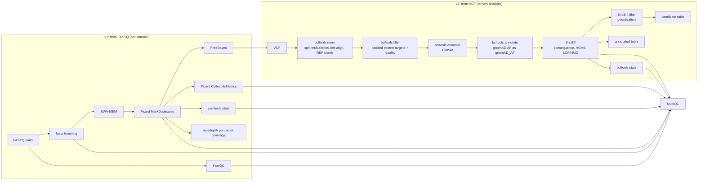

# Whole exome sequencing (WES): tertiary analysis workflows for Galaxy

Two Galaxy workflows for germline whole exome sequencing. Import the `.ga` files.

| File | Version | Starts from | What it does |
|---|---|---|---|
| [`wes-tertiary-from-fastq.ga`](wes-tertiary-from-fastq.ga) | **v1** | paired-end FASTQ (`list:paired` collection, one element per sample) | Read QC and trimming, alignment, duplicate marking, capture/coverage QC, variant calling, then the full v2 tertiary analysis, plus one MultiQC report for all samples |
| [`wes-tertiary-from-vcf.ga`](wes-tertiary-from-vcf.ga) | **v2** | a germline VCF/BCF from any caller (FreeBayes, GATK, DeepVariant, DRAGEN, …) | Normalisation, restriction to the exome targets, quality filtering, ClinVar, gnomAD and SnpEff annotation, prioritisation, tables |

v1 embeds v2 as a subworkflow, so both workflows apply exactly the same tertiary logic.



## 1. Install the tools and import the workflows

1. **Tools**: as a Galaxy admin, install the repositories listed in [`tools.yml`](tools.yml). You can use
   *Admin → Install and Uninstall*, or [Ephemeris](https://ephemeris.readthedocs.io). Install Ephemeris into a
   virtual environment; Debian/Ubuntu refuse a system-wide `pip install` with "externally-managed-environment":
   ```bash
   python3 -m venv ~/ephemeris-venv && ~/ephemeris-venv/bin/pip install ephemeris
   ```
   ```bash
   ~/ephemeris-venv/bin/shed-tools install -g http://192.168.191.12 -a <ADMIN_API_KEY> -t tools.yml
   ```
   If `python3 -m venv` reports that `ensurepip` is not available, install `python3-venv` (or `python3-full`)
   with `apt` first. The API key belongs to a Galaxy admin user (*User → Preferences → Manage API Key*).
2. **Workflows**: *Workflows → Import*, then upload `wes-tertiary-from-vcf.ga` and `wes-tertiary-from-fastq.ga`
   (or paste the raw GitHub URL of each file).

**Galaxy version.** The workflows pin the current wrapper versions (bcftools 1.24, SnpEff 5.4, SnpSift 5.4.0c,
FreeBayes 1.3.10, BWA 0.7.19, MultiQC 1.35). The SnpSift and MultiQC wrappers declare Galaxy profile 25.0, so the
pinned versions need **Galaxy ≥ 25.0**. On older servers, install older revisions of those repositories. Galaxy
then uses the installed version when it opens the workflow and shows a "tool version changed" notice. The
parameters used here are present in older versions too, but check those steps in the editor.

The `.ga` files are prebuilt; nothing needs to be compiled to use them. The `.gxwf.yml` files in [`src/`](src)
are the human-readable sources (Galaxy Format 2). Rebuild only after editing them, which needs Python ≥ 3.10 and
`gxformat2` (a virtual environment avoids the "externally managed environment" error of system pip):
```bash
python3 -m venv .venv && .venv/bin/pip install "gxformat2>=0.29"
```
```bash
.venv/bin/python build.py
```
Import the `.ga` files, not the sources: the v1 source references v2 with `@import`, which only `build.py`
resolves.

**Complete tool states.** The sources set only the parameters that matter. Galaxy would fill every other
parameter with its default when loading a step, and then mark the workflow with "may contain tools which have
changed". To avoid that notice, `build.py` takes each tool step's complete state from
[`src/galaxy-tool-states.json`](src/galaxy-tool-states.json), which holds the states Galaxy computed for these
exact steps. A recorded state is used only if the tool version is the same and the state agrees with every value
the source sets. Otherwise `build.py` keeps the source state and prints a warning. After changing a source or a
tool version, refresh the file:
1. Run `build.py`.
2. Import both `.ga` files into a Galaxy that has the tools installed.
3. Run `python tests/refresh_tool_states.py --galaxy http://192.168.191.12`. It reads the API key from
   `$GALAXY_API_KEY` or `~/.galaxy_admin_key`.
4. Run `build.py` again.

## 2. Reference data (prepare once, keep in a shared history or data library)

Every reference must use **the same genome build and the same chromosome naming** (`chr1` vs `1`) as the reads
and VCFs. A naming mismatch does not raise an error. ClinVar/gnomAD annotations are simply missing.

| Workflow input | What to use | Notes |
|---|---|---|
| **Reference genome (FASTA)** | GRCh38 without ALT contigs, e.g. the *GRCh38 no-alt analysis set* (UCSC naming `chr1…`) | Upload as datatype `fasta` (uncompressed). For VCF input (v2) it must be the genome the variants were called on. |
| **Exome target regions (BED)** | The capture kit's target (or "covered") BED for the same build, from Twist, IDT, Agilent, etc. | No `track`/`browser` header lines. v1 uses it unpadded for coverage QC. The workflows pad it themselves for variant restriction. |
| **Target padding (bp)** | Default `50` | Keeps canonical and extended splice-site variants just outside the targets. |
| **SnpEff database** | Run the **SnpEff download** tool once, e.g. an Ensembl database such as `GRCh38.115` or a RefSeq/MANE one such as `GRCh38.mane.1.2.refseq` | The **SnpEff databases** tool lists the exact names available for SnpEff 5.4. MANE Select databases give clinically conventional NM_ HGVS. SnpEff itself tolerates `chr1` vs `1`. The default Java heap is 8 GB (`GALAXY_MEMORY_MB`). |
| **ClinVar (VCF)** | `clinvar.vcf.gz` from https://ftp.ncbi.nlm.nih.gov/pub/clinvar/vcf_GRCh38/ | ClinVar uses `1, 2, …, MT`. For a `chr`-named reference, run **bcftools annotate** on it once with *Rename chromosomes* = [`data/ncbi_to_ucsc_chromosomes.tsv`](data/ncbi_to_ucsc_chromosomes.tsv) and output type *compressed BCF*. |
| **Population allele frequencies (VCF)** | gnomAD exomes (v4.1 recommended) reduced to `INFO/AF` and to the padded targets, as an indexed **BCF** (recipe below) | The full gnomAD VCFs are hundreds of GB. Plain VCF inputs are re-compressed and indexed in every job, while BCF is used directly. Only `INFO/AF` is read; it is stored as `INFO/gnomAD_AF`. |

Recipe for the gnomAD file, run once on any machine with `bcftools` and `bedtools`. Take the per-chromosome
exome sites VCF URLs from the gnomAD downloads page. The pattern below is for v4.1; `targets.bed` is the kit BED.
```bash
bedtools slop -b 100 -i targets.bed -g GRCh38.fa.fai > targets.padded100.bed
```
```bash
for c in $(seq 1 22) X Y; do
  bcftools view -R targets.padded100.bed -Ou \
    "https://storage.googleapis.com/gcp-public-data--gnomad/release/4.1/vcf/exomes/gnomad.exomes.v4.1.sites.chr${c}.vcf.bgz" |
  bcftools annotate -x '^INFO/AF' -Ob -o "gnomad_af.chr${c}.bcf"
done
```
```bash
bcftools concat -Ou gnomad_af.chr*.bcf | bcftools norm -m -any -f GRCh38.fa -Ob -o gnomad.exomes.v4.1.AF.targets.bcf && bcftools index gnomad.exomes.v4.1.AF.targets.bcf
```
Upload the resulting `.bcf` with datatype `bcf`.

The `bcftools norm -m -any -f` step is required for any population or ClinVar file: split multiallelic records and
left-align/trim indels against the same reference the reads are aligned to. The workflow normalises the calls, and
annotations are transferred only on an exact `CHROM/POS/REF/ALT` match. If a source keeps multiallelic or padded
records, common indels look absent and pass the rarity filter. In the HG001 test run, before normalising the
population file, homozygous deletions with gnomAD AF 0.94 were reported as rare loss-of-function variants.
Expect the v4.1 extraction to download most of the exome VCFs, because each record carries several KB of INFO.

## 3. Running

**v1 (FASTQ).** Upload the FASTQ files (`fastqsanger.gz`) and build a *List of Dataset Pairs*. Name each pair
with the sample ID: the element identifier becomes the read-group sample (`SM`) and the VCF sample name. Use
identifiers that end in a letter or digit other than `a f g q s t z` (e.g. `S01`, `NA12878`). The BWA wrapper
strips trailing characters from that set while removing `.gz`/`.fastq` suffixes, so `Patient_tag` would become
`Patient_`. One sample is simply a list with one pair. Samples are processed independently, and the result
collections are keyed by sample.

**v2 (VCF).** Select a VCF/BCF, or select a list collection of VCFs to process a batch. Multi-sample VCFs work.
The tables show the genotype columns of the first sample (`GEN[0]`); change them to `GEN[*]` for all samples.

**Compute notes for v1.**
- BWA-MEM builds the GRCh38 index inside each mapping job: about 1 h and 5–6 GB RAM per sample. If your server
  has a BWA index installed through a data manager, open the *mapping* step and switch *Reference genome* to
  the built-in index to skip this.
- FreeBayes runs in parallel per chromosome using the job's `GALAXY_SLOTS`.

## 4. Outputs

| Output | v1 | v2 | Content |
|---|:-:|:-:|---|
| `candidate_table` | ✔ | ✔ | **Prioritised candidates**, one row per variant: genotype, depth, allelic depths, gene, transcript, consequence, impact, HGVS c./p., LOF/NMD, gnomAD AF, ClinVar significance, review status and disease |
| `candidate_vcf` | ✔ | ✔ | The same candidates as a fully annotated VCF |
| `annotated_table` / `annotated_vcf` | ✔ | ✔ | All on-target, QC-passed variants with the same annotation, for browsing or for custom filters |
| `snpeff_summary`, `variant_stats` | ✔ | ✔ | SnpEff HTML summary and `bcftools stats` |
| `multiqc_report`, `multiqc_stats` | ✔ | | One report covering FastQC, fastp, Picard duplicates and HsMetrics, samtools, bcftools and SnpEff |
| `hs_metrics` | ✔ | | Capture QC: on-target rate, fold-80, `PCT_TARGET_BASES_20X` and others |
| `target_coverage_summary`, `target_coverage_thresholds` | ✔ | | mosdepth summary, and bases covered at 1/10/20/30/50× **per target**, for finding poorly covered exons |
| `deduplicated_bam`, `raw_vcf` | ✔ | | Alignments (duplicates marked) and unfiltered FreeBayes calls |

Intermediate datasets are hidden in the history. Use *show hidden* to inspect them.

## 5. Filters and how to change them

Both filters are workflow parameters, so you can change them on the run form without editing the workflow.

**Quality filter** (bcftools `--include`, applied to calls inside the padded targets):
```
(FILTER="PASS" || FILTER=".") && QUAL>=20 && FMT/DP>=10
```

**Prioritisation filter** (SnpSift):
```
(CLNSIG =~ 'athogenic') | (((ANN[*].IMPACT = 'HIGH') | (ANN[*].IMPACT = 'MODERATE')) & ((! exists gnomAD_AF) | (gnomAD_AF < 0.01)))
```
This keeps:
- ClinVar *Pathogenic*, *Likely pathogenic* or *Conflicting classifications of pathogenicity*, at any frequency;
- rare (gnomAD AF < 1 % or absent) variants with HIGH (stop-gain, frameshift, canonical splice, start-loss, …) or
  MODERATE (missense, in-frame indel) impact in any transcript.

Variations:
- Stricter frequency for dominant disorders: replace `0.01` with `0.001`.
- Only homozygous / hemizygous candidates (recessive model): wrap the expression in parentheses and append the
  genotype test: `(<default expression>) & (GEN[0].GT = '1/1')`.
- Also report LOW-impact splice-region variants: add `| (ANN[*].EFFECT has 'splice_region_variant')` inside the
  impact group.
- **Virtual gene panel**: run **SnpSift Filter** on `candidate_vcf` with *Filter type* = complex,
  expression `ANN[*].GENE in SET[0]`, and a text file of gene symbols (one per line) as the set. Then run
  **SnpSift Extract Fields** with the same field list as the `candidate_table` step.

To add columns, edit the *Fields to extract* of the `candidate_table` / `annotated_table` steps. For example, add
`CLNSIGCONF` and `ALLELEID` (already in the VCF), or `ANN[*].GENE` with one-effect-per-line.

## 6. Design notes

- **Normalise before annotating.** Multiallelic records are split and indels left-aligned against the reference,
  so ClinVar and gnomAD are matched on exact `CHROM/POS/REF/ALT`. Records whose REF does not match the reference
  (a wrong build) are dropped.
- **`gnomAD_AF:=AF`.** The population AF is stored under its own name so that the caller's `INFO/AF` (genotype
  allele frequency) is not overwritten.
- **Target restriction after calling.** The FreeBayes wrapper starts one FreeBayes process per BED line, which is
  impractical for ~200 000 exome targets. The workflow calls per chromosome and then keeps calls inside the
  padded targets (`bcftools filter -R`, overlapping records included).
- **BWA-MEM instead of BWA-MEM2.** Indexing GRCh38 with BWA-MEM2 needs ~85 GB RAM, so the classic aligner is used
  because it runs on modest servers. Swap in BWA-MEM2 (same read-group options) if you have a prebuilt index.
- **Duplicates are marked, not removed.** FreeBayes ignores reads flagged as duplicates.

## 7. Validation

The workflows were first checked offline:

- **Structure and tool parameters**: [`tests/validate_workflows.py`](tests/validate_workflows.py) checks every
  step of both `.ga` files, including the embedded subworkflow, against the actual wrapper XML from
  [galaxyproject/tools-iuc](https://github.com/galaxyproject/tools-iuc). It uses Galaxy's own parameter models
  (`galaxy-tool-util`) and datatype registry (`galaxy-data`): tool ids and versions, every parameter value and
  conditional case, every connection target and source output, and datatype compatibility (including implicit
  conversions). Result: 0 errors. `--self-test` injects 6 kinds of faults and confirms each is reported.
- **Annotation and filter logic**: [`tests/test_annotation_logic.py`](tests/test_annotation_logic.py) rebuilds the
  bcftools and SnpSift command lines from the parameters stored in `wes-tertiary-from-vcf.ga`. It runs them on
  synthetic data covering:
  - the quality, depth, FILTER, on/off-target, padding and REF-mismatch rules;
  - multiallelic splitting;
  - allele-specific ClinVar/gnomAD matching;
  - 12 prioritisation cases, including the exact 1 % boundary.

  All pass.

```bash
pip install -r tests/requirements.txt
```
```bash
git clone --depth 1 https://github.com/galaxyproject/tools-iuc.git /tmp/tools-iuc
```
```bash
python tests/validate_workflows.py --tools-iuc /tmp/tools-iuc --self-test
```
```bash
python tests/test_annotation_logic.py --snpsift-jar /path/to/SnpSift.jar
```

### End-to-end run in Galaxy (HG001)

v1 was run once in Galaxy 26.2 (aarch64 server) on a GIAB HG001/NA12878 exome. All 23 jobs finished. Inputs:
- **Reads:** GIAB Garvan HiSeq 2500 exome, library NIST7035, lane 1 only (38.2 M reads). The full sample has two
  libraries × two lanes; one lane is a deliberately thin, quick test.
- **Targets:** Illumina Nextera Rapid Capture Expanded Exome BED, lifted from hg19 to GRCh38 with CrossMap
  (201,442 targets, 62.1 Mb).
- **Reference and annotation:** Ensembl GRCh38 primary assembly (`1, 2, …` naming), SnpEff `GRCh38.115`, ClinVar
  (NCBI), and population AF from GATK's `af-only-gnomad.hg38` (gnomAD v2) reduced to the padded targets. A v4.1
  subset was impractical here: its records carry several KB of INFO each, so extracting the targets downloads most
  of the full exome VCFs.

Capture QC (Picard HsMetrics): mean target coverage 23×, median 20×, 77 % of target bases ≥ 10×, 50 % ≥ 20×,
fold-80 2.88, 6.1 % duplicates.

Accuracy against the GIAB v4.2.1 benchmark, inside targets ∩ benchmark regions (56.9 Mb). Calls and truth were
normalised with `bcftools norm` and matched on exact alleles (stricter than hap.py for complex indels):

| Call set | Type | Recall | Precision | F1 | Genotype match |
|---|---|--:|--:|--:|--:|
| `annotated_vcf`, all evaluated targets | SNV | 0.728 | 0.993 | 0.840 | 0.996 |
| `annotated_vcf`, all evaluated targets | indel | 0.504 | 0.828 | 0.627 | 0.925 |
| `annotated_vcf`, targets fully ≥ 10× (13.8 Mb) | SNV | 0.956 | 0.990 | 0.973 | 0.997 |
| `annotated_vcf`, targets fully ≥ 10× (13.8 Mb) | indel | 0.889 | 0.707 | 0.787 | 0.960 |

The low overall recall comes from coverage: with one lane, 23 % of the target bases stay below the `FMT/DP>=10`
quality filter. On well-covered targets SNV recall is 95.6 %. 85 % of the 55,655 reported variants received a
gnomAD AF and 21 % a ClinVar record. The candidate table had 1,357 variants, 104 of them ClinVar (likely)
pathogenic or with conflicting classifications.

Lessons from the run, reflected in section 2:
- Fetch inputs into Galaxy by `https://` URLs. The same NCBI files fetched by `ftp://` URL arrived corrupted.
- SnpEff 5.4 has no `GRCh38.105`; use a name that the **SnpEff databases** tool lists, such as `GRCh38.115`.

## 8. Scope and limitations

Germline SNVs and short indels in the exome targets only. Not covered: CNV/SV calling, mitochondrial variants,
inheritance/trio analysis, ACMG/AMP classification and phenotype (HPO) ranking. The candidate table supports
expert review; it is not a diagnosis. This is a research workflow, not a validated clinical pipeline.
