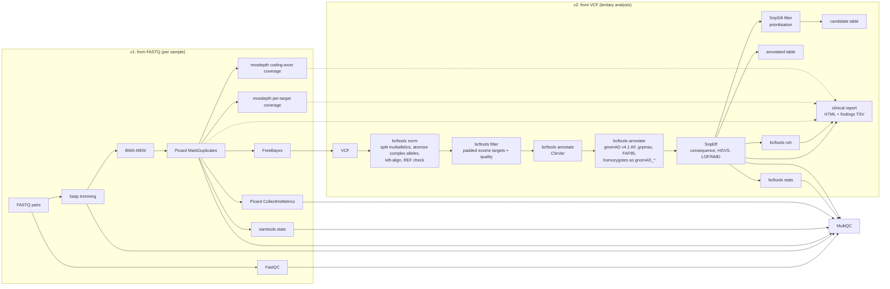

# Whole exome sequencing (WES): tertiary analysis workflows for Galaxy

Two Galaxy workflows for germline whole exome sequencing. Import the `.ga` files.

| File | Version | Starts from | What it does |
|---|---|---|---|
| [`wes-tertiary-from-fastq.ga`](wes-tertiary-from-fastq.ga) | **v1** | paired-end FASTQ (`list:paired` collection, one element per sample) | Read QC and trimming, alignment, duplicate marking, capture/coverage QC, variant calling, then the full v2 tertiary analysis, plus one MultiQC report for all samples |
| [`wes-tertiary-from-vcf.ga`](wes-tertiary-from-vcf.ga) | **v2** | a germline VCF/BCF from any caller (FreeBayes, GATK, DeepVariant, DRAGEN, …) | Normalisation, restriction to the exome targets, quality filtering, ClinVar, gnomAD and SnpEff annotation, prioritisation, tables, runs of homozygosity and a **clinical interpretation report** |

Both end in a human-readable HTML report of the medically significant findings (section 4a): diagnostic
findings, candidate variants, ACMG secondary findings, carrier status, pharmacogenomics, risk alleles,
runs of homozygosity, coverage of clinically relevant genes, and what the analysis cannot detect.

v1 embeds v2 as a subworkflow, so both workflows apply exactly the same tertiary logic.



## 1. Install the tools and import the workflows

1. **Tools**: as a Galaxy admin, install the repositories listed in [`tools.yml`](tools.yml). You can use
   *Admin → Install and Uninstall*, or [Ephemeris](https://ephemeris.readthedocs.io). Install Ephemeris into a
   virtual environment; Debian/Ubuntu refuse a system-wide `pip install` with "externally-managed-environment":
   ```bash
   python3 -m venv ~/ephemeris-venv && ~/ephemeris-venv/bin/pip install ephemeris
   ```
   ```bash
   ~/ephemeris-venv/bin/shed-tools install -g http://192.168.191.12 -a <ADMIN_API_KEY> -t tools.yml
   ```
   If `python3 -m venv` reports that `ensurepip` is not available, install `python3-venv` (or `python3-full`)
   with `apt` first. The API key belongs to a Galaxy admin user (*User → Preferences → Manage API Key*).
2. **Report tool** (not in the Tool Shed): copy [`tools/wes_clinical_report`](tools/wes_clinical_report) to the
   server, list it in a local tool config, and let Galaxy show its HTML unsanitised:
   ```xml
   <!-- /etc/galaxy/local_tool_conf.xml -->
   <toolbox tool_path="/srv/galaxy/local_tools">
       <section id="wes_analysis_local" name="WES analysis">
           <tool file="wes_clinical_report/wes_clinical_report.xml"/>
       </section>
   </toolbox>
   ```
   Add that file to `tool_config_file` in `galaxy.yml`, set `sanitize_allowlist_file` to a file containing the
   line `wes_clinical_report` (or use *Admin → Manage Allowlist*), restart Galaxy, and install the tool's
   dependencies (Python 3.12, samtools 1.22) from *Admin → Manage Dependencies*. Without the allowlist entry the
   report still opens, but without its styling.
3. **Workflows**: *Workflows → Import*, then upload `wes-tertiary-from-vcf.ga` and `wes-tertiary-from-fastq.ga`
   (or paste the raw GitHub URL of each file).

**Galaxy version.** The workflows pin the current wrapper versions (bcftools 1.24, SnpEff 5.4, SnpSift 5.4.0c,
FreeBayes 1.3.10, BWA 0.7.19, MultiQC 1.35). The SnpSift and MultiQC wrappers declare Galaxy profile 25.0, so the
pinned versions need **Galaxy ≥ 25.0**. On older servers, install older revisions of those repositories. Galaxy
then uses the installed version when it opens the workflow and shows a "tool version changed" notice. The
parameters used here are present in older versions too, but check those steps in the editor.

The `.ga` files are prebuilt; nothing needs to be compiled to use them. The `.gxwf.yml` files in [`src/`](src)
are the human-readable sources (Galaxy Format 2). Rebuild only after editing them, which needs Python ≥ 3.10 and
`gxformat2` (a virtual environment avoids the "externally managed environment" error of system pip):
```bash
python3 -m venv .venv && .venv/bin/pip install "gxformat2>=0.29"
```
```bash
.venv/bin/python build.py
```
Import the `.ga` files, not the sources: the v1 source references v2 with `@import`, which only `build.py`
resolves.

**Complete tool states.** The sources set only the parameters that matter. Galaxy would fill every other
parameter with its default when loading a step, and then mark the workflow with "may contain tools which have
changed". To avoid that notice, `build.py` takes each tool step's complete state from
[`src/galaxy-tool-states.json`](src/galaxy-tool-states.json), which holds the states Galaxy computed for these
exact steps. A recorded state is used only if the tool version is the same and the state agrees with every value
the source sets. Otherwise `build.py` keeps the source state and prints a warning. After changing a source or a
tool version, refresh the file:
1. Run `build.py`.
2. Import both `.ga` files into a Galaxy that has the tools installed.
3. Run `python tests/refresh_tool_states.py --galaxy http://192.168.191.12`. It reads the API key from
   `$GALAXY_API_KEY` or `~/.galaxy_admin_key`.
4. Run `build.py` again.

## 2. Reference data (prepare once, keep in a shared history or data library)

Every reference must use **the same genome build and the same chromosome naming** (`chr1` vs `1`) as the reads
and VCFs. A naming mismatch does not raise an error. ClinVar/gnomAD annotations are simply missing.

| Workflow input | What to use | Notes |
|---|---|---|
| **Reference genome (FASTA)** | GRCh38 without ALT contigs, e.g. the *GRCh38 no-alt analysis set* (UCSC naming `chr1…`) | Upload as datatype `fasta` (uncompressed). For VCF input (v2) it must be the genome the variants were called on. |
| **Exome target regions (BED)** | The capture kit's target (or "covered") BED for the same build, from Twist, IDT, Agilent, etc. | No `track`/`browser` header lines. v1 uses it unpadded for coverage QC. The workflows pad it themselves for variant restriction. |
| **Target padding (bp)** | Default `50` | Keeps canonical and extended splice-site variants just outside the targets. |
| **SnpEff database** | Run the **SnpEff download** tool once, e.g. an Ensembl database such as `GRCh38.115` or a RefSeq/MANE one such as `GRCh38.mane.1.2.refseq` | The **SnpEff databases** tool lists the exact names available for SnpEff 5.4. MANE Select databases give clinically conventional NM_ HGVS. SnpEff itself tolerates `chr1` vs `1`. The default Java heap is 8 GB (`GALAXY_MEMORY_MB`). |
| **ClinVar (VCF)** | `clinvar.vcf.gz` from https://ftp.ncbi.nlm.nih.gov/pub/clinvar/vcf_GRCh38/ | ClinVar uses `1, 2, …, MT`. For a `chr`-named reference, run **bcftools annotate** on it once with *Rename chromosomes* = [`data/ncbi_to_ucsc_chromosomes.tsv`](data/ncbi_to_ucsc_chromosomes.tsv) and output type *compressed BCF*. |
| **Coding regions (BED)** (v1) | Coding exons of one transcript per gene, gene symbol in column 4 (recipe below) | Per-gene coverage in the report: which clinically relevant genes have gaps. |
| **Gene-disease validity (GenCC TSV)** (optional) | [GenCC submissions export](https://search.thegencc.org/download) (TSV, CC0) | Diseases and mode of inheritance per gene; decides diagnostic vs carrier vs review. |
| **Gene constraint (gnomAD TSV)** (optional) | `gnomad.v4.1.constraint_metrics.tsv` from the gnomAD downloads page | LOEUF/pLI for loss-of-function intolerance (PVS1 applicability). |
| **HPO gene annotations** (optional) | `phenotype_to_genes.txt` from the latest [HPO release](https://github.com/obophenotype/human-phenotype-ontology/releases) | With *Patient phenotype (HPO terms)*, ranks candidates by phenotype match. |
| **Population allele frequencies (VCF)** | gnomAD v4.1 joint (exome + genome) frequencies reduced to the padded targets, as an indexed **BCF** built with [`data/build_gnomad_extract.sh`](data/build_gnomad_extract.sh) (below) | Transferred fields: `gnomAD_AF`, `_AN`, `_nhomalt` (homozygotes), `_grpmax` / `_grpmax_AF` / `_grpmax_AN` (genetic ancestry group with the highest AF), `_FAF95` / `_FAF95_grp` (highest filtering allele frequency, the statistic of the ACMG BA1/BS1 rules), `_filter` (gnomAD PASS / EXOMES_FILTERED / GENOMES_FILTERED / BOTH_FILTERED) and `_discordance_p` (exome vs genome frequency test). The caller's own `INFO/AF` is untouched. A file without these fields (e.g. an AF-only one) stops the annotation step with "tag not defined". |

The gnomAD file is built once with [`data/build_gnomad_extract.sh`](data/build_gnomad_extract.sh) on any Linux
machine with `bcftools` (≥ 1.17) and `bedtools`. It reads only the indexed blocks of the public gnomAD v4.1 joint
VCFs (877 GB in all) that overlap the regions, over plain HTTP from Google Cloud Storage. `regions.bed` uses Ensembl
names and should cover every capture kit you use plus the coding exons (the coding-region BED below), and the
reference is the workflow's FASTA with its `.fai`:
```bash
cat kit1.bed kit2.bed canonical_cds.GRCh38.115.bed | cut -f1-3 > regions.bed
```
```bash
build_gnomad_extract.sh regions.bed GRCh38.fa gnomad.v4.1.joint.targets.GRCh38.bcf 64
```
For two exome kits plus all coding exons (110 Mb with 100 bp padding) this took 1 h 51 min with 64
parallel readers (about 116 MB/s from the bucket) and produced a BCF of 1.6 GB with 65.0 M allele records (the
padding and the gnomAD genomes add many intronic and rare alleles). gnomAD data are CC0. The joint VCF carries no CADD or
SpliceAI scores, so the extract has no non-commercial terms.
Upload the resulting `.bcf` with datatype `bcf`.

Recipe for the coding-region BED (Ensembl canonical transcripts; use the Ensembl release of the SnpEff database).
For a `chr`-named reference, prefix column 1 with `chr`:
```bash
curl -sL https://ftp.ensembl.org/pub/release-115/gtf/homo_sapiens/Homo_sapiens.GRCh38.115.gtf.gz | zcat |
  awk -F'\t' '$3=="CDS" && $9 ~ /tag "Ensembl_canonical"/ && $9 ~ /gene_biotype "protein_coding"/ {
    match($9, /gene_name "[^"]+"/); g = substr($9, RSTART+11, RLENGTH-12); print $1"\t"$4-1"\t"$5"\t"g }' |
  sort -k1,1 -k2,2n -u > canonical_cds.GRCh38.115.bed
```

The `bcftools norm -m -any -f` step is required for any population or ClinVar file: split multiallelic records and
left-align/trim indels against the same reference the reads are aligned to. The workflow normalises the calls, and
annotations are transferred only on an exact `CHROM/POS/REF/ALT` match. If a source keeps multiallelic or padded
records, common indels look absent and pass the rarity filter. In the HG001 test run, before normalising the
population file, homozygous deletions with gnomAD AF 0.94 were reported as rare loss-of-function variants.
Expect the v4.1 extraction to download most of the exome VCFs, because each record carries several KB of INFO.

## 3. Running

**v1 (FASTQ).** Upload the FASTQ files (`fastqsanger.gz`) and build a *List of Dataset Pairs*. Name each pair
with the sample ID: the element identifier becomes the read-group sample (`SM`) and the VCF sample name. Use
identifiers that end in a letter or digit other than `a f g q s t z` (e.g. `S01`, `NA12878`). The BWA wrapper
strips trailing characters from that set while removing `.gz`/`.fastq` suffixes, so `Patient_tag` would become
`Patient_`. One sample is simply a list with one pair. Samples are processed independently, and the result
collections are keyed by sample.

**v2 (VCF).** Select a VCF/BCF, or select a list collection of VCFs to process a batch. Multi-sample VCFs work.
The tables show the genotype columns of the first sample (`GEN[0]`); change them to `GEN[*]` for all samples.

**Compute notes for v1.**
- BWA-MEM builds the GRCh38 index inside each mapping job: about 1 h and 5–6 GB RAM per sample. If your server
  has a BWA index installed through a data manager, open the *mapping* step and switch *Reference genome* to
  the built-in index to skip this.
- FreeBayes runs in parallel per chromosome using the job's `GALAXY_SLOTS`.

## 4. Outputs

| Output | v1 | v2 | Content |
|---|:-:|:-:|---|
| `candidate_table` | ✔ | ✔ | **Prioritised candidates**, one row per variant: genotype, depth, allelic depths, gene, transcript, consequence, impact, HGVS c./p., LOF/NMD, gnomAD AF, ClinVar significance, review status and disease |
| `candidate_vcf` | ✔ | ✔ | The same candidates as a fully annotated VCF |
| `annotated_table` / `annotated_vcf` | ✔ | ✔ | All on-target, QC-passed variants with the same annotation, for browsing or for custom filters |
| `snpeff_summary`, `variant_stats` | ✔ | ✔ | SnpEff HTML summary and `bcftools stats` |
| `multiqc_report`, `multiqc_stats` | ✔ | | One report covering FastQC, fastp, Picard duplicates and HsMetrics, samtools, bcftools and SnpEff |
| `hs_metrics` | ✔ | | Capture QC: on-target rate, fold-80, `PCT_TARGET_BASES_20X` and others |
| `target_coverage_summary`, `target_coverage_thresholds` | ✔ | | mosdepth summary, and bases covered at 1/10/20/30/50× **per target**, for finding poorly covered exons |
| `deduplicated_bam`, `raw_vcf` | ✔ | | Alignments (duplicates marked) and unfiltered FreeBayes calls |
| `clinical_report` | ✔ | ✔ | **Human-readable HTML report** of the medically significant findings (section 4a) |
| `clinical_findings` | ✔ | ✔ | Every finding of the report as a table: category, gene, variant, genotype, depth, allele fraction, HGVS, gnomAD AF, ClinVar, QC flags, evidence |
| `runs_of_homozygosity` | ✔ | ✔ | bcftools roh regions |
| `coding_coverage_thresholds` | ✔ | | Bases covered at 1/10/20/30/50× per coding exon |

## 4a. The clinical report

The report is produced by explicit, versioned rules from public knowledge bases; there is no statistical or
language model in it, so every statement can be traced to its source (ClinVar record and review status,
GenCC classification, gnomAD frequency, CPIC allele function). It is **decision support for a qualified
reviewer**: every finding that may be acted on must be confirmed by an orthogonal method in an accredited
laboratory.

| Section | Rule |
|---|---|
| Sample and data quality | Ts/Tv, het/hom, het allele-fraction distribution (contamination hint), genetic sex from chrX heterozygosity and chrY coverage, target coverage at 10/20/30× |
| Diagnostic findings | ClinVar pathogenic/likely pathogenic (not conflicting) **and** a genotype that fits the gene's mode of inheritance in GenCC: one allele for dominant genes, hemizygous for X-linked genes in males, two alleles for recessive genes. Genes with both dominant and recessive disorders, X-linked heterozygous females and genes without a GenCC entry go to a *review* table |
| Candidate variants | Not classified in ClinVar (or VUS/conflicting), gnomAD frequency below the cut-off (default 1 %), predicted loss-of-function in a GenCC gene, plus missense/in-frame variants in genes matching the HPO terms. Automated ACMG/AMP evidence codes (PVS1, PM2_supporting, BA1, BS1, PP2, PP4) for triage, inheritance fit (incl. possible compound heterozygotes) and ranking by phenotype match |
| ACMG SF v3.3 | 84 genes (v3.2 plus ABCD1, CYP27A1, PLN; Genet Med 2025;27:101454); biallelic only for MUTYH, ATP7B, BTD, GAA, RPE65, CYP27A1; ABCD1 hemizygous, homozygous or two heterozygous variants (not a single heterozygous variant in a female); HFE p.Cys282Tyr homozygotes only; TTN truncating only. Rare loss-of-function variants not in ClinVar are listed as *review* |
| Carrier status | One P/LP allele in a recessive gene |
| Pharmacogenomics | CYP2C19, CYP2C9, VKORC1, CYP4F2, SLCO1B1, DPYD, TPMT, NUDT15, CYP3A5, CYP2B6, UGT1A1 at fixed GRCh38 positions (checked against ClinVar and the reference). A missing variant counts as the reference allele only with ≥ 15 reads at the position (BAM in v1); otherwise the gene is *indeterminate*. CPIC phenotypes, ClinVar drug-response variants (≥ 1 star) |
| Risk alleles | Factor V Leiden, prothrombin G20210A, HFE p.Cys282Tyr/p.His63Asp, APOE (flagged: disclose only with counselling and consent), ClinVar risk/association variants (≥ 1 star) |
| Runs of homozygosity | Total length of runs ≥ 1 Mb (consanguinity), runs concentrated on one chromosome (uniparental disomy), homozygous findings inside runs |
| Coverage | Per-gene coding coverage at 10/20×; clinically relevant genes below 95 % at 20× are listed, because a negative result there is not reliable |
| Limits | Lists what an exome pipeline cannot detect (CNVs, SVs, repeat expansions, mtDNA, CYP2D6, HLA, pseudogene regions, mosaicism…) |

**Population frequency.** Every frequency rule (BA1 > 5 %, BS1 above the cut-off, PM2_supporting below 0.01 %
for dominant and 0.1 % for recessive genes, "too common for a penetrant disorder", the candidate cut-off) uses the
higher of the overall gnomAD AF and the highest group filtering AF (FAF95: the lower 95 % confidence bound of the AF
in the most frequent non-bottlenecked group; Whiffin et al. 2017). The FAF stops a variant that is rare overall but
common in one ancestry group from passing as rare, and the overall AF still catches founder variants of the
Ashkenazi or Finnish groups, which FAF excludes. A homozygous candidate in a recessive gene seen homozygous in two or
more gnomAD individuals does not count as fitting the inheritance. Frequencies from sites that failed gnomAD's own
filters, or whose exome and genome frequencies disagree (p < 10⁻⁴), are flagged.

Each reported variant carries QC flags: low depth, allele imbalance, low QUAL, indel, homopolymer or tandem
repeat context (from the reference), difficult/polymorphic region (HLA, KIR, mucins), segmental duplication / pseudogene genes. A call is marked **low confidence** when it has a het alt fraction < 0.25, QUAL < 30, an indel in a homopolymer or tandem repeat of ≥ 8, or lies in a paralogous/hypervariable gene; low-confidence findings stay listed, after the confident ones. In the GIAB validation below every false-positive finding was low confidence and no confirmed finding was.

Intermediate datasets are hidden in the history. Use *show hidden* to inspect them.

## 5. Filters and how to change them

Both filters are workflow parameters, so you can change them on the run form without editing the workflow.

**Quality filter** (bcftools `--include`, applied to calls inside the padded targets):
```
(FILTER="PASS" || FILTER=".") && QUAL>=20 && FMT/DP>=10
```

**Prioritisation filter** (SnpSift):
```
(CLNSIG =~ 'athogenic') | (((ANN[*].IMPACT = 'HIGH') | (ANN[*].IMPACT = 'MODERATE')) & ((! exists gnomAD_AF) | (gnomAD_AF < 0.01)) & ((! exists gnomAD_FAF95) | (gnomAD_FAF95 < 0.01)))
```
This keeps:
- ClinVar *Pathogenic*, *Likely pathogenic* or *Conflicting classifications of pathogenicity*, at any frequency;
- rare (gnomAD AF and highest group FAF95 < 1 %, or absent) variants with HIGH (stop-gain, frameshift, canonical splice, start-loss, …) or
  MODERATE (missense, in-frame indel) impact in any transcript.

Variations:
- Stricter frequency for dominant disorders: replace both `0.01` with `0.001`.
- Only homozygous / hemizygous candidates (recessive model): wrap the expression in parentheses and append the
  genotype test: `(<default expression>) & (GEN[0].GT = '1/1')`.
- Also report LOW-impact splice-region variants: add `| (ANN[*].EFFECT has 'splice_region_variant')` inside the
  impact group.
- **Virtual gene panel**: run **SnpSift Filter** on `candidate_vcf` with *Filter type* = complex,
  expression `ANN[*].GENE in SET[0]`, and a text file of gene symbols (one per line) as the set. Then run
  **SnpSift Extract Fields** with the same field list as the `candidate_table` step.

To add columns, edit the *Fields to extract* of the `candidate_table` / `annotated_table` steps. For example, add
`CLNSIGCONF` and `ALLELEID` (already in the VCF), or `ANN[*].GENE` with one-effect-per-line.

## 6. Design notes

- **Normalise before annotating.** Multiallelic records are split and indels left-aligned against the reference,
  so ClinVar and gnomAD are matched on exact `CHROM/POS/REF/ALT`. Records whose REF does not match the reference
  (a wrong build) are dropped.
- **`gnomAD_*` names.** The population frequencies carry their own prefix, so the caller's `INFO/AF` (genotype
  allele frequency) is not overwritten.
- **Target restriction after calling.** The FreeBayes wrapper starts one FreeBayes process per BED line, which is
  impractical for ~200 000 exome targets. The workflow calls per chromosome and then keeps calls inside the
  padded targets (`bcftools filter -R`, overlapping records included).
- **BWA-MEM instead of BWA-MEM2.** Indexing GRCh38 with BWA-MEM2 needs ~85 GB RAM, so the classic aligner is used
  because it runs on modest servers. Swap in BWA-MEM2 (same read-group options) if you have a prebuilt index.
- **Duplicates are marked, not removed.** FreeBayes ignores reads flagged as duplicates.

## 7. Validation

The workflows were first checked offline:

- **Structure and tool parameters**: [`tests/validate_workflows.py`](tests/validate_workflows.py) checks every
  step of both `.ga` files, including the embedded subworkflow, against the actual wrapper XML from
  [galaxyproject/tools-iuc](https://github.com/galaxyproject/tools-iuc). It uses Galaxy's own parameter models
  (`galaxy-tool-util`) and datatype registry (`galaxy-data`): tool ids and versions, every parameter value and
  conditional case, every connection target and source output, and datatype compatibility (including implicit
  conversions). Result: 0 errors. `--self-test` injects 6 kinds of faults and confirms each is reported.
- **Annotation and filter logic**: [`tests/test_annotation_logic.py`](tests/test_annotation_logic.py) rebuilds the
  bcftools and SnpSift command lines from the parameters stored in `wes-tertiary-from-vcf.ga`. It runs them on
  synthetic data covering:
  - the quality, depth, FILTER, on/off-target, padding and REF-mismatch rules;
  - multiallelic splitting;
  - allele-specific ClinVar/gnomAD matching;
  - 12 prioritisation cases, including the exact 1 % boundary.

  All pass.

```bash
pip install -r tests/requirements.txt
```
```bash
git clone --depth 1 https://github.com/galaxyproject/tools-iuc.git /tmp/tools-iuc
```
```bash
python tests/validate_workflows.py --tools-iuc /tmp/tools-iuc --self-test
```
```bash
python tests/test_annotation_logic.py --snpsift-jar /path/to/SnpSift.jar
```

### End-to-end run in Galaxy (HG001)

v1 was run once in Galaxy 26.2 (aarch64 server) on a GIAB HG001/NA12878 exome. All 23 jobs finished. Inputs:
- **Reads:** GIAB Garvan HiSeq 2500 exome, library NIST7035, lane 1 only (38.2 M reads). The full sample has two
  libraries × two lanes; one lane is a deliberately thin, quick test.
- **Targets:** Illumina Nextera Rapid Capture Expanded Exome BED, lifted from hg19 to GRCh38 with CrossMap
  (201,442 targets, 62.1 Mb).
- **Reference and annotation:** Ensembl GRCh38 primary assembly (`1, 2, …` naming), SnpEff `GRCh38.115`, ClinVar
  (NCBI), and population AF from GATK's `af-only-gnomad.hg38` (gnomAD v2) reduced to the padded targets (since
  replaced by the gnomAD v4.1 extract; the GIAB validation below was rerun with it).

Capture QC (Picard HsMetrics): mean target coverage 23×, median 20×, 77 % of target bases ≥ 10×, 50 % ≥ 20×,
fold-80 2.88, 6.1 % duplicates.

Accuracy against the GIAB v4.2.1 benchmark, inside targets ∩ benchmark regions (56.9 Mb). Calls and truth were
normalised with `bcftools norm` and matched on exact alleles (stricter than hap.py for complex indels):

| Call set | Type | Recall | Precision | F1 | Genotype match |
|---|---|--:|--:|--:|--:|
| `annotated_vcf`, all evaluated targets | SNV | 0.728 | 0.993 | 0.840 | 0.996 |
| `annotated_vcf`, all evaluated targets | indel | 0.504 | 0.828 | 0.627 | 0.925 |
| `annotated_vcf`, targets fully ≥ 10× (13.8 Mb) | SNV | 0.956 | 0.990 | 0.973 | 0.997 |
| `annotated_vcf`, targets fully ≥ 10× (13.8 Mb) | indel | 0.889 | 0.707 | 0.787 | 0.960 |

The low overall recall comes from coverage: with one lane, 23 % of the target bases stay below the `FMT/DP>=10`
quality filter. On well-covered targets SNV recall is 95.6 %. 85 % of the 55,655 reported variants received a
gnomAD AF and 21 % a ClinVar record. The candidate table had 1,357 variants, 104 of them ClinVar (likely)
pathogenic or with conflicting classifications.

Lessons from the run, reflected in section 2:
- Fetch inputs into Galaxy by `https://` URLs. The same NCBI files fetched by `ftp://` URL arrived corrupted.
- SnpEff 5.4 has no `GRCh38.105`; use a name that the **SnpEff databases** tool lists, such as `GRCh38.115`.

### Clinical report on HG001

The same run with the clinical report (26 jobs, all finished). Every non-pharmacogenomic finding in the report
was checked against the GIAB v4.2.1 truth set for HG001:

| Report finding | Report section | QC flags in the report | GIAB v4.2.1 |
|---|---|---|---|
| *PAH* c.1241A>G p.Tyr414Cys het (ClinVar P, expert panel) | Carrier | none | confirmed (0/1) |
| *TPP1* c.509-1G>A het (ClinVar P) | Carrier | low depth (10×) | confirmed (0/1) |
| *PLG* c.112A>G p.Lys38Glu het (ClinVar P/LP) | Review: gene with dominant and recessive disorders | none | confirmed (0/1) |
| *MNS1* c.605delA het (ClinVar LP, 1 star) | Carrier | homopolymer (T×10) | **false positive** (inside benchmark, no variant) |
| *PRSS1* p.Ala16Val het (ClinVar P/LP, gnomAD AF 0.26) | Review: too common for a penetrant disorder | segmental duplication | outside benchmark |
| *PIGQ* c.1680delT hom (not in ClinVar) | Candidate (recessive model) | indel | outside benchmark; GIAB has a nearby SNV only |
| *PRPF3* c.-48-4_-48-3dupTT het | Candidate | low depth, allele balance, homopolymer (T×12) | wrong allele (truth: hom 4-bp insertion) |

All three findings inside the benchmark without a QC flag were confirmed; the false positive and the wrong
allele carry repeat flags. Pharmacogenomics (read depth from the BAM): CYP2C9 \*1/\*2 (intermediate
metabolizer), SLCO1B1 c.521TC (decreased function), CYP2C19 \*2 heterozygous (indeterminate: \*17 position not
covered), CYP4F2, NUDT15, CYP2B6 normal; DPYD, TPMT, VKORC1, CYP3A5 and UGT1A1 indeterminate (a defining position
below 15 reads or off-target). These agree with the CDC GeT-RM consensus for NA12878 (CYP2C9 \*1/\*2 or \*2/\*61,
CYP2C19 \*1/\*2, SLCO1B1 \*1/\*15, which carries c.521T>C). Genetic sex: female; runs of homozygosity 18 Mb.

| Step | Wall time | Peak memory |
|---|--:|--:|
| Clinical report (HG001, all inputs incl. BAM and reference) | 9 s | 1.3 GB |
| bcftools roh | 0.4 s | 14 MB |
| mosdepth over 193,535 coding exons | 41 s | not recorded |

The coverage of this one-lane test (59 % of target bases ≥ 20×) is far below a clinical exome; the report says
so and lists the 79 ACMG SF genes below 95 % at 20×.

### Validation on recent GIAB exomes (NovaSeq 6000, IDT capture)

Recently sequenced exomes of the GIAB reference samples from
[PRJNA734598](https://www.ebi.ac.uk/ena/browser/view/PRJNA734598) (Baid et al., 2021; NovaSeq 6000, IDT
capture, 2×151 bp, about 18.5 M read pairs each), each run through v1 in Galaxy with the IDT target BED of
[DeepVariant's exome case study](https://storage.googleapis.com/deepvariant/exome-case-study-testdata/idt_capture_novogene.grch38.bed).
Truth: NIST GIAB v4.2.1 benchmark (an independent, multi-technology consensus) and, for HG001/NA12878, the CDC
GeT-RM consensus pharmacogenetic genotypes (inter-laboratory testing of Coriell reference DNA).

**Clinical concordance.** The same v2 workflow was also run on each sample's GIAB truth VCF (restricted to the
IDT targets × benchmark regions, quality filter disabled). The findings of the two reports were then matched
variant by variant inside those regions with [`tests/compare_findings.py`](tests/compare_findings.py) (CHROM/POS/REF/ALT). A finding "missed"
is one the truth genotypes support but the sequenced sample's report lacks; an "extra" one is reported from the
sequenced sample but absent from the truth.

**Coverage, accuracy and cost.** Accuracy is allele-exact after normalisation (`bcftools isec`; rtg/hap.py do
not run on this aarch64 server, so complex indels are judged more strictly than with haplotype matching).
Runtime is the sum of the 26 job runtimes; BWA-MEM takes about 61 min per sample, of which roughly 50 min are
spent building the GRCh38 index inside the job (a cached index removes that). Peak memory per job was not
recorded by this Galaxy's job metrics.

| Sample (run) | Mean target cov. / ≥20× | Region | SNV recall / precision | Indel recall / precision | Job runtime | Peak memory |
|---|---|---|--:|--:|--:|--:|
| HG001 (SRR14724473) | 54.6× / 93.0 % | IDT ∩ benchmark, 35.5 Mb | 0.981 / 0.988 | 0.900 / 0.885 | 1.5 h | not recorded |
| | | targets fully ≥ 20×, 32.0 Mb | 0.995 / 0.988 | 0.948 / 0.886 | | |
| HG002 (SRR14724472) | 54.2× / 92.1 % | IDT ∩ benchmark, 36.1 Mb | 0.979 / 0.984 | 0.900 / 0.878 | 1.5 h | not recorded |
| | | targets fully ≥ 20×, 32.5 Mb | 0.994 / 0.984 | 0.946 / 0.880 | | |
| HG005 (SRR14724469) | 53.4× / 91.9 % | IDT ∩ benchmark, 35.6 Mb | 0.979 / 0.989 | 0.918 / 0.916 | 1.5 h | not recorded |
| | | targets fully ≥ 20×, 32.1 Mb | 0.995 / 0.989 | 0.945 / 0.913 | | |

Genotype agreement among matched variants: 99.6–99.7 % for SNVs, 92–94 % for indels. Missed SNVs are mostly
in targets with stretches below 20×.

**Clinical concordance** with report 0.2.0 (ACMG SF v3.3, gnomAD v4.1 joint extract), matched / in truth report;
extra findings in brackets:

| Finding group | HG001 | HG002 | HG005 |
|---|---|---|---|
| ClinVar pathogenic / likely pathogenic | 2/2 (0) | 1/1 (+2) | 4/4 (0) |
| ACMG SF v3.3 (reportable or review) | 0/0 (0) | 0/0 (0) | 1/1 (0) |
| Candidate rare loss-of-function | 1/1 (0) | 1/1 (0) | 3/3 (0) |
| ClinVar drug response | 26/26 (0) | 24/24 (+1) | 20/20 (0) |
| ClinVar risk factor / association | 27/27 (0) | 30/30 (0) | 28/28 (0) |
| Pharmacogenomic genotypes (8 assessable genes + APOE; first run, with the BAM) | all equal | all equal | all equal |

No finding supported by the truth genotypes was missed. All three extra findings, all in HG002 (*MNS1*
c.605delA, alt fraction 0.17 in a T×10 homopolymer; *CNGA1* p.Glu117\*, alt fraction 0.24, QUAL 20; *CYP2D6*
c.941G>A drug-response variant, alt fraction 0.16 in the CYP2D6/CYP2D7 paralog region), are marked **low
confidence** by the report (section 4a), so precision of the high-confidence findings was 100 % in all three
samples. *MNS1* and *CNGA1* now also carry gnomAD's own warnings (site filtered, exome/genome frequencies
discordant). The fourth extra finding of the gnomAD v2 run, *PRSS1* p.Gly177\* in the PRSS1/PRSS2 segmental
duplication, is gone: gnomAD v4.1 has it at AF 0.24 (FAF95 0.39 in African-ancestry samples, filtered in both
exomes and genomes). Findings in the samples' reports that the truth
confirms include *PAH* p.Tyr414Cys and *TPP1* c.509-1G>A (HG001 carrier), *F11* p.Glu135\* (HG002, the
Ashkenazi factor XI deficiency allele), *BBS5* p.Arg89\* (HG005 carrier) and a rare *RYR2* frameshift (HG005,
ACMG SF review), and NUDT15 \*1/\*3 (HG005, intermediate metabolizer for thiopurines).

**gnomAD v2 → v4.1.** The VCF workflow was rerun on each sample's called VCF and truth VCF with the v4.1 extract
and report 0.2.0 (same calls, so the accuracy above is unchanged). The candidate table lost 36–48 % of its rows,
nearly all of them alleles the gnomAD v2 AF-only file had as rare or absent but that are ≥ 1 % overall or in one
genetic ancestry group in v4.1. The only report findings that changed were in the "inheritance not met" group:
*MYO5A*, *IFIH1*, *VPS13B*, *PITRM1*, *HOXD12*, *IFNAR2* and *PRSS1* alleles left (v4.1 AF or FAF95 1.1–24 %),
and an *HLA-DRB1* allele (v4.1 AF 0.14 %, flagged discordant and difficult region) entered.

| Sample | Candidate table rows, called VCF (v2 → v4.1) | Report findings, called VCF (v2 → v4.1) | Clinical concordance (above) | VCF workflow, 13 jobs (called VCF) | gnomAD annotation step | Peak memory, gnomAD annotation |
|---|--:|--:|---|--:|--:|--:|
| HG001 | 1,151 → 722 | 88 → 84 | no finding missed | 5.6 min | 22 s (v2: 8 s) | 18 MB |
| HG002 | 1,298 → 797 | 83 → 81 | no finding missed | 5.5 min | 22 s (v2: 7 s) | not measured |
| HG005 | 1,542 → 797 | 79 → 78 | no finding missed | 5.5 min | 22 s (v2: 8 s) | not measured |

98.9 % of HG001's 54,975 reported variants received a gnomAD v4.1 record. Peak memory was measured outside Galaxy
(`/usr/bin/time`, same input), as this Galaxy does not record job memory.

**Pharmacogenomics against the CDC GeT-RM consensus (HG001 = NA12878).** HG002 and HG005 are not GeT-RM samples.

| Gene | GeT-RM consensus | Report (HG001, SRR14724473) | |
|---|---|---|---|
| CYP2C9 | \*1/\*2 | \*1/\*2, intermediate metabolizer | agrees |
| SLCO1B1 | \*1/\*15 (\*15 carries c.521T>C) | c.521TC, decreased function | agrees |
| CYP3A5 | \*3/\*3 | \*3/\*3, poor metabolizer | agrees |
| CYP4F2 | \*1/\*1 | \*1/\*1 | agrees |
| TPMT | \*1/\*1 | \*1/\*1 | agrees |
| CYP2B6 | \*1/\*1 | c.516GG | agrees |
| DPYD | \*1/(\*4) (\*4 = normal function) | activity score 2, normal | agrees |
| CYP2C19 | \*1/\*2 | \*2 heterozygous; indeterminate (\*17 position off-target) | not assessable |
| VKORC1 | −1639 GA | indeterminate (promoter, off-target) | not assessable |
| UGT1A1 | \*60/\*28 | indeterminate (\*80 promoter proxy off-target) | not assessable |

Seven genes agree, none disagree, three are reported as not assessable rather than guessed.

**Known systematic artefact.** *PIGQ* c.1680delT is called homozygous in HG001 (both data sets) and HG005. It is
in neither GIAB truth set nor gnomAD v4, and lies outside the GIAB benchmark next to a common homozygous SNV
(16:582225 T>C). It is reported as a candidate with high confidence; a laboratory artefact list or the GIAB
"difficult regions" stratification would remove it (not yet implemented).

## 8. Scope and limitations

Germline SNVs and short indels in the exome targets only. Not covered: CNV/SV calling, mitochondrial variants,
inheritance/trio analysis, ACMG/AMP classification and phenotype (HPO) ranking. The candidate table supports
expert review; it is not a diagnosis. This is a research workflow, not a validated clinical pipeline.
